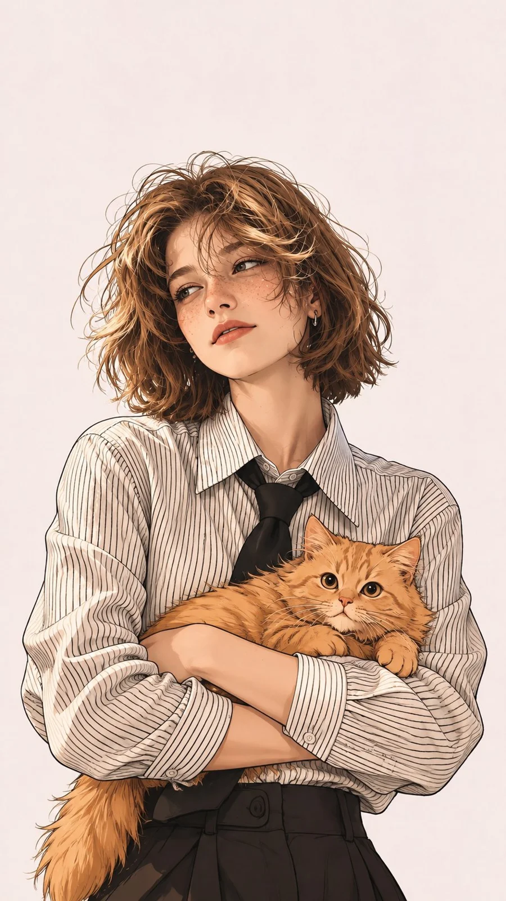

# Hand-Drawn Anime Girl With Vintage Telephone

**中文标题：** 手绘动漫少女·复古座机  
**ID:** `gi25-x-1284` · **Mode:** `generate`  
**Categories:** `general`  
**Tags:** `x-twitter`, `community`, `gpt-image-2.5`, `x-direct`, `en`



### Hand-Drawn Anime Girl With Vintage Telephone

```text
Create a highly detailed, hand-drawn 2D anime-style illustration of a beautiful young woman sitting on the floor while talking on a vintage yellow landline telephone.

Character: A young woman with long, glossy black hair, straight bangs, large expressive dark eyes, rosy cheeks, delicate facial features, and a playful, slightly surprised expression. Her hair is styled with a bright orange hair clip on one side and small silver hoop earrings.

Pose: Sitting casually on the floor with her body slightly leaning forward. She holds the yellow telephone receiver against her ear with one hand, looking sideways with a curious expression. Her other arm rests naturally on her bent knee. The red coiled telephone cord extends across the floor and around her body.

Outfit: An oversized cream-colored long-sleeve shirt layered over a teal blue top, with natural fabric folds and loose sleeves for a cozy, casual aesthetic.

Telephone: A classic vintage mustard-yellow telephone receiver with a matching red coiled cord, rendered with detailed highlights and smooth glossy surfaces.

Background: A simple, warm off-white textured background with subtle paper grain and minimal environmental details, keeping the focus entirely on the character.

Art style: High-quality Japanese anime illustration, modern manga aesthetic, clean expressive linework, soft cel shading, warm pastel colors, subtle highlights in the hair, detailed facial expressions, natural anatomy, delicate blush, and a polished editorial illustration finish.

Composition: Vertical 9:16 portrait, medium close-up to three-quarter view, character positioned slightly off-center, with the telephone cord creating a natural visual flow through the composition.

No text, no watermark, no additional characters. Ultra-detailed, high-resolution illustration.
```

- **Recommended model:** `gpt-image-2.5-sunburst`
- **Settings:** _(defaults)_
- **Source:** [community](https://x.com/Ziha_ai/status/2116744227036270895) — @Ziha_ai
- **License note:** Original public X post; quoted with attribution — remix with attribution
- **Notes:** Collected directly from X; original post https://x.com/Ziha_ai/status/2116744227036270895; post text names GPT Image 2.5; discovered via X search, prompt re-verified against the original X post via api.fxtwitter.com; verified=True
- **Preview:** `previews/gi25-x-1284.webp`
