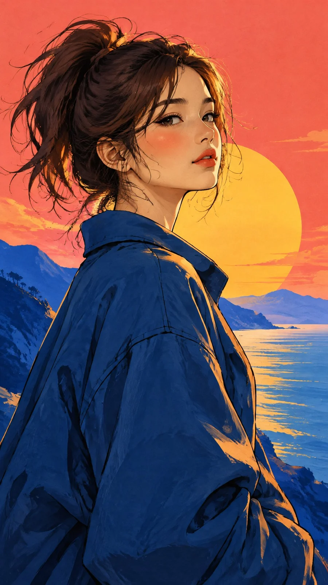

# Illustrated Sapphire-Jacket Girl Portrait (JSON Prompt)

**中文标题：** 宝蓝外套少女插画人像（JSON）  
**ID:** `gi25-x-1287` · **Mode:** `generate`  
**Categories:** `general`  
**Tags:** `x-twitter`, `community`, `gpt-image-2.5`, `x-direct`, `en`



### Illustrated Sapphire-Jacket Girl Portrait (JSON Prompt)

```text
{
  "prompt": {
    "subject": {
      "type": "beautiful young woman portrait",
      "face": "delicate elegant facial features, expressive almond-shaped eyes, long eyelashes, soft blush, naturally defined nose and beautiful coral-red lips",
      "hair": "dark espresso brown hair in a loose messy high ponytail, soft windswept strands framing her face",
      "expression": "peaceful, thoughtful and slightly dreamy",
      "pose": "three-quarter side profile, body turned away from the viewer, head gently turned toward the horizon, chin slightly raised, looking into the distance",
      "outfit": "oversized deep sapphire-blue casual jacket with a relaxed silhouette and beautifully illustrated fabric folds"
    },
    "composition": {
      "framing": "vertical upper-body portrait",
      "camera_angle": "slightly low angle",
      "character_position": "large central foreground subject",
      "silhouette": "elegant neck, defined shoulders and flowing hair",
      "visual_balance": "large geometric sunset circle positioned behind the character"
    },
    "background": {
      "environment": "minimalist stylized coastal mountain landscape",
      "sky": "rich vibrant coral-pink sky",
      "sun": "large golden-yellow setting sun",
      "mountains": "simple overlapping cobalt-blue and turquoise mountain silhouettes",
      "water": "small visible section of calm blue ocean near the horizon",
      "details": "minimal flat cloud shapes and a few clean landscape silhouettes",
      "style": "simple graphic background with large bold color shapes, no clutter"
    },
    "art_style": {
      "medium": "digital painting with hand-drawn ink outlines",
      "aesthetic": "Japanese-inspired modern fashion illustration mixed with graphic novel artwork",
      "linework": "expressive clean outlines",
      "texture": "visible subtle brush strokes and delicate paper grain",
      "shading": "smooth painterly cel shading with bold shadow shapes",
      "finish": "beautiful handmade editorial illustration"
    },
    "color_palette": {
      "primary": [
        "sapphire blue",
        "coral pink",
        "golden yellow"
      ],
      "secondary": [
        "deep navy",
        "turquoise",
        "warm peach",
        "dark brown"
      ],
      "treatment": "rich vibrant colors with strong warm and cool contrast"
    },
    "lighting": {
      "type": "warm golden-hour backlighting",
      "highlights": "soft golden highlights on cheeks, nose, hair and shoulders",
      "shadows": "deep reddish-brown and navy painterly shadows"
    },
    "quality": {
      "resolution": "ultra high resolution",
      "details": "beautiful facial details, natural anatomy, carefully illustrated hair and clothing",
      "aspect_ratio": "9:16"
    },
    "negative_prompt": [
      "photorealism",
      "3D rendering",
      "generic anime appearance",
      "overly complicated background",
      "flowers",
      "excessive plants",
      "extra characters",
      "distorted face",
      "bad anatomy",
      "text",
      "watermark",
      "logo"
    ]
  }
}
```

- **Recommended model:** `gpt-image-2.5-sunburst`
- **Settings:** _(defaults)_
- **Source:** [community](https://x.com/Just_Anika_Here/status/2116748665461129343) — @Just_Anika_Here
- **License note:** Original public X post; quoted with attribution — remix with attribution
- **Notes:** Collected directly from X; original post https://x.com/Just_Anika_Here/status/2116748665461129343; post text names GPT Image 2.5; discovered via X search, prompt re-verified against the original X post via api.fxtwitter.com; verified=True
- **Preview:** `previews/gi25-x-1287.webp`
