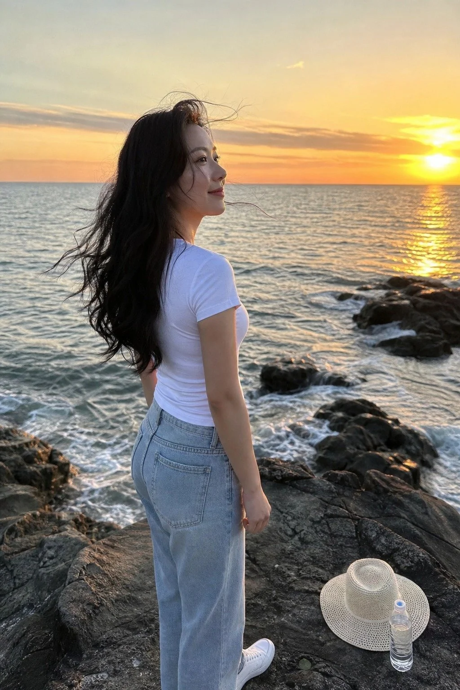

# iPhone Candid Seaside Rock Sunset Portrait

**中文标题：** iPhone 实拍海边礁石落日人像  
**ID:** `gi25-x-1292` · **Mode:** `generate`  
**Categories:** `general`  
**Tags:** `x-twitter`, `community`, `gpt-image-2.5`, `x-direct`, `zh`



### iPhone Candid Seaside Rock Sunset Portrait

```text
iPhone手机实拍感的海边礁石落日人像摄影，黄昏海边的日常瞬间。人物：一位28岁左右的东方女性，身材匀称自然，面容清秀柔和，皮肤保留真实毛孔与自然纹理，拒绝塑料感磨皮，淡妆，唇色自然。面部头发细节：黑色大波浪长发，发丝被海风轻轻吹动，几缕碎发拂过脸颊，眉眼舒展，脸颊带一点落日暖光的自然红晕。表情眼神：望向远处海平面上的落日，嘴角带一丝放松的浅笑，眼神平静而专注。服装：白色修身短袖T恤，面料柔软有真实褶皱，下身是浅蓝色高腰直筒牛仔裤和白色休闲鞋，穿搭简洁日常。姿态动作：站立在礁石上，身体微微侧向镜头，双手自然垂放，海风吹动衣角与发丝，姿态松弛不摆拍。道具：脚边礁石上放着一顶浅色遮阳帽和一瓶矿泉水。环境：前景是深灰色礁石与拍打礁石的细碎浪花，中景是人物与潮湿的礁石地面，远景是落日下的开阔海面、金色海天交界线与渐暗的天空。光线：落日柔和的自然光斜射，色温约3500K，暖金色阳光洒在人物侧脸与发丝上，海面泛着金色反光，阴影柔和，天空暖橙与淡蓝对撞。相机：iPhone手持抓拍感，35mm等效焦段，f/2.8光圈，平视机位，竖构图9:16，浅景深，背景海面轻微bokeh虚化，带轻微噪点与真实手机直出质感。调色：自然偏暖的落日色调，色彩饱和度适中，带轻微film grain颗粒感。情绪氛围：傍晚海边看落日的松弛与治愈，生活气息浓厚。画风：真实生活摄影，不摆拍。质量标签：ultra detailed, photorealistic, natural skin texture, candid photo。负面约束：No oil painting, No anime, No 3D render, No deformed hands, No plastic skin, No over-smoothing, No text, No watermark.
```

- **Recommended model:** `gpt-image-2.5-sunburst`
- **Settings:** _(defaults)_
- **Source:** [community](https://x.com/CandyTravelight/status/2116787945474769354) — @CandyTravelight
- **License note:** Original public X post; quoted with attribution — remix with attribution
- **Notes:** Collected directly from X; prompt posted as the author's own reply https://x.com/CandyTravelight/status/2116787945474769354 to https://x.com/CandyTravelight/status/2116787325279908093, which carries the images; GPT Image 2.5 is named in the parent post; discovered via X search, prompt re-verified against the original X post via api.fxtwitter.com; verified=True; the same prompt is also run on two other models in the post; preview is image 1, the GPT Image 2.5 result
- **Preview:** `previews/gi25-x-1292.webp`
