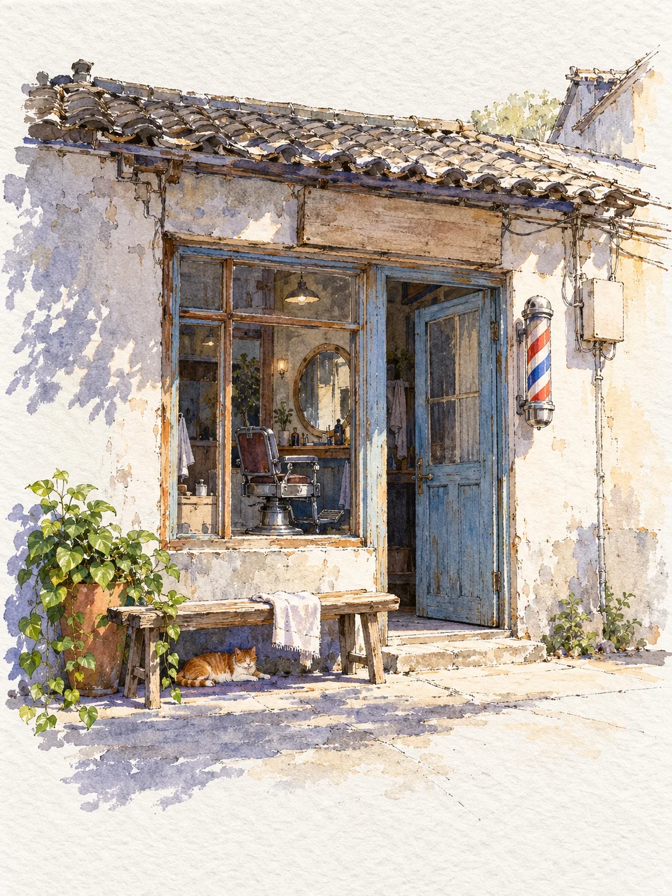

# Pen-and-Wash Old Street Barber Shop

**中文标题：** 钢笔淡彩老街理发店  
**ID:** `gi25-x-1294` · **Mode:** `generate`  
**Categories:** `general`  
**Tags:** `x-twitter`, `community`, `gpt-image-2.5`, `x-direct`, `zh`



### Pen-and-Wash Old Street Barber Shop

```text
Create an image with the following visual system. Replace the subject as specified.

Visual system (light, color, composition, medium, mood):
一张竖幅 3:4 的钢笔淡彩速写，画在带明显纹理的冷压水彩纸上，像速写本里的一页，而不是精细写实的水彩画。画面中部偏上是一间中国南方老街上的小店门面：灰白色抹灰墙有点斑驳，一段青灰色小瓦坡屋檐，木门板或旧木框玻璃门，墙上随手钉着一两个空白的电表箱、一截电线或一台旧空调外机。正面平视的中景，门窗正对着看，墙面基本是平的，只带一点自然透视，不画纵深街道；门前一小片水泥地，摆着这家店自己的东西和一两盆植物，背景只露出一点相邻的屋顶。整张画的骨架是清楚可见的细深棕色针管笔线：门框、瓦片、凳腿、物件都先用笔线勾出来，线条轻松、略带抖动和断续，不把轮廓全部闭合；水彩只是在线上薄薄铺一层，颜色不完全贴着线走，看得见纸纹颗粒、水痕回流和干笔飞白。细节适量，大块墙面留白纸，不要每个角落都画满小物件。门面四周的笔触越往外越松，最后淡入大片白纸，上下各留出一截空白纸面。强烈的暖阳从右上方斜照，受光的墙面和地面直接留出纸白，投影统一朝左下方延伸，是一大块清楚的、透明的蓝紫和靛蓝色，屋檐下和门洞里也是蓝紫色暗部。色彩：暖纸白和浅灰白约五成，黄绿到橄榄绿的植物约两成，蓝紫、靛蓝的阴影约两成，低饱和赭黄和陶土棕的木头、陶盆约百分之八，零星一点灰粉或砖红。不要欧式乡村小屋、石头墙和满墙花藤，不要黑色粗轮廓和填色插画感，阴影不要用中性灰黑，材质不要画得过度写实。招牌、灯箱、门牌、电表箱都只画成空白的木板或色块，画面里不要任何可读的文字、字母、数字、签名或水印，这家店是做什么的全靠门口的东西看出来。整体安静、温暖，像晴天午后在老街上随手画下的一张。

New subject:
一家老理发店：一扇刷成浅蓝色的旧木门半开着，门边墙上装着一根红白蓝条纹的理发店转灯，窗户里能看见一把老式铁皮理发椅和一面圆镜子，门口一张木长凳上搭着一条白毛巾，一只橘猫趴在长凳底下，墙角一盆绿萝。
```

- **Recommended model:** `gpt-image-2.5-sunburst`
- **Settings:** _(defaults)_
- **Source:** [community](https://x.com/static_stare/status/2116797900898308342) — @static_stare
- **License note:** Original public X post; quoted with attribution — remix with attribution
- **Notes:** Collected directly from X; original post https://x.com/static_stare/status/2116797900898308342; post text names GPT Image 2.5; discovered via X search, prompt re-verified against the original X post via api.fxtwitter.com; verified=True; prompt for image 1 of 4 (the author shares the other three on request); preview is image 1
- **Preview:** `previews/gi25-x-1294.webp`
