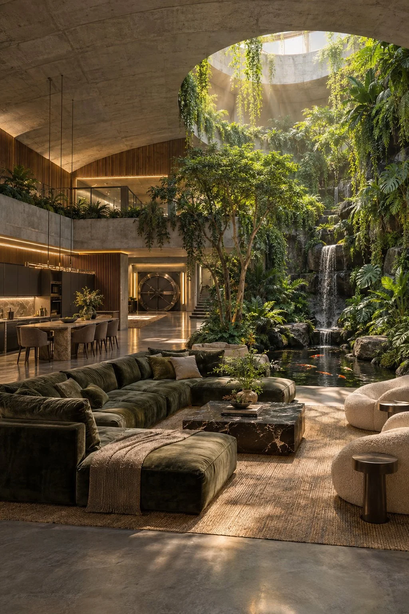

# Lush Underground Luxury Bunker Home Interior

**中文标题：** 地下奢华住宅绿植中庭  
**ID:** `gi25-x-1298` · **Mode:** `generate`  
**Categories:** `general`  
**Tags:** `x-twitter`, `community`, `gpt-image-2.5`, `x-direct`, `en`



### Lush Underground Luxury Bunker Home Interior

```text
8K ultra-detailed photorealistic editorial stock photograph, professional architectural photography of a lush underground luxury bunker home. Vast open-plan living area with soaring board-formed concrete vaulted ceilings, warm walnut wood slats and linen walls. Central indoor atrium bursting with lush tropical vegetation: floor-to-ceiling living walls of ferns, monstera and hanging vines, indoor trees, moss rocks and gentle waterfall into koi pond. Soft simulated golden-hour sunlight from engineered light wells and skylights creating volumetric rays and plant shadows. Luxury furnishings: oversized velvet sofas, marble dining table, gourmet kitchen. Polished concrete floors, elegant circular vault door in background. Warm cinematic lighting, no people, hyper-realistic textures, sharp focus, magazine quality.
```

- **Recommended model:** `gpt-image-2.5-sunburst`
- **Settings:** _(defaults)_
- **Source:** [community](https://x.com/MystiqueLicorne/status/2116853257070846239) — @MystiqueLicorne
- **License note:** Original public X post; quoted with attribution — remix with attribution
- **Notes:** Collected directly from X; original post https://x.com/MystiqueLicorne/status/2116853257070846239; post text names GPT Image 2.5; discovered via X search, prompt re-verified against the original X post via api.fxtwitter.com; verified=True
- **Preview:** `previews/gi25-x-1298.webp`
