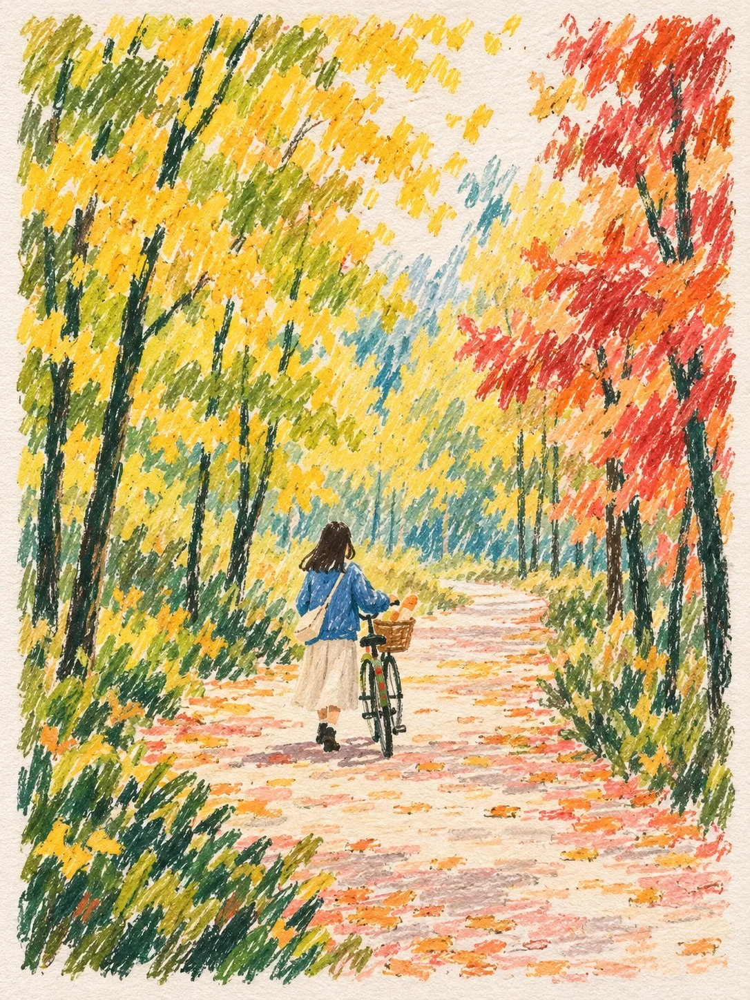

# Oil-Pastel Autumn Ginkgo Path

**中文标题：** 油画棒秋日银杏小路  
**ID:** `gi25-x-1300` · **Mode:** `generate`  
**Categories:** `general`  
**Tags:** `x-twitter`, `community`, `gpt-image-2.5`, `x-direct`, `zh`



### Oil-Pastel Autumn Ginkgo Path

```text
Create an image with the following visual system. Replace the subject as specified.

Visual system (light, color, composition, medium, mood):
一幅竖幅 3:4 的纸本油画棒秋日风景，画在有纹理的浅色画纸上，画面四周留一圈自然的纸白边，画区边缘略微参差。接近行人视线、略微俯视的中远景：一条浅色的路或通道从画面下缘中央宽宽地进来，向中央偏右收窄，再弯进景物深处；前景两角用厚实的低矮草丛压住，左右两侧的树干或景物和上方树冠构成不封闭的框景，中间和远处留出透气的纸白空隙。画里的人物都很小，只用衣服色块和松散轮廓交代，不画五官。柔和的暖白日光从前上方偏左漫进来，受光处主要靠露出纸白，阴影用冷青绿色的稀疏短线暗示，没有硬边投影。颜色秩序：黄绿和橄榄绿约三成五，占左侧和中部；朱红、橙红和少量杏橙约两成五，集中在右侧形成暖色重心；深青绿到近黑墨绿约一成，画细长树干、草叶和人物暗部；暖纸白约两成，是留边、空隙和路面的底；浅桃粉和淡赭约一成，铺在路面上。这是一张稚拙、松散的手工油画棒画，不是彩铅插画也不是精细风景画：笔触要粗、短、直，每一笔都清楚分开，像用粗蜡笔快速一排排划出来的短线，笔触之间露出大量纸白；树冠只是一团团短斜线堆出来的色块，看不到单片叶子的形状，不画叶片轮廓、落叶细节或枝条细节；树干只用一两道深墨绿竖线概括；人物、房子、动物都极度简化成几块颜色，没有细节、没有阴影塑形；远景和天空大量留纸白或只轻轻扫几笔，不画云朵细节和远山层次。全部用粗短、断续、方向明确的油画棒笔触造型：路面笔触随弯曲走向横着铺，树叶用竖斜短划聚成团，树干是细长的深色竖线，叠擦处略厚，轻擦处断线露底，看得到纸纹颗粒和蜡质的阻力。不要平滑过渡、透明晕染、写实光影或细腻的明暗渐变，不要连续勾线、细密叶片或写实人物，树冠不要铺满把中间的亮处堵死。完成态是保留手工痕迹的平面绘画，明亮、安静、亲近。画面里没有签名、文字、落款或水印。

尺度与密度（最重要）：每一道笔触都很大，长约画面宽度的二十分之一到十五分之一、宽度像粗蜡笔头，整张画大约只有几百笔，而不是几千根细线；颜色要饱和、浓，像用力压上去的油画棒。镜头更近，画面像一个小角落而不是开阔远景：没有地平线、远山、远处村庄的细节，远处的空间直接用一片蓝绿色、浅青色的斜向排线填满或留白。人物画大一些，约占画面高度的五分之一到四分之一，只用三四块纯色色块组成，脚下一小块深色投影。整体像一位插画师十分钟画完的速写，不精致、不工整。

New subject:
金黄的银杏林道：一条笔直后又微微弯进去的林荫道，两侧银杏树冠满是黄绿和金黄，右侧有几棵红枫，路面落满一层浅桃粉和淡赭色的落叶，一个穿蓝外套的女孩推着自行车往里走，车筐里放着一小袋面包。
```

- **Recommended model:** `gpt-image-2.5-sunburst`
- **Settings:** _(defaults)_
- **Source:** [community](https://x.com/static_stare/status/2116863336390230148) — @static_stare
- **License note:** Original public X post; quoted with attribution — remix with attribution
- **Notes:** Collected directly from X; original post https://x.com/static_stare/status/2116863336390230148; post text names GPT Image 2.5; discovered via X search, prompt re-verified against the original X post via api.fxtwitter.com; verified=True; prompt for image 1 of 4 (the author shares the other three on request); preview is image 1
- **Preview:** `previews/gi25-x-1300.webp`
