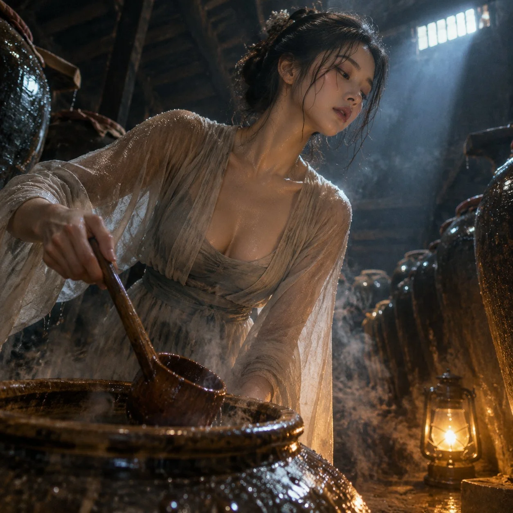

# Song-Dynasty Wine Cellar Low-Angle Still

**中文标题：** 宋代酒窖低角度静帧  
**ID:** `gi25-x-1302` · **Mode:** `generate`  
**Categories:** `general`  
**Tags:** `x-twitter`, `community`, `gpt-image-2.5`, `x-direct`, `en`



### Song-Dynasty Wine Cellar Low-Angle Still

```text
Vertical 3:4 low-angle shot in a Song wine cellar: rows of tall ceramic jars fade into damp dark, and a woman in translucent gauze bends to lift a wooden ladle from an open jar. Seen from waist up, tilted upward toward her face, the curve of her neck and the wet sheen of her collarbone catching the light. Fermenting rice steam curls upward; a small oil lantern at floor level warms the jar rims, while a shaft of cold daylight from a high vent grazes her shoulder. Droplets on glazed clay, condensation on her sleeve, gauze clinging where the vapour touches it. Muted amber and slate palette, deep shadow, tactile, film-like grain, shallow focus.
```

- **Recommended model:** `gpt-image-2.5-sunburst`
- **Settings:** _(defaults)_
- **Source:** [community](https://x.com/alanblogsooo/status/2116874994081038845) — @alanblogsooo
- **License note:** Original public X post; quoted with attribution — remix with attribution
- **Notes:** Collected directly from X; original post https://x.com/alanblogsooo/status/2116874994081038845; post text names GPT Image 2.5; discovered via X search, prompt re-verified against the original X post via api.fxtwitter.com; verified=True
- **Preview:** `previews/gi25-x-1302.webp`
