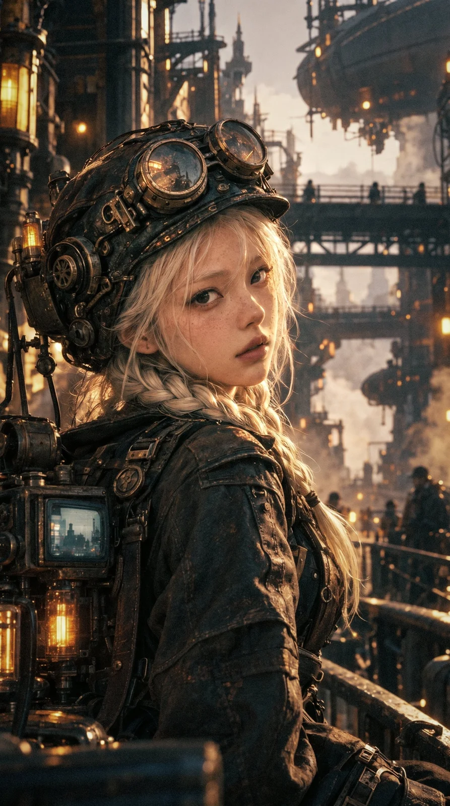

# 80s Film Still Steampunk Girl

**中文标题：** 80 年代胶片电影感蒸汽朋克少女  
**ID:** `gi25-x-1305` · **Mode:** `generate`  
**Categories:** `general`  
**Tags:** `x-twitter`, `community`, `gpt-image-2.5`, `x-direct`, `zh`



### 80s Film Still Steampunk Girl

```text
9：16 4k
胶片相机抓拍的瞬间，80 年代的胶片电影画面，Luc Besson and Steven Spielberg's cinematography styles，Black mist filter。成像质感参考图1，但是更搞会密度的中间偏暗调
蒸汽朋克,中性偏暗调摄影，正面主光
极度美丽的中国少女。圆短脸型小巧圆润的下巴，小翘皮鼻子,近乎白色的眉毛和白色渐变到浅灰色发梢的头发，清晰细腻的皮肤纹理和毛孔,厚而性感的嘴唇，大眼睛，有明显的卧蚕,肤色有自然的变化,。嘴唇丰满但不过分夸张，呈现柔和自然色泽。肤色呈明净的浅杏桃色，脸颊、鼻尖与嘴唇带柔淡的珊瑚粉。面部亮度均匀，额头、鼻梁和脸颊之间只有轻缓的明暗起伏，皮肤阴影保留自然冷色。肤色与环境色融合，同时保持清楚、自然的色彩区分。
繁复的蒸汽朋克款头盔。华卡在头盔上的护目镜，身上大量镶嵌有皮革和黑色、银色金属的机械部件，点缀着阴极管射线小屏幕和辉光电子管，复古旧化的纹理清晰有黄铜布满划痕、氧化痕迹和磨损低饱和度棕色皮革，黑色的金属和少量的白银.
光是柔和的杏色暖光。暗部是清冷色。整体中性灰平衡
电影感，真人电影剧照，IMAX ，Panavision，Cooke S4/i 50mm，T2.0，浅景深，柔和侧逆光，电影级明暗过渡，细腻胶片颗粒，Kodak Vision3 500T 胶片质感，真实肤色，轻微去饱和，暖橙与冷蓝对比，真实皮肤纹理，不要过度锐化，不要塑料感
眼睛和面部处于精确的合焦平面，雀斑、发丝、皮肤纹理与织物纤维通过细微的色调变化显现，边缘自然圆润。肖像镜头的大光圈浅景深，清晰区域向焦外连续过渡，背景构件融化成宽大的柔润色块。极细、低存在感的胶片颗粒，轻微的光学柔化，细腻、浓郁而通透的色彩层次。
色彩鲜活、饱满，具有通透而浓郁的胶片色彩密度。
负面提示词：HDR 效果，3D CG，塑料皮肤，磨皮，蜡质面孔，游戏引擎渲染感，beauty retouch, perfect skin, studio portrait lighting, ultra sharp, HDR, clarity, dehaze, 8k, CGI look, glossy, clean digital
```

- **Recommended model:** `gpt-image-2.5-sunburst`
- **Settings:** _(defaults)_
- **Source:** [community](https://x.com/Sin_Yiyao/status/2116876236962095428) — @Sin_Yiyao
- **License note:** Original public X post; quoted with attribution — remix with attribution
- **Notes:** Collected directly from X; original post https://x.com/Sin_Yiyao/status/2116876236962095428; post text names GPT Image 2.5; discovered via X search, prompt re-verified against the original X post via api.fxtwitter.com; verified=True
- **Preview:** `previews/gi25-x-1305.webp`
