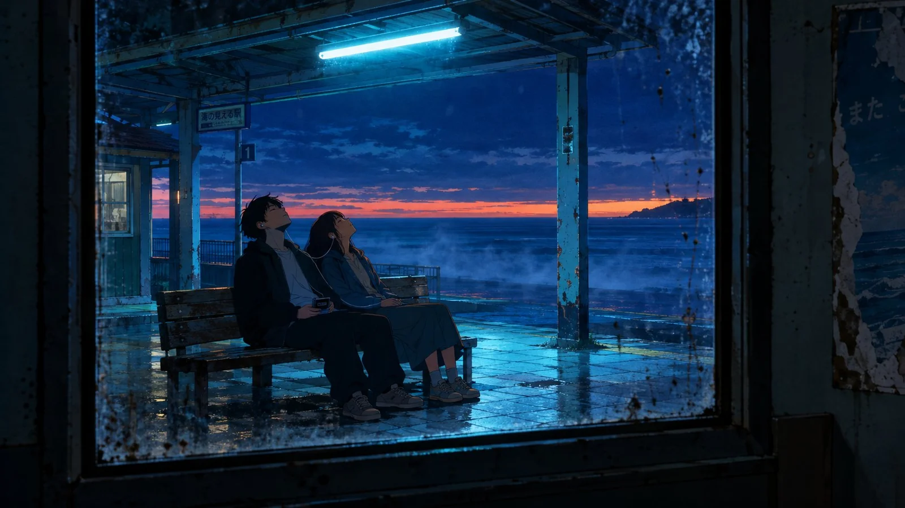

# Cel-Painted Blue-Hour Abandoned Seaside Station

**中文标题：** 赛璐璐蓝调废弃海边车站  
**ID:** `gi25-x-1306` · **Mode:** `generate`  
**Categories:** `general`  
**Tags:** `x-twitter`, `community`, `gpt-image-2.5`, `x-direct`, `en`



### Cel-Painted Blue-Hour Abandoned Seaside Station

```text
Cel-painted blue hour. The abandoned seaside station is lit by one surviving fluorescent tube under the roof, cyan light pooling on cracked tile while the sky above stays deep indigo with a thin orange scar along the water. Two people sit on the bench, one holding a cassette Walkman, a single earbud trailing between them, heads tipped back against the wood. Shot from inside the empty waiting room through a grimy window frame, so the glass edge, flyspeck dirt and a torn poster frame the couple — a frame inside a frame. Sea mist drifting across the platform. Cold cyan against warm skin, chemical colour, hard cel shadow shapes, 35mm grain, long-exposure stillness. Restraint held tight.
```

- **Recommended model:** `gpt-image-2.5-sunburst`
- **Settings:** _(defaults)_
- **Source:** [community](https://x.com/alanblogsooo/status/2116881532329808114) — @alanblogsooo
- **License note:** Original public X post; quoted with attribution — remix with attribution
- **Notes:** Collected directly from X; original post https://x.com/alanblogsooo/status/2116881532329808114; post text names GPT Image 2.5; discovered via X search, prompt re-verified against the original X post via api.fxtwitter.com; verified=True
- **Preview:** `previews/gi25-x-1306.webp`
