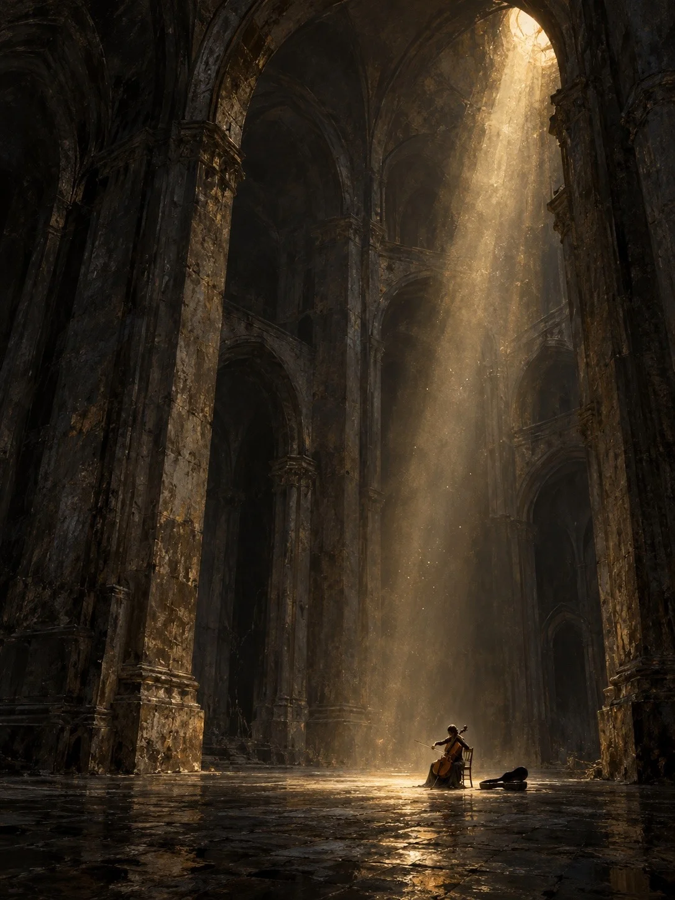

# Dark Oil Painting Stone Arch Hall With a Light Shaft

**中文标题：** 暗调油画石拱大厅光柱  
**ID:** `gi25-x-1309` · **Mode:** `generate`  
**Categories:** `general`  
**Tags:** `x-twitter`, `community`, `gpt-image-2.5`, `x-direct`, `zh`



### Dark Oil Painting Stone Arch Hall With a Light Shaft

```text
Create an image with the following visual system. Replace the subject as specified.

Visual system (light, color, composition, medium, mood):
一幅竖幅 3:4 的暗调数字油画，讲一个巨大空间和一个微小主体。略低的平视机位、远景，主体非常小，压在画面底部约六分之一的位置、略偏右，完整可见；前景是一片暗沉的地面，中景是主体，后景是厚重的立柱和一层层拱券，向上延伸出画框、逐渐融进黑暗，建筑占据画面绝大部分，强调垂直方向和悬殊的尺度。全画只有一道光：暖金色的天光从顶部偏右的一个高处开口落下，略向左倾斜，穿过空气里的灰尘形成一道边缘柔散、内部明暗不均的光柱，正好落在主体身上和周围地面，铺出一片不规则的亮斑；其余地方只有极弱的反射光，不要第二束光、亮窗、补光或舞台聚光灯那种硬边光柱。颜色秩序：深暖灰和炭黑约六成五，铺满拱顶、远墙和四周暗场；低饱和灰褐和烟灰约两成五，是被微光照到的石壁、地面和空气层次；旧金、淡赭黄和极少的奶油白约一成，只在光源开口、光柱核心和地面亮斑里。暗部是偏暖的炭灰和褐黑，局部带极轻的灰绿，保留细微层次，不要死黑。石壁有纵向擦痕、灰褐斑驳和模糊接缝，地面的反光破碎而断续，主体多是深色剪影，只有一圈克制的轮廓亮边。用松散叠擦、纵向拖痕和局部厚涂完成，形体概括，细节弱化，不要照片质感或全图锐利。寂静、庄严，略带孤独。画面里没有任何文字、签名或水印。

New subject:
一座高耸的石砌拱廊大厅，一位穿深色长裙的大提琴手独自坐在一把木椅上拉琴，琴弓扬起，身旁地上放着打开的琴盒。
```

- **Recommended model:** `gpt-image-2.5-sunburst`
- **Settings:** _(defaults)_
- **Source:** [community](https://x.com/static_stare/status/2116894594260459651) — @static_stare
- **License note:** Original public X post; quoted with attribution — remix with attribution
- **Notes:** Collected directly from X; original post https://x.com/static_stare/status/2116894594260459651; post text names GPT Image 2.5; discovered via X search, prompt re-verified against the original X post via api.fxtwitter.com; verified=True; prompt for image 1 of 4 (the author shares the other three on request); preview is image 1
- **Preview:** `previews/gi25-x-1309.webp`
