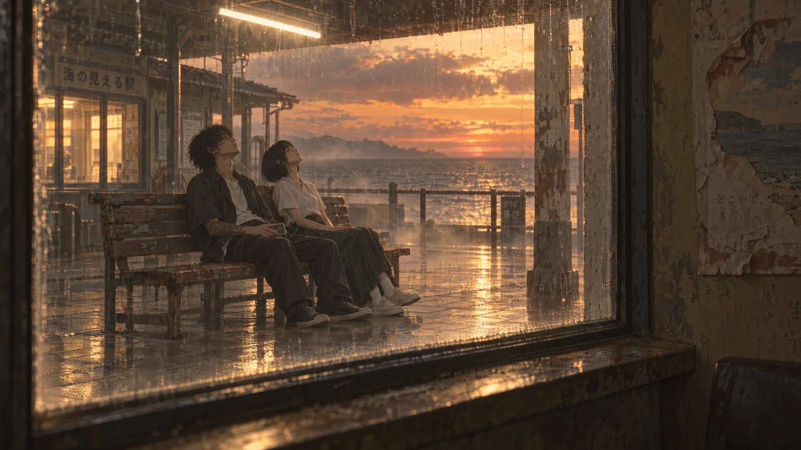

# Honey-Amber Seaside Waiting Room Window 3D CG Still

**中文标题：** 蜜糖琥珀海边候车室窗景 3D 静帧  
**ID:** `gi25-x-1313` · **Mode:** `generate`  
**Categories:** `general`  
**Tags:** `x-twitter`, `community`, `gpt-image-2.5`, `x-direct`, `zh`



### Honey-Amber Seaside Waiting Room Window 3D CG Still

```text
3D CG 电影感动画静帧，16:9 单帧，蜜糖琥珀暖调。镜头在候车室靠里的地方，朝右前方斜着一点看出去，能看到窗洞的墙厚和窗台的顶面。画面左边是一大扇窗，窗从画面顶边一直通到底、上沿被画面裁掉，横向占画面左边约七成宽；窗的下沿留出一条厚重的窗台，台面顺着透视从左下往右上斜；窗的右边是一整块室内的墙，墙皮掉漆、贴着一张干裂卷边的旧海报，纸面褪成灰白、只剩模糊的色块；窗的左边缘只留一条窄墙和深色的铁框。窗框是深色的细铁框，玻璃脏，一道道雨痕、角落干着水渍和污点。透过窗看到一座海边小站：顶棚压在上方，一根暖白的灯管横在顶棚下、画面偏上，灯光在潮湿的空气里散开一片暖雾；左边是一座小候车室，里面亮着一扇更暖的窗；中间偏左摆一张旧木长椅，男生坐在长椅左边、女生坐在他右边，两人并排、身体朝画面右侧的海，只能看到他们的侧面；两个人都把头向后仰着看天，后脑抵在椅背的木条上；他们共用一副有线耳机，线从他那台旧磁带随身听垂到她这一侧，他把随身听搁在腿上。整张长椅和两个人都完整地落在窗里，脚踩在湿砖地上。女生穿白衬衫、深墨绿马面裙，白袜和旧帆布鞋；男生深色外套敞着、里面白 T、深色长裤、帆布鞋，小臂上是旧文身。长椅后面是一道生锈的铁栏杆，窗的右侧立着一根方形的水泥柱，柱身斑驳，只有锈痕和剥落的漆。海在窗外中右侧铺开，海平线大约在画面中部偏上，远端有一小段山影；天是暖的黄昏，蜜糖金和桃色的云铺满整片天，太阳已经落到海平线以下，海平线上只压着最后一条橙红，冷蓝只剩最远的一线海面。站台地面是湿的方砖，把灯管的光和天光反上来一片橙金，海雾贴着站台缓缓飘。结构层是 PBR 的掉漆铁、旧木、湿瓷砖和斑驳的墙面，黑位压得住；光层是暖白灯管的泛光和光晕；空间层靠雾随距离变浓。窗里的人、窗框和墙都是锐利的，只有高光和远处的雾允许柔化。整张画面再压一层土黄冷的电影滤镜：整体低饱和的土黄和赭石，高光是奶油暖白，暗部偏青灰的冷调、不到纯黑，中间调发灰，对比柔和，像 Kodak Portra 400 的扫街片再叠一层薄琥珀滤镜，轻微泛光，细颗粒。
```

- **Recommended model:** `gpt-image-2.5-sunburst`
- **Settings:** _(defaults)_
- **Source:** [community](https://x.com/alanblogsooo/status/2116911610212270096) — @alanblogsooo
- **License note:** Original public X post; quoted with attribution — remix with attribution
- **Notes:** Collected directly from X; original post https://x.com/alanblogsooo/status/2116911610212270096; post text names GPT Image 2.5; discovered via X search, prompt re-verified against the original X post via api.fxtwitter.com; verified=True
- **Preview:** `previews/gi25-x-1313.webp`
