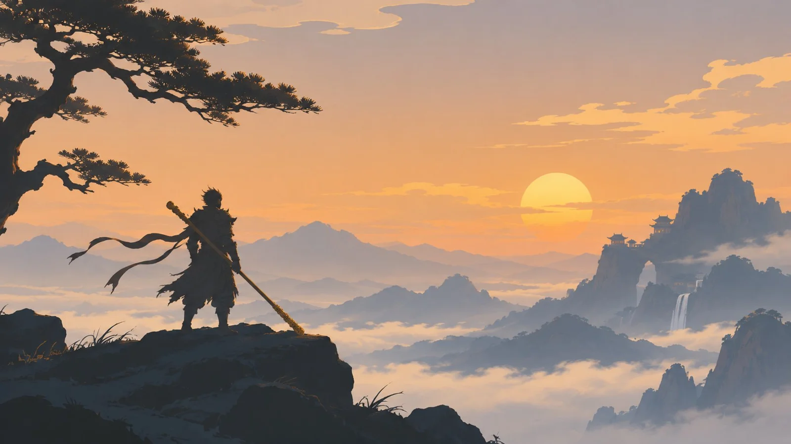

# Black Myth: Wukong Minimal Oriental Landscape Wallpaper

**中文标题：** 黑神话悟空东方极简山水壁纸  
**ID:** `gi25-x-1314` · **Mode:** `generate`  
**Categories:** `general`  
**Tags:** `x-twitter`, `community`, `gpt-image-2.5`, `x-direct`, `zh`



### Black Myth: Wukong Minimal Oriental Landscape Wallpaper

```text
生成一张融合东方美学与极简设计的 4K 电脑壁纸，主题为《黑神话：悟空》。天命人手持金箍棒，独自站在高耸的山峰边缘，远处是层层叠叠的中国山水，夕阳从云海之间缓缓落下。天空以大面积淡金色和灰蓝色表现，山峰使用简洁的深色轮廓，人物以清晰剪影呈现。
Style keywords: minimalist Chinese fantasy, oriental cinematic composition, large atmospheric color masses, restrained edge density, simplified mountain silhouettes, elegant negative space, broad shadow shapes, muted gold and ink-blue palette, low micro-contrast, no excessive details, 16:9, 4K wallpaper, no text.
```

- **Recommended model:** `gpt-image-2.5-sunburst`
- **Settings:** _(defaults)_
- **Source:** [community](https://x.com/Jennasif2d/status/2116918695167680551) — @Jennasif2d
- **License note:** Original public X post; quoted with attribution — remix with attribution
- **Notes:** Collected directly from X; original post https://x.com/Jennasif2d/status/2116918695167680551; post text names GPT Image 2.5; discovered via X search, prompt re-verified against the original X post via api.fxtwitter.com; verified=True
- **Preview:** `previews/gi25-x-1314.webp`
