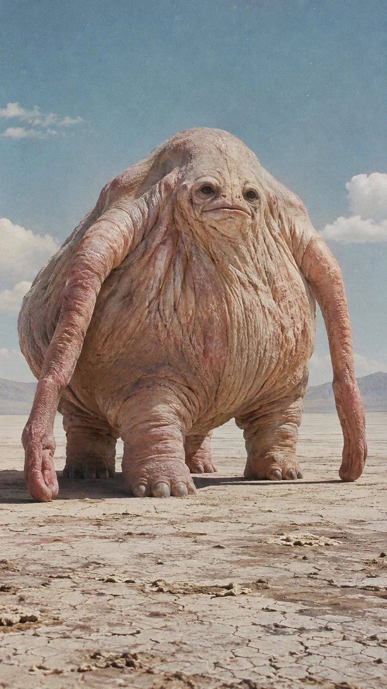

# Impossible Creature Documentary Photo Template

**中文标题：** 不可能生物纪实摄影模板  
**ID:** `gi25-x-1315` · **Mode:** `generate`  
**Categories:** `general`  
**Tags:** `x-twitter`, `community`, `gpt-image-2.5`, `x-direct`, `en`



### Impossible Creature Documentary Photo Template

```text
A mysterious and biologically impossible creature described as [INSERT YOUR STRANGE CREATURE CONCEPT], photographed in a believable real-world environment. The organism possesses an extraordinarily unusual but anatomically coherent body structure, with realistic organic proportions, unconventional evolutionary adaptations and distinctive physical characteristics. Its appearance is deeply unsettling yet scientifically plausible at first glance. Every anatomical feature feels physically tangible, including realistic skin imperfections, wrinkles, subtle pigmentation, organic asymmetry and natural interaction with environmental light. The creature is captured in a spontaneous documentary moment, entirely visible within the frame, as though discovered during an undocumented scientific expedition.

Ultra-realistic analog documentary photography of an impossible biological organism, photographed as if it genuinely existed in the real world. Authentic 35mm Kodak film aesthetic, visible organic film grain, subtle color fading, muted dusty pastel colors, natural sunlight, realistic environmental shadows, imperfect exposure, subtle lens softness, atmospheric depth, physically believable skin textures, intricate organic anatomy, understated cinematic composition, vintage 1980s scientific expedition photography, unsettling biological realism, no fantasy illustration, no CGI appearance, no digital painting, no glossy 3D rendering, no artificial sharpness, no text, no watermark.
```

- **Recommended model:** `gpt-image-2.5-sunburst`
- **Settings:** _(defaults)_
- **Source:** [community](https://x.com/92digitalartArt/status/2116930620303589588) — @92digitalartArt
- **License note:** Original public X post; quoted with attribution — remix with attribution
- **Notes:** Collected directly from X; original post https://x.com/92digitalartArt/status/2116930620303589588; post text names GPT Image 2.5; discovered via X search, prompt re-verified against the original X post via api.fxtwitter.com; verified=True
- **Preview:** `previews/gi25-x-1315.webp`
