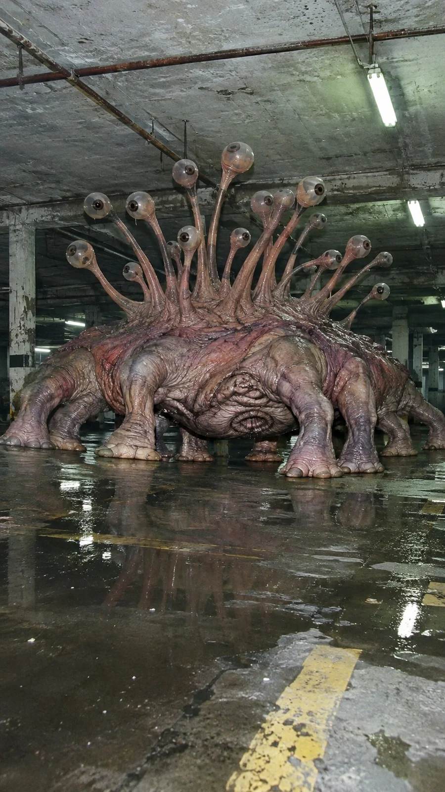

# Brutalist Flash Documentary of an Unknown Organism

**中文标题：** 粗野主义闪光纪实·未知生物  
**ID:** `gi25-x-1316` · **Mode:** `generate`  
**Categories:** `general`  
**Tags:** `x-twitter`, `community`, `gpt-image-2.5`, `x-direct`, `en`



### Brutalist Flash Documentary of an Unknown Organism

```text
Ultra-realistic brutalist documentary flash photography of an unknown biological organism, photographed as if genuinely discovered inside an abandoned industrial structure. Harsh direct on-camera flash illumination, strong frontal highlights, deep physically accurate shadows, cold desaturated concrete-gray environments, pale pink and muted lavender organic skin tones, subtle greenish fluorescent ambient contamination, realistic wet surface reflections, authentic digital camera sensor noise, imperfect exposure, slight optical distortion, natural lens softness, extremely detailed biological textures, visible pores, wrinkles, translucent membranes and realistic anatomical imperfections. Raw investigative photography aesthetic, unsettling clinical realism, spontaneous documentary framing, realistic scale and environmental interaction. No cinematic fantasy lighting, no CGI appearance, no digital painting, no illustration, no glossy 3D rendering, no artificial sharpening, no text, no watermark. Vertical 9:16 composition.
```

- **Recommended model:** `gpt-image-2.5-sunburst`
- **Settings:** _(defaults)_
- **Source:** [community](https://x.com/92digitalartArt/status/2116964739867619737) — @92digitalartArt
- **License note:** Original public X post; quoted with attribution — remix with attribution
- **Notes:** Collected directly from X; original post https://x.com/92digitalartArt/status/2116964739867619737; post text names GPT Image 2.5; discovered via X search, prompt re-verified against the original X post via api.fxtwitter.com; verified=True
- **Preview:** `previews/gi25-x-1316.webp`
