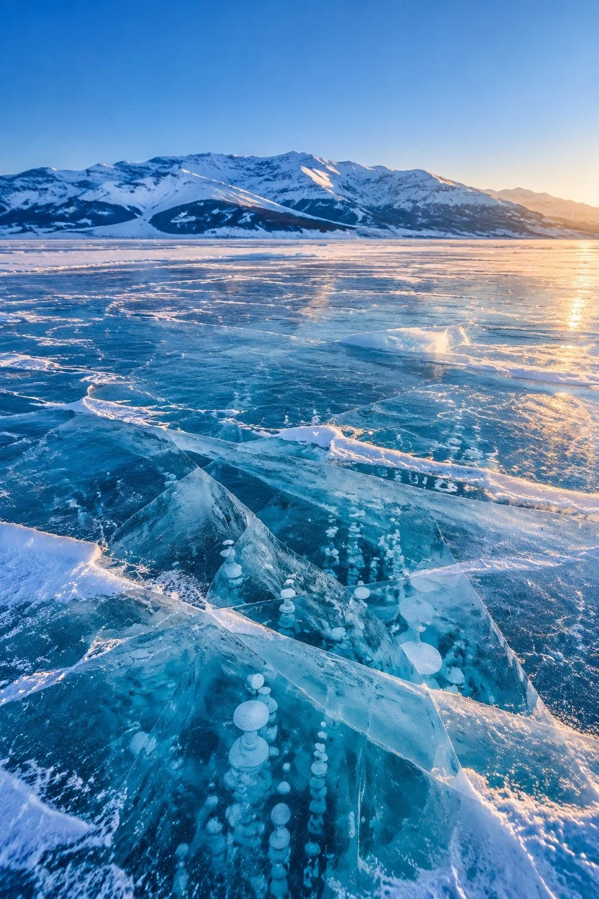

# Sayram Lake Winter Blue Ice Landscape

**中文标题：** 赛里木湖冬日蓝冰风光  
**ID:** `gi25-x-1317` · **Mode:** `generate`  
**Categories:** `general`  
**Tags:** `x-twitter`, `community`, `gpt-image-2.5`, `x-direct`, `zh`



### Sayram Lake Winter Blue Ice Landscape

```text
新疆赛里木湖冬日蓝冰风光，竖版摄影大片。地点是天山深处的高山湖泊赛里木湖，时值深冬清晨，湖面已完全封冻，天空澄澈湛蓝，空气干冷通透。主体是铺满湖面的宝石蓝冰层：冰面裂纹如蛛网般向远处蔓延，冰层下凝固着一串串白色冰泡，近景几块被挤压隆起的冰推层层叠叠，冰体透着深浅不一的宝蓝与青玉色，边缘覆着薄雪。空气中漂浮着细碎冰晶与寒雾，湖面反射着冷冽天光。低角度的冬日暖阳从右侧斜洒而来，色温约4000K，金色光束落在冰面裂纹与雪线上，与深蓝冰面形成暖冷对撞。背景分层清晰：近景蓝冰裂纹与冰泡、中景一望无际的冰封湖面、远景雪线分明的连绵天山与淡蓝天际。相机：低机位贴近冰面，24mm广角焦段，f/8小光圈保证全景深，竖构图三分法，冰面占画面下三分之二，天山与天空占上三分之一，留白天际。调色：深蓝与暖金对撞，Eastmancolor胶片模拟，轻微film grain，饱和度克制自然，真实感强。情绪：静谧、辽阔、如梦似幻的冰雪童话感。高质量摄影，细节丰富，8K画质。No people, No oil painting, No anime, No 3D render, No oversaturation, No text, No watermark, No deformed structures.
```

- **Recommended model:** `gpt-image-2.5-sunburst`
- **Settings:** _(defaults)_
- **Source:** [community](https://x.com/CandyTravelight/status/2117081765026111494) — @CandyTravelight
- **License note:** Original public X post; quoted with attribution — remix with attribution
- **Notes:** Collected directly from X; original post https://x.com/CandyTravelight/status/2117081765026111494; post text names GPT Image 2.5; discovered via X search, prompt re-verified against the original X post via api.fxtwitter.com; verified=True; the same prompt is also run on two other models in the post; preview is image 1, the GPT Image 2.5 result
- **Preview:** `previews/gi25-x-1317.webp`
