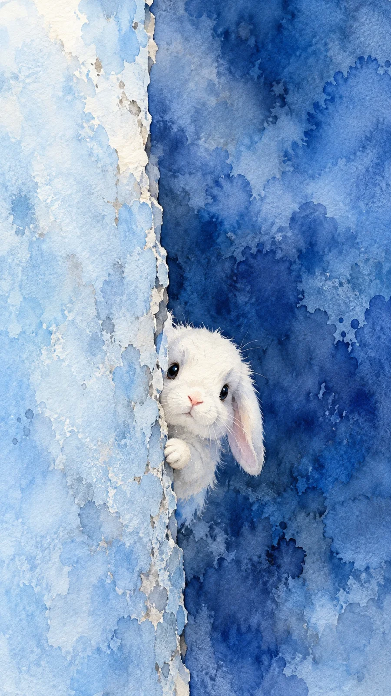

# Transparent Watercolor Animal Peeking From a Wall

**中文标题：** 透明水彩墙边探头小动物  
**ID:** `gi25-x-1322` · **Mode:** `generate`  
**Categories:** `general`  
**Tags:** `x-twitter`, `community`, `gpt-image-2.5`, `x-direct`, `zh`



### Transparent Watercolor Animal Peeking From a Wall

```text
Create an image with the following visual system. Replace the subject as specified.

Visual system (light, color, composition, medium, mood):
一幅接近 9:16 的竖幅纸本透明水彩插画。画面被一道近乎竖直、略有起伏的破碎墙沿分成左右两块同色系蓝色域：左侧约占四成的浅天蓝到冰蓝前景墙面，右侧是深群青到钴蓝的湿中湿背景；边沿夹着细窄、不连续的白纸留白和少量灰蓝裂痕，避免机械直线。柔和偏冷的漫射光从左上方照入，背景以湿画法铺出蓝色浓淡流动，保留自然水痕、回流花、颜料沉积与粗纹水彩纸颗粒。构图采用与主体眼睛近乎齐平的正面机位，大面积环境包围小主体：可替换的小动物从墙沿后悄悄探出头与少量胸口，身体大部分被遮住，位于画面中下部、略偏右，约占画幅六分之一，上方保留充裕蓝色留白。主体亮部多用纸白，以极淡灰蓝和米白塑形，面部仅点少许浅粉暖色；眼鼻稍清晰，毛缘局部融入水色。不要文字、标志、边框、均匀数码渐变或过度写实毛发。整体松动通透、安静好奇。

New subject:
一只白色垂耳小兔从墙的边缘后面探出半个脑袋，一只长耳朵垂下来，粉色鼻头，黑亮的圆眼睛，小前爪搭在墙边。
```

- **Recommended model:** `gpt-image-2.5-sunburst`
- **Settings:** _(defaults)_
- **Source:** [community](https://x.com/static_stare/status/2117113800272843140) — @static_stare
- **License note:** Original public X post; quoted with attribution — remix with attribution
- **Notes:** Collected directly from X; original post https://x.com/static_stare/status/2117113800272843140; post text names GPT Image 2.5; discovered via X search, prompt re-verified against the original X post via api.fxtwitter.com; verified=True; prompt for image 1 of 4 (the author shares the other three on request); preview is image 1
- **Preview:** `previews/gi25-x-1322.webp`
