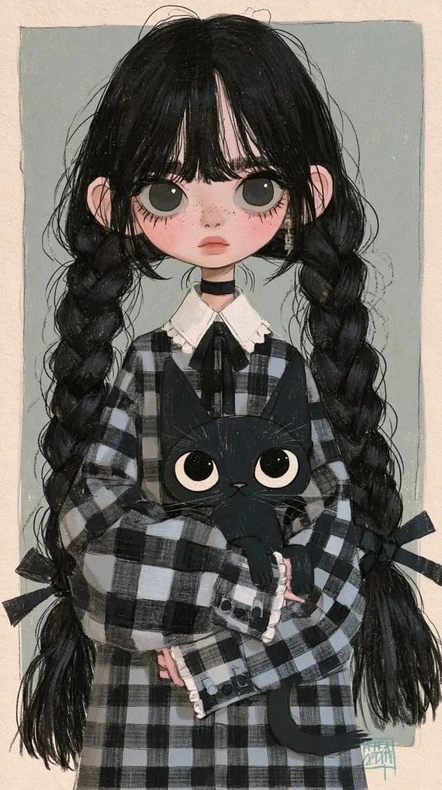

# Gothic Kawaii Girl With Black Cat Storybook Illustration

**中文标题：** 哥特可爱少女与黑猫绘本插画  
**ID:** `gi25-x-1323` · **Mode:** `generate`  
**Categories:** `general`  
**Tags:** `x-twitter`, `community`, `gpt-image-2.5`, `x-direct`, `en`



### Gothic Kawaii Girl With Black Cat Storybook Illustration

```text
Gothic Kawaii Girl with Black Cat | Hand-Drawn Storybook Illustration

Create a highly detailed, hand-drawn 2D character illustration in a cute yet slightly gothic kawaii art style, with a soft vintage storybook aesthetic, textured pencil shading, delicate ink outlines, and a muted color palette.

Character: A cute young girl with an oversized head, large expressive dark gray eyes, long black eyelashes, rosy pink cheeks, tiny freckles across her nose, a small nose, and soft coral-colored lips. She has pale skin and long, thick, jet-black hair styled in two oversized, messy braided pigtails that extend below her waist, with loose wispy strands and long, center-parted curtain bangs framing her face.

Outfit: An oversized black and gray plaid dress with a loose silhouette, long sleeves, a white pointed Peter Pan collar with delicate lace trim, a large black ribbon bow at the neckline, and black decorative buttons on the cuffs. A thin black choker wraps around her neck.

Pose: The girl is sitting or standing in a relaxed, front-facing pose, gently holding a small black cat in her arms. Her arms are crossed naturally around the cat, creating a cozy and affectionate composition.

Cat: A cute, chubby black cat with a rounded head, oversized pointed ears, enormous round cream-colored eyes with dark pupils, a tiny triangular nose, delicate whiskers, and a long curved tail. The cat is nestled comfortably in the girl's arms, facing directly toward the viewer with an innocent expression.

Composition: Full-body vertical portrait, centered character, symmetrical framing, with the girl's long braids cascading down both sides of her body. The black cat is positioned prominently in the center of the composition.

Background: A muted dusty sage-green rectangular backdrop surrounded by warm cream-colored textured paper. Minimal background details, subtle paper grain, and a handmade sketchbook aesthetic.

Art Style: Soft vintage children's book illustration, gothic kawaii character design, Korean-inspired cute character art, hand-drawn pencil and ink texture, subtle crosshatching, visible sketch lines, delicate watercolor-like shading, slightly imperfect outlines, muted black, gray, cream, and blush pink tones.

Lighting: Soft, diffused natural light with gentle shadows and no dramatic contrast.

Technical Details: 9:16 vertical composition, highly detailed character design, intricate hair strands, realistic fabric texture, expressive oversized eyes, clean character silhouette, charming and cozy atmosphere, no photorealism, no 3D rendering, no text, no watermark.
```

- **Recommended model:** `gpt-image-2.5-sunburst`
- **Settings:** _(defaults)_
- **Source:** [community](https://x.com/Ziha_ai/status/2117114895514943911) — @Ziha_ai
- **License note:** Original public X post; quoted with attribution — remix with attribution
- **Notes:** Collected directly from X; original post https://x.com/Ziha_ai/status/2117114895514943911; post text names GPT Image 2.5; discovered via X search, prompt re-verified against the original X post via api.fxtwitter.com; verified=True
- **Preview:** `previews/gi25-x-1323.webp`
