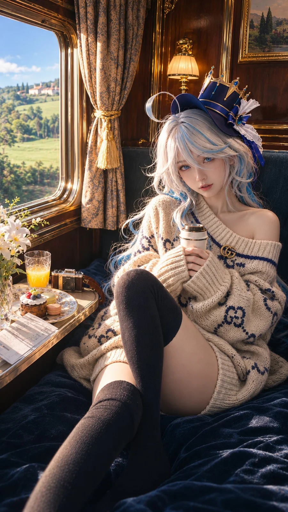

# Furina Cosplay Luxury Sleeper Train Fashion Portrait

**中文标题：** 芙宁娜 Cosplay 豪华卧铺列车时尚人像  
**ID:** `gi25-x-1324` · **Mode:** `generate`  
**Categories:** `general`  
**Tags:** `x-twitter`, `community`, `gpt-image-2.5`, `x-direct`, `zh`



### Furina Cosplay Luxury Sleeper Train Fashion Portrait

```text
画面比例：竖版 9:16。超高质量真实人物摄影，国际高级时尚杂志封面级摄影品质。

一张具有极高真实感的旅行纪实风格时尚人像照片，拍摄于一列行驶在法国乡间的古典豪华卧铺列车内。将法国古典油画的光影美学、高级奢侈品时尚摄影的精致质感，以及真实生活抓拍的自然感完美结合。

整张照片必须被理解为真实相机拍摄的真人、真实服装和真实场景，而不是动漫插画、三维渲染或数字绘画。

一、人物：真人版芙宁娜 Cosplay

画面中的主角是一位二十出头、明确成年的东亚女性，正在 Cosplay《原神》中的芙宁娜（Furina）。

她拥有高级写真模特般的出众容貌，脸型小巧，精致而不失自然的五官，秀气的鼻梁，柔和清晰的下颌线，细腻的嘴唇，略带清冷和高贵气质的神情。她刚刚睡醒，神态带着一点慵懒和迷糊，气质柔软亲近。

严格还原芙宁娜的标志性视觉特征：银白色与浅冰蓝色交织的头发、精致的蓝色眼眸、具有角色辨识度的不对称发型与面部两侧的卷曲发束。头发采用高质量真实 Cosplay 假发的质感，发丝细密、自然蓬松，存在真实的层次、毛流、少量飞散的碎发和不规则的发束，绝不是塑料般顺滑的三维模型头发。

头顶佩戴芙宁娜标志性的深海军蓝小礼帽，帽子拥有金色装饰、蓝色宝石、白色褶皱饰物和精致的角色风格装饰，具有真实的布料、金属以及宝石材质。小帽子佩戴自然，大小比例合理，与她的发型完整结合。

皮肤必须呈现真实年轻女性的摄影质感：可见极其细微的毛孔、自然皮肤纹理、柔软的面部绒毛、真实的眼睑结构、轻微的肤色变化及自然的唇部光泽。禁止磨皮、陶瓷肌、蜡像肌、过分均匀的皮肤和 AI 美颜。

二、服装：Gucci × Hermès 风格的奢华粗针织毛衣

她穿着一件明显超大号的奶油白色粗棒针毛衣，以 Gucci 的复古学院派图案美学和 Hermès 的高级羊绒针织工艺为灵感。

毛衣非常宽松，肩线明显下落，袖子肥大而柔软，袖口略微盖住手掌；厚实的天然羊毛与羊绒混纺纱线形成清晰、立体、自然的粗针织结构。

毛衣以暖象牙白为底色，加入克制而精致的深海军蓝复古几何纹样、优雅的装饰性编织图案，体现欧洲老钱风与法式旅行时尚的高级感。

宽大的领口自然滑落到一侧肩膀，露出一侧锁骨和肩部。毛衣作为宽松的毛衣裙穿着，下摆覆盖至大腿上段，布料因坐姿形成自然的重力褶皱和松弛堆叠。

她穿着黑色偏深海军蓝的厚棉过膝袜，袜子的针织纹理细腻真实，袜口柔软地贴合大腿。袜口与毛衣下摆之间露出一段自然白皙的大腿肌肤。没有穿鞋。

人物身材高挑纤长，比例符合真实人体解剖结构，曲线自然，不刻意夸张。

三、动作与构图

摄影机位来自对面上铺的朋友，采用略高于人物视线的自然俯拍角度，模拟旅行途中用 iPhone 1 倍主摄拍摄的真实视角，同时拥有专业时尚摄影般的构图控制。

人物坐在下铺靠窗的位置，后背倚靠深灰绿色真皮靠背和深蓝色天鹅绒床铺。

一条腿自然盘起，膝盖向上弯曲；另一条腿向画面下方自然伸展，形成具有透视感的前景线条。双手轻轻握着一个奶油白色保温杯，放在身体前方。

她没有看向窗外，而是微微转过头，直接看向摄影机镜头，与拍摄者形成自然的眼神交流。

眼神安静、慵懒，带着一点刚睡醒的迷离和若有若无的笑意。没有刻意摆拍感，也没有夸张的表情。

人物脸部是画面的第一视觉中心，头发、小礼帽、肩部、毛衣和双腿共同形成舒展而自然的纵向构图。

画面右上角可以带入一小部分上铺护栏与白色被褥，形成轻微的虚化前景，进一步增强真实旅途抓拍的空间感。

四、环境：法国古典豪华列车

一间极具欧洲古典主义气质的法式复古卧铺包厢，参考二十世纪初豪华欧洲列车的室内设计。

车厢拥有深色抛光胡桃木护墙板、优雅的黄铜装饰、精致的古典雕花、复古的壁灯、深灰绿色真皮铺位、厚实的深蓝色天鹅绒床单和柔软凌乱的白色被子。

窗户带有厚实的黄铜金属边框，旁边悬挂奶油金与灰蓝色古典提花窗帘，搭配精致的流苏绑带。

壁面上可以看见一幅小型镀金画框的法国乡村油画，空间精致、有历史感，所有元素都符合真实老式豪华火车包厢的建筑和材质逻辑。

窗边的小桌板上自然摆放着一份精致的法式水果奶油小蛋糕、两枚马卡龙、一杯橙汁、一小束白色鲜花、一台复古相机以及一张对折的车票。

物品排列自然，像真实旅行者使用后的状态，不要过度整齐，也不要堆砌无关装饰。

窗外是明媚而温柔的法国春日乡村：翠绿的草坡、盛开的果树、淡黄色的野花、远方红瓦石屋组成的小村庄、稀疏的树木和蓝天下柔软的白云。

火车正在行驶，窗外近处的植被具有轻微而符合摄影逻辑的横向运动模糊，远景保持适度清晰，呈现真实的运动层次。

绝对没有雪景。

五、核心光影：法国古典油画式的暖光塑形

画面唯一占据主导地位的主光源来自画面左侧的车窗。

春日上午的金色阳光穿过窗户，以较低的侧向角度照进车厢，形成温暖而富有立体感的侧光。

参考法国古典油画的人像光影处理，以及高端时尚杂志中精致、克制的自然光肖像摄影。

温暖阳光柔和地照亮人物的银白色头发、左侧面颊、鼻梁、嘴唇、锁骨、肩膀、毛衣的粗针织纹理及腿部的自然曲线。

脸部呈现美丽而真实的明暗过渡。光线沿着鼻梁、眼窝、颧骨和下颌线逐渐衰减，形成富有雕塑感的面部立体结构，而不是平面化的美颜补光。

毛衣的立体针织纹理在侧光下产生自然、细小而有逻辑的阴影。银白色发丝在阳光照射下呈现细腻的金色轮廓光，部分冰蓝色发束保持自然的冷色反射。

车厢深处维持浓郁而透明的暖棕色阴影，深蓝色天鹅绒保留丰富的暗部层次。

一盏小巧的暖黄色古典壁灯提供很弱的环境辅助光，但不能与左侧窗光争夺主光源地位。

整体色彩是温暖金色阳光、奶油白色毛衣、冰蓝银发、深蓝天鹅绒、胡桃木棕色和春日草绿色之间的高级自然配色。

光影呈现法国油画式的明暗层次，但画面本身必须是百分之百真实摄影，不能出现油画笔触、绘画纹理或插画质感。

六、画质重塑：国际时尚杂志封面级真实摄影

以高端全画幅商业人像摄影的成像品质为基础，同时保留 iPhone 旅行纪实照片般亲密、随性的拍摄感。

高质量光学镜头成像，真实的空间透视，自然柔和的景深，准确的焦平面。焦点精确落在人物眼睛及面部，皮肤与发丝拥有高度自然的细节，背景随距离逐渐柔和，不出现夸张的人工虚化。

画质纯净、通透、扎实，具有高质量 RAW 照片经过专业调色后的真实光学质感。

色彩自然，有精致的胶片色彩层次。高光拥有柔和的肩部过渡，阳光照亮的白色毛衣仍保留完整针织细节，不出现大面积死白。暗部保留真实材质的深浅变化，不被强行提亮。

特别重塑并修复所有可能破损的图像区域：

修复面部、眼睛、鼻梁、唇部和耳朵的微小解剖结构，避免不自然的融化与变形。
修复头发每一束的流向，使发丝连接自然，避免断裂、粘连、重复生成和塑料质感。
修复双手、手指、指甲以及握杯姿势，确保人体结构正确。
重塑毛衣的完整针织逻辑，针脚连续、粗细自然，避免随机碎纹、虚假高频细节或融化的针织图案。
修复大腿与过膝袜的连接、袜口的自然受力、膝盖形态和腿部透视。
修复复古车厢木纹、黄铜反射、窗框结构、桌面物品及装饰品的物理一致性。
消除低清晰度重绘造成的涂抹、脏污色块、假锐化、局部马赛克与重影。
保留真实摄影中必要的细微传感器噪点与自然光学柔和度，不进行粗暴降噪或过度锐化。

画面拥有极高的细节可信度，而不是单纯通过增加锐度、微对比度或高频纹理制造所谓高清感。

整体效果像由顶级时尚摄影师在真实古典火车上拍摄的高级时装人像作品：光线优美、人物真实、皮肤自然、材质高级、构图成熟、气氛温柔。

最终必须是一张具有高级时尚杂志封面摄影品质的真实照片，而不是 AI 插画。

无需添加任何杂志标题、排版文字、品牌水印或边框。

七、严格禁止

禁止动漫脸、二次元绘画、CGI、3D 渲染、游戏截图、数字插画、油画笔触、过度磨皮、塑料皮肤、玻璃眼球、陶瓷肌、虚假锐化、HDR 光晕、过度曝光、死黑阴影、过饱和色彩、不自然的身体比例、错误手指、重复肢体、融化的织物纹理、杂乱点状噪声、破损图案、廉价 Cosplay 塑料材质、过度人工补光、过度梦幻滤镜、大片浮动颗粒、虚假的电影颗粒。

不改变芙宁娜的标志性发色与小礼帽，不改变春日法式田园风光，不改变左侧暖光的主导地位，不改变人物看向镜头的动作和自然慵懒的情绪。

最终视觉目标：法式古典油画级光影 × 顶级奢侈品时尚大片 × 真实 Cosplay 人物摄影 × 细腻而可信的现代摄影画质。
```

- **Recommended model:** `gpt-image-2.5-sunburst`
- **Settings:** _(defaults)_
- **Source:** [community](https://x.com/Sin_Yiyao/status/2117130588943450230) — @Sin_Yiyao
- **License note:** Original public X post; quoted with attribution — remix with attribution
- **Notes:** Collected directly from X; original post https://x.com/Sin_Yiyao/status/2117130588943450230; post text names GPT Image 2.5; discovered via X search, prompt re-verified against the original X post via api.fxtwitter.com; verified=True; fan-art cosplay prompt for the Genshin Impact character Furina
- **Preview:** `previews/gi25-x-1324.webp`
