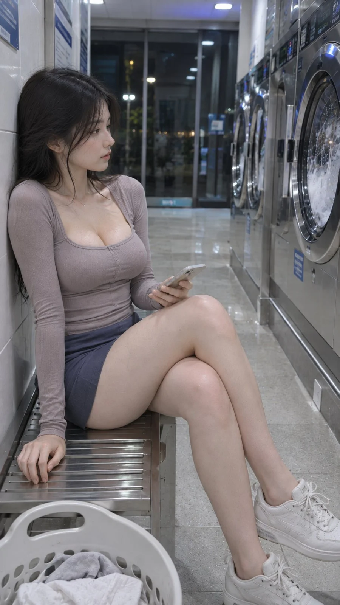

# Late-Night Laundromat Realistic Lifestyle Photo

**中文标题：** 深夜自助洗衣房写实生活照  
**ID:** `gi25-x-1329` · **Mode:** `generate`  
**Categories:** `general`  
**Tags:** `x-twitter`, `community`, `gpt-image-2.5`, `x-direct`, `zh`



### Late-Night Laundromat Realistic Lifestyle Photo

```text
风格方向： 深夜等待衣物烘干情绪

场景方向： 社区自助洗衣房 / 一排滚筒洗衣机 / 金属长椅 / 洗衣篮

服装方向： 浅莓灰色修身方领长袖薄针织上衣 + 深灰蓝色高腰修身短裙

气质标签： 安静、轻微疲惫、慵懒、克制、有故事感

五官方向： 电影自然脸，流畅鹅蛋脸，微长杏眼，自然柔软唇形

发型方向： 黑色长发自然披散，耳侧碎发略显凌乱

身形方向： 轻盈匀称，上围自然丰满，腰臀比例协调

线条强调： 中偏强

镜头方向： 女生坐在洗衣机旁的长椅上，背部自然靠着墙面，双脚平稳落地，一只手拿着手机查看时间，另一只手搭在腿侧，身体轻微侧向镜头，抬眼望着正在转动的滚筒洗衣机。

光线氛围： 中性白色洗衣房顶灯，洗衣机金属表面产生真实反射，窗外保留冷色夜景。

画幅比例： 9:16

曲线重点： 稳定坐姿自然表现胸部、腰线和腿部比例，修身针织上衣衬托上半身曲线，避免强行扭腰。
```

- **Recommended model:** `gpt-image-2.5-sunburst`
- **Settings:** _(defaults)_
- **Source:** [community](https://x.com/liyue_ai/status/2117187479556227389) — @liyue_ai
- **License note:** Original public X post; quoted with attribution — remix with attribution
- **Notes:** Collected directly from X; original post https://x.com/liyue_ai/status/2117187479556227389; post text names GPT Image 2.5; discovered via X search, prompt re-verified against the original X post via api.fxtwitter.com; verified=True
- **Preview:** `previews/gi25-x-1329.webp`
