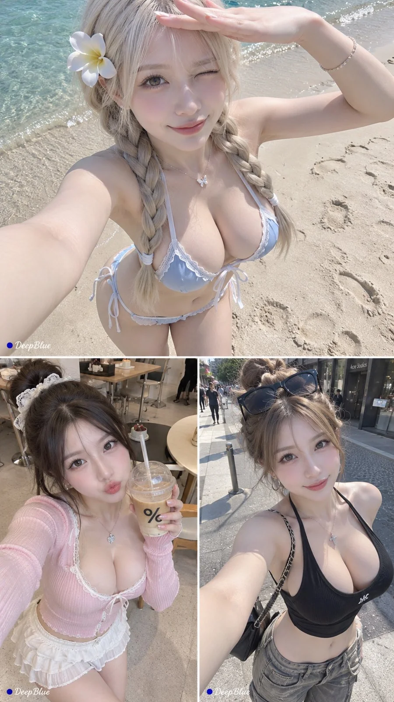

# East Asian Influencer High-Angle iPhone POV Selfie Gacha Series

**中文标题：** 东亚ins网红高角度iPhone自拍抽卡系列  
**ID:** `gi25-x-1330` · **Mode:** `generate`  
**Categories:** `general`  
**Tags:** `x-twitter`, `community`, `gpt-image-2.5`, `x-direct`, `zh`



### East Asian Influencer High-Angle iPhone POV Selfie Gacha Series

```text
东亚成年ins网红 × 全风格穿搭开放抽卡 × 随机妆发与生活方式场景 × iPhone高角度POV自拍

【人物设定】

每张随机生成一位20多岁的成年东亚ins网红，白皙通透、带自然光泽的肌肤，高挑修长，腰线纤细，身材曲线明显，整体比例协调。

五官精致立体，眼睛明亮，卧蚕自然，睫毛卷翘，鼻梁秀气，双唇粉嫩。随机变化脸型、眼型、个人气质与妆容浓淡，保持统一的高颜值审美与精致感。

整体形象具有明显社交平台网红气质，时尚、上镜、会拍照，具有轻度展示欲和生活方式感，但不过度摆拍，依然自然鲜活。

【穿搭与妆发抽卡】

每张随机探索不同风格、季节与场合的女性穿搭，包括甜美、清纯、韩系辣妹、Y2K、运动休闲、度假、街头、复古、轻奢、派对、新中式及其他时尚风格。

自由组合上衣、短裙、短裤、连衣裙、长裤、鞋履与各类配饰，随机变化领口、剪裁、面料、配色与露肤程度。服装自然贴合身形，展现纤细腰线与协调曲线，具有真实可信的穿着结构。

根据穿搭搭配随机发色、发型、刘海、美瞳、妆容、美甲、首饰、墨镜、帽子、发饰、包包及其他配件，形成完整协调、各具特色的个人造型。

【场景与情境抽卡】

随机探索具有ins晒图感的真实生活方式场景，包括海滩、beach club、泳池、街头、咖啡馆、甜品店、便利店、酒店、卧室、镜前、商场、洗手间、天台、公园、车内、旅行景点及其他适合自拍分享的生活场景。

每张围绕一个具体情境展开，根据场景自然决定人物行为、周围物件、时间、天气与光线。可适度加入饮料、购物袋、太阳镜、手机壳、钥匙、毛巾、杂志、化妆品等生活小物，让画面更像真实社交平台内容。

穿搭、人物动作与环境相互呼应，形成完整可信的自拍情境。

【动作与表情抽卡】

采用人物本人手持手机的第一人称自拍视角，以高角度俯拍为主要特征，灵活变化俯拍程度、手机距离及轻微侧俯拍角度。

人物可站立、坐着、行走、倚靠、半蹲、靠栏杆、坐在床边、坐在车内或处于其他合理的生活状态中。持机手通常位于画面外，必要时自然露出部分前臂；另一只手根据情境做出合理动作，例如拨头发、扶墨镜、遮阳、托脸、整理衣领、拿饮料、扶帽子、拎包、轻触嘴唇、比耶或其他自然自拍动作。

随机呈现甜美微笑、俏皮眨眼、调皮嘟嘴、惊喜、害羞、慵懒、清冷、自信、无辜、搞怪等即时表情。

动作与表情都源于当下情境，人物与镜头自然互动，呈现鲜活、亲近、轻松、会拍照的自拍瞬间，避免僵硬摆拍。

【摄影与构图】

9:16竖版，真实iPhone广角自拍质感。

随机变化人物与镜头距离、身体朝向、头部角度、人物位置、景别和背景占比。允许适度裁切、非对称构图与自然透视，保持自拍机位、手臂结构和人体比例合理。

根据环境采用真实自然光或现场照明，保留细腻皮肤纹理、自然色差、衣料质感与合理阴影。整体色彩清新通透，明亮干净，具有真实社交平台热门自拍照片的生活感与视觉吸引力。

【系列规则】

每张独立随机组合人物造型、穿搭风格、生活场景、动作表情与构图。

n=10，9:16竖版，每张独立生成，不制作拼图。

左下签名：深蓝色实心圆点在前，白色手写体「DeepBlue」在后，尺寸克制，不遮挡主体。
```

- **Recommended model:** `gpt-image-2.5-sunburst`
- **Settings:** _(defaults)_
- **Source:** [community](https://x.com/DeepBlueX0/status/2117188119325770043) — @DeepBlueX0
- **License note:** Original public X post; quoted with attribution — remix with attribution
- **Notes:** Collected directly from X; original post https://x.com/DeepBlueX0/status/2117188119325770043; post text names GPT Image 2.5; discovered via X search, prompt re-verified against the original X post via api.fxtwitter.com; verified=True; batch prompt (n=9/10 independent images, each a different character/subject); preview is image 1; the post notes chat mode vs. work mode give different looks
- **Preview:** `previews/gi25-x-1330.webp`
