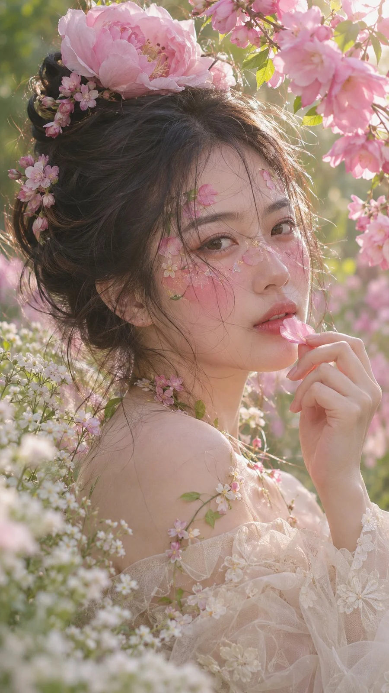

# Spring Secret-Garden RAW Portrait with Flower Bun

**中文标题：** 春日秘密花园花苞发髻RAW人像  
**ID:** `gi25-x-1332` · **Mode:** `generate`  
**Categories:** `general`  
**Tags:** `x-twitter`, `community`, `gpt-image-2.5`, `x-direct`, `zh`



### Spring Secret-Garden RAW Portrait with Flower Bun

```text
生成一张9:16竖版、超写实RAW摄影风格的春日人像照片。主体是一位明确成年的25–28岁东亚女性，置身于盛春的秘密花园中。采用头肩近景至胸像构图。

【主体与五官】
女性拥有柔和的小鹅蛋脸、饱满自然的额头、略微收窄的下颌线。眼睛呈杏仁形，虹膜为带有浅橄榄色调的深棕色，保留真实细腻的虹膜纹理。眉毛细长自然，鼻梁小巧挺直，鼻尖泛着极淡的粉色。嘴唇饱满自然，呈玫瑰蜜桃色，保留清晰、湿润的真实唇纹。肌肤白皙通透，具有自然光泽，必须保留真实毛孔、细小汗毛以及微弱的肤色色差，避免不自然的磨皮效果。

【发型与花饰】
头发为乌黑中带有深棕色调的浓密长发，头顶部自然蓬松，盘成略微凌乱的高位花苞发髻。发丝向不同方向自然散开，呈现真实、轻盈、随风微动的状态。

发髻顶部固定一朵大型浅粉色重瓣牡丹状花朵，花瓣层层交叠，边缘微微半透明，具有细腻褶皱和真实花蕊。发髻侧面及后方点缀数簇小型粉色花朵。

额前与脸颊两侧垂落许多细长、自然弯曲的碎发，部分发丝轻轻穿过眉毛、眼睛和脸颊，呈现自然不刻意的凌乱美感。

【花卉妆容】
眼周使用低饱和度的灰粉玫瑰色眼影，睫毛纤长但不过分夸张。双颊晕染大面积柔和的樱花粉腮红。

额头、眼下和颧骨附近绘制精致的粉色花瓣图案，并点缀极小的淡黄色五瓣花、透明珠光细闪以及少量细碎绿叶。

花卉图案必须与真实皮肤自然融合，如同细腻的手绘彩妆，而不是贴在脸上的塑料装饰或贴纸。保留皮肤本身的纹理与光泽。

【服装与配饰】
身穿象牙白色露肩花卉薄纱礼服。领口饰有精细的奶油白色花卉蕾丝刺绣和柔软荷叶边，双肩自然露出。

胸衣内部带有完整、不透明的衬层，外层由轻薄欧根纱与网纱交叠构成，呈现真实、细腻的半透明层次。

颈部环绕细小的粉白色花朵与绿色藤蔓，部分花枝自然垂落在锁骨和肩头，仿佛与花园中的植物融为一体。

【动作与表情】
女性置身于盛开的粉色花丛之中，上半身轻微侧转，头部轻轻回望镜头。

眼神安静、柔软、略带朦胧感，表情自然放松。

右手轻轻抬至唇边，指尖小心地捏住一片浅粉色花瓣。花瓣轻触或靠近微张的嘴唇，动作细腻、优雅、自然。

肩颈保持放松，身体不出现刻意扭转或僵硬摆拍的状态。

【场景与前景】
场景为盛春时节的秘密花园。女性被大量粉色重瓣花朵、细小白花和鲜绿色藤蔓自然包围。

画面左下方布置密集的小白花与细枝，形成具有层次感的柔焦前景。

画面右上方由繁盛的粉色花簇构成自然的视觉框架。

背景包含柔和的绿色树叶、蓝青色天空光斑以及朦胧的粉色花海。

采用浅景深效果，形成柔滑、奶油般的散景光斑。前景、人物与背景之间具有清晰而自然的空间层次。

【光线与镜头】
明亮而柔和的春日逆光从画面右上方穿过花枝。

光线照亮发丝边缘、粉色花瓣和肩部，形成细腻的暖白色轮廓光。

面部由大面积漫反射自然补光均匀照亮，阴影非常柔和，但依然保留真实的面部立体感。

模拟85mm等效焦距人像镜头，光圈f/1.8–f/2.2。

眼睛精准对焦，面部细节清晰锐利；花卉前景轻微失焦，背景自然柔和虚化。

【最终摄影质感】
超写实RAW摄影质感，日系春日清透写真风格。

采用低对比度的粉绿色电影调色，柔和高光、极轻微的胶片颗粒。

真实呈现花瓣纹理、独立发丝、皮肤毛孔和薄纱纤维。

4K级高清细节，画面具有梦幻浪漫的氛围，但必须保持真实摄影所具有的自然光学质感。

【负面提示词】
未成年外观、动漫、二次元、CGI、3D渲染、塑料皮肤、过度磨皮、过度美颜、夸张眼睛、僵硬发型、塑料花朵、花朵与皮肤异常融合、畸形手掌、手指数量错误、廉价影楼背景、文字、Logo、水印、拼图。
```

- **Recommended model:** `gpt-image-2.5-sunburst`
- **Settings:** _(defaults)_
- **Source:** [community](https://x.com/leo_xiaolei/status/2117192536196587827) — @leo_xiaolei
- **License note:** Original public X post; quoted with attribution — remix with attribution
- **Notes:** Collected directly from X; prompt posted as the author's own reply https://x.com/leo_xiaolei/status/2117192536196587827 to https://x.com/leo_xiaolei/status/2117192532505596233, which carries the images; GPT Image 2.5 is named in the parent post; discovered via X search, prompt re-verified against the original X post via api.fxtwitter.com; verified=True; the author says it is a GPT Image 2.5 adaptation of a Midjourney prompt by @jackzhang123vip
- **Preview:** `previews/gi25-x-1332.webp`
