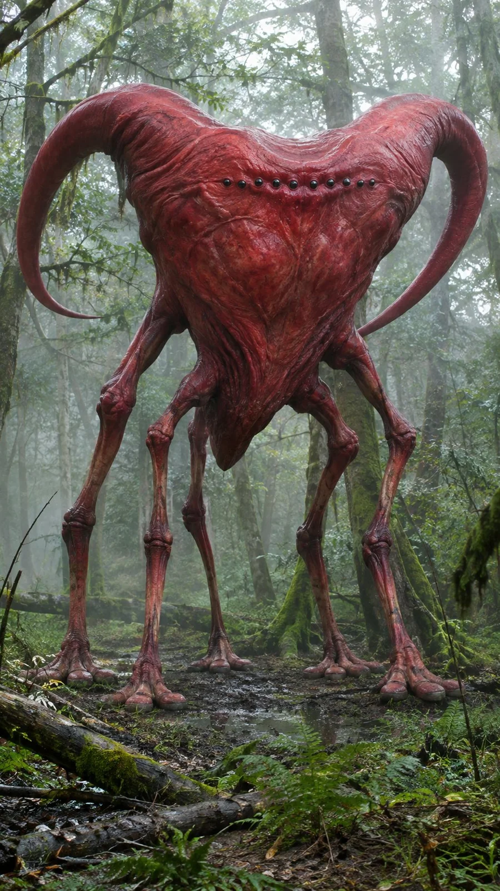

# Unknown Species DSLR Wildlife Field Photo

**中文标题：** 未知物种单反野生动物纪实照  
**ID:** `gi25-x-1335` · **Mode:** `generate`  
**Categories:** `general`  
**Tags:** `x-twitter`, `community`, `gpt-image-2.5`, `x-direct`, `en`



### Unknown Species DSLR Wildlife Field Photo

```text
Ultra-photorealistic professional DSLR wildlife photography of an unidentified living organism, captured with a full-frame Canon EOS R5 camera and a 200mm telephoto lens. Authentic natural-history field photography, realistic optical background compression, genuine lens-based depth of field, naturally sharp subject details with subtle optical softness, physically accurate daylight illumination, believable dynamic range, natural automatic white balance, restrained realistic colors, delicate sensor noise, subtle lens imperfections and realistic exposure variations. Extremely convincing biological surface detail, natural skin pigmentation, authentic fur or tissue microtextures, physically accurate shadows, believable anatomy and realistic environmental interaction. Spontaneous field-documentary composition, slight handheld framing imperfections, natural atmospheric perspective, no studio lighting, no cinematic fantasy effects, no excessive HDR, no artificial color grading. The final image must resemble a genuine professional wildlife photograph of an undiscovered species. No CGI, no 3D rendering, no illustration, no digital painting, no artificial sharpening, no plastic textures, no humans, no human silhouettes, no additional creatures, no text, no watermark.
```

- **Recommended model:** `gpt-image-2.5-sunburst`
- **Settings:** _(defaults)_
- **Source:** [community](https://x.com/92digitalartArt/status/2117198750250586203) — @92digitalartArt
- **License note:** Original public X post; quoted with attribution — remix with attribution
- **Notes:** Collected directly from X; original post https://x.com/92digitalartArt/status/2117198750250586203; post text names GPT Image 2.5; discovered via X search, prompt re-verified against the original X post via api.fxtwitter.com; verified=True
- **Preview:** `previews/gi25-x-1335.webp`
