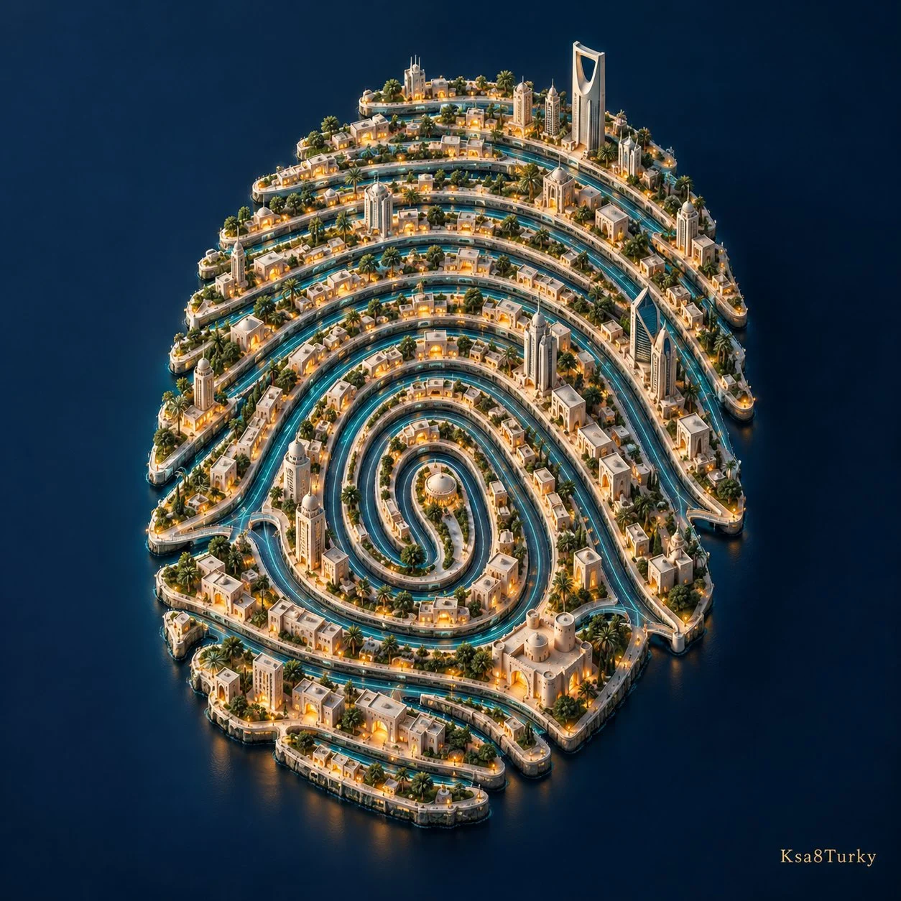

# Miniature City Arranged as a Fingerprint: Surreal 3D Editorial

**中文标题：** 微缩城市指纹·超现实3D编辑图  
**ID:** `gi25-x-1337` · **Mode:** `generate`  
**Categories:** `general`  
**Tags:** `x-twitter`, `community`, `gpt-image-2.5`, `x-direct`, `en`



### Miniature City Arranged as a Fingerprint: Surreal 3D Editorial

```text
Create a premium square surreal editorial 3D artwork: [MINIATURE ENVIRONMENT] arranged along [RECOGNIZABLE PATTERN]. Example: an ivory miniature city with amber windows and cyan streets forming one fictional fingerprint. Elevated overhead camera, readable silhouette, tactile architecture, deep navy studio ground, controlled lighting and realistic occlusion. No actual biometric reference, people, UI or captions. Small exact Ksa8Turky signature at bottom right with safe margin.
```

- **Recommended model:** `gpt-image-2.5-sunburst`
- **Settings:** _(defaults)_
- **Source:** [community](https://x.com/ksa8Turky/status/2117203061794046345) — @ksa8Turky
- **License note:** Original public X post; quoted with attribution — remix with attribution
- **Notes:** Collected directly from X; original post https://x.com/ksa8Turky/status/2117203061794046345; post text names GPT Image 2.5; discovered via X search, prompt re-verified against the original X post via api.fxtwitter.com; verified=True; remove or replace the author signature line
- **Preview:** `previews/gi25-x-1337.webp`
