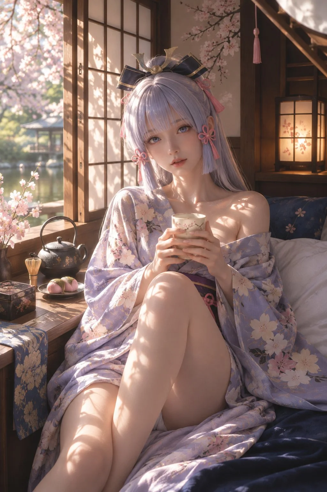

# Kamisato Ayaka Cosplay Spring Washitsu Portrait

**中文标题：** 神里绫华 Cosplay 春日和室私影  
**ID:** `gi25-x-1340` · **Mode:** `generate`  
**Categories:** `general`  
**Tags:** `x-twitter`, `community`, `gpt-image-2.5`, `x-direct`, `zh`



### Kamisato Ayaka Cosplay Spring Washitsu Portrait

```text
画面比例：竖版 9:16。超高质量真实人物摄影，国际高级时尚杂志级摄影品质，真实真人 Cosplay 摄影。

创作一张极其真实、具有高级日系私房写真气质的春日人物摄影作品。主角是一位 Cosplay《原神》神里绫华（Kamisato Ayaka）的成年东亚年轻女性，身穿宽松、柔软、略显慵懒的淡紫色樱花纹样日式浴衣，舒适地坐在古朴日式和室的深蓝色软垫上，双手捧着一只精致的日式陶瓷茶杯，微微歪头，安静地望向摄影机。

整张照片结合真实日系生活摄影、自然的人物神态、精致的高级时尚摄影构图，以及温暖而富有雕塑感的古典侧光。

核心要求：严格参考提供的两张光照参考图。第一张灰色球体与圆柱体白模决定光线方向、光线衰减、明暗结构和阴影分布；第二张女性摄影参考图决定真实皮肤上的光影质感、温暖高光、柔软阴影、肌肤的细微反射以及明亮而通透的日光氛围。

最终必须是真实摄影，不是动漫、CGI 或数字绘画。

一、人物：真人版神里绫华 Cosplay

画面主角是一位二十出头、明确成年的美丽东亚女性，五官精致、脸型小巧、下颌线柔和、鼻梁秀气、嘴唇自然饱满，兼具日式美人的温柔气质与高级时尚模特的精致容貌。

严格还原神里绫华的标志性人物特征：

浅银白色中带有柔和淡紫色调的长发。
整齐细致的平刘海，具有真实自然的发丝层次。
两侧垂落的发束与脑后自然披散的长发。
头顶佩戴标志性的深蓝黑色蝴蝶结状发饰，带有精致金色装饰。
发饰两侧点缀淡粉色日式绳结与流苏。
浅蓝灰色的眼眸，晶莹但具有真实人眼的光学特征。

头发必须是极高质量真实 Cosplay 假发，具有自然的发束厚度、发丝方向、少量碎发、真实的毛发反射和轻微的不规则性。

皮肤具有细腻、柔软、真实的年轻女性质感，可见细小毛孔、柔和肤色变化、自然的面部绒毛、真实的眼睑与唇部纹理。

妆容克制，采用淡粉色眼妆、柔和睫毛、自然唇色，绝不使用夸张的动漫妆容或过度美颜。

她的表情安静、柔软、温柔，略带刚刚睡醒的慵懒感，嘴唇轻微放松，目光自然地注视镜头，与摄影者形成亲密但不刻意的眼神交流。

二、服装：宽松的淡紫色樱花浴衣

人物穿着一件柔软、宽大、略显慵懒的传统日式浴衣。

浴衣主色为低饱和度的淡薰衣草紫、浅灰紫与柔和的丁香色，布面上分布着精致的浅粉色、奶油白色樱花纹样，以及极其细腻的植物枝叶花纹。

衣料采用真实的高级棉麻混纺材质，轻盈、柔软、透气，具有真实的纺织结构和自然垂坠感。

宽大的和服袖口随人物动作自然下垂，袖内形成丰富、柔和的重力褶皱。

腰部搭配深紫色与暖金色细节的传统日式腰带，腰带有精致的编织纹理与小巧的绳结装饰。

浴衣穿着略显松弛，领口自然地向一侧肩膀滑落，露出完整的锁骨线条、一侧肩膀和少量上胸部肌肤，呈现自然、柔软、舒适的居家状态，而不是刻意性感的摆拍。

宽松的布料在腰部、手臂、髋部与腿部形成可信的重力褶皱。

衣摆随着坐姿自然铺散在深蓝色软垫上，露出自然弯曲的膝盖和部分大腿肌肤。

整体服装必须兼具神里绫华的角色辨识度、传统日本服装美学和高级真实纺织材质。

三、人物姿势与摄影构图

严格保持前一张成品图片的人物姿势与纵向构图。

画面采用竖版 9:16，摄影机位略高于人物视线，从正前方稍微俯拍，模拟摄影师在亲密距离内使用高质量相机拍摄的自然纪实视角。

人物坐在靠近日式窗户的位置，后背轻轻依靠深蓝色织物靠垫与柔软寝具。

一条腿自然向身体前方弯曲，膝盖抬起，形成画面中央偏下方的主要前景线条。

另一条腿沿画面下方自然伸展，带来真实的纵向透视。

人物双手自然捧住一只小巧的日式陶瓷茶杯，将茶杯放在胸前偏下的位置。手指柔和、放松，指节与握杯结构准确。

头部轻微向一侧倾斜，脸部基本朝向摄影机，视线直接与镜头接触。

上半身保持柔软自然的松弛状态，肩膀放松，不刻意挺胸或僵硬摆拍。

人物面部位于画面中上部，是绝对第一视觉中心。

银白色头发、深色蝴蝶结发饰、淡紫色浴衣、弯曲的腿部，以及自然铺开的布料，共同形成舒展、优雅的纵向构图。

画面右上方可保留少量柔和的白色被褥与木质结构，作为真实日式居住空间的前景层次。

四、环境：春日传统日式和室

环境是一间温暖、安静、古朴而精致的日本传统和室，带有浓郁的春日生活气息。

室内主要采用深色天然木梁、温暖棕色木质墙面、米白色和纸障子窗、榻榻米、深蓝色传统织物坐垫，以及少量樱花图案装饰。

人物左侧是一扇部分打开的传统障子窗。

窗外是一座美丽而真实的日本春日庭园，粉白色樱花正在盛开，绿植柔和，远处能够看见传统日式木亭、静谧水面和少量庭石。

远景适度虚化，但仍然能够辨认出真实的日式庭园结构。

窗边的矮木桌上摆放着一套简洁、精美的日式茶具：

一只黑褐色手工铁壶，表面带有细致的锻造纹理。
一只竹制茶筅。
一盘粉色与浅绿色的日式和果子。
一只带有樱花纹样的小型漆器茶盒。
一枝插在古朴陶器花瓶中的浅粉色樱花。
一块自然折叠的深蓝色和风刺绣桌布。

人物手中的杯子为奶油白色手工陶瓷茶杯，带有小巧的粉色樱花枝纹，表面具有真实的釉面反光、细微的陶瓷质感和适度的不规则手工边缘。

室内右后方摆放一盏日式木框和纸灯笼，散发很弱的暖黄色辅助光。

墙上可装饰一幅克制、雅致的樱花枝绘画。

所有道具必须自然、古朴、真实，符合传统日式室内设计逻辑，不要堆砌无关装饰。

五、最核心：严格复刻两张参考图的布光

这部分具有最高优先级。光照必须严格遵循提供的白模参考图和真实女性皮肤摄影参考图，而不是重新自由设计光线。

1. 光源方向与明暗结构

第一张白模参考图作为三维空间光照的权威依据。

主光源位于画面左前上方，略高于人物头部，从斜上方照射人物。

光线具有明显但柔和的方向性。

人物头部、左侧面颊、左肩、锁骨上缘、左侧衣物、抬起的膝盖与腿部朝向光源的表面接收较强照明。

人物右侧面部、背向光源的肩膀、躯干侧面、衣物凹陷处，以及靠近背景的位置自然进入较深阴影。

遵循白模圆球与圆柱的真实立体塑形规律：

光照朝向主光源的曲面具有清晰的亮度峰值，亮部沿着立体结构逐渐过渡到中间调，再进入深灰色的柔和阴影。

人物面部、肩膀、锁骨、手臂、膝盖和大腿都应该具有这种符合真实三维曲面关系的亮暗分布。

不要使用均匀的正面柔光填满人物，不要让面部两侧同样明亮，也不要让背景获得与人物相同的照明强度。

2. 真实皮肤的暖光质感

第二张参考图作为人体皮肤受光质感的权威依据。

将参考图中柔和而明亮的暖色日光、细腻的高光反射、自然的明暗层次，以及富有透明感的肤质准确转移到神里绫华的真实人物摄影中。

温暖、柔和的阳光从左上方进入，轻轻掠过人物面颊、鼻梁、嘴唇、颈部、锁骨、肩部、双手与腿部。

亮部皮肤呈现非常细腻的珍珠般光泽，但并不是油腻的高反射塑料皮肤。

肌肤拥有柔和的暖桃色与象牙色反射，存在真实的次表面散射效果和自然的肤色细微变化。

皮肤曲面上的高光自然连续，不应形成生硬的白色高亮斑块。

光线经过头发时产生细腻的边缘透光与发丝反射。

3. 柔和而立体的阴影

阴影应当具有非常真实、顺滑而富有层次的过渡。

在鼻翼、下颌、锁骨下缘、肩膀转折处、浴衣衣褶、手指间隙和膝盖侧面，保留明确的三维阴影结构。

人物受光面柔和明亮，背光面深沉但保留纹理，不出现死黑或不合理的黑色断层。

室内深色木墙、深蓝色坐垫和人物背后的环境形成相对深沉的背景层次，使人物在温暖的光照下自然突出。

明暗对比应参考高级古典人像摄影中的侧向塑形，而不是高反差舞台聚光灯。

4. 春日自然光中的细微光斑

阳光经过窗外樱花枝叶与日式障子结构，可以在局部皮肤、浴衣和室内木质表面形成少量柔和而自然的枝叶投影。

这些投影必须符合统一的光线方向和真实投影几何。

人物的肩膀、锁骨、手臂与腿部可以出现小范围柔和的樱花枝叶光影。

投影边缘略有柔化，具有真实阳光穿过枝叶后的层次，而不是随意添加的装饰图案。

光斑只作为次要细节，不能覆盖人物面部或破坏第一张白模定义的主光照结构。

5. 整体曝光与色温

主光源为春日下午偏暖的自然日光。

亮部色调以柔和香槟金、温暖奶油白和自然象牙色为主。

阴影中保留淡灰紫、暖棕色与深蓝色的自然冷暖变化。

银紫色发丝既能接受暖光，又要保留神里绫华标志性的银白与淡紫色发色，不被全部染成金黄色。

淡紫色浴衣在强光下依然保留完整的樱花纹样与细腻纺织纹理。

人物皮肤明亮通透，但所有高光都必须保留质感与细节。

不要过度曝光、不要虚假的泛白柔光、不要 HDR，不要夸张的金色光晕。

最终光照应具有白模参考图的清晰三维体积塑形，以及第二张摄影参考图的柔软暖光、细腻真实皮肤和通透的春日氛围。

六、摄影画质与镜头语言

整张照片采用高级全画幅数码相机拍摄的人像摄影品质，同时保留日本生活摄影中自然而亲密的随手抓拍感。

摄影机位距离人物较近，使用自然广角至标准焦段的镜头透视，接近 35mm 全画幅等效视角。

自然的空间透视，人物头部与腿部的大小关系符合真实摄影逻辑。

焦点精确落在人物眼睛，面部拥有极高的细节可信度。

头发、眉毛、睫毛、眼睑、皮肤、嘴唇、双手和浴衣织物都具有自然清晰的真实纹理。

背景随着空间距离逐渐柔和虚化，不能使用夸张或不真实的人工背景模糊。

柔和的自然光学锐度，平滑的高光过渡，深沉但透明的暗部。

颜色经过专业摄影后期处理，具有日系高级生活杂志的柔和色彩，同时拥有国际时尚摄影的画面纯净度、精确曝光和成熟构图。

保留非常细腻的真实传感器噪点，但绝不添加明显的胶片颗粒、杂乱点状纹理或假锐化边缘。

所有材质必须真实可信：

皮肤具有真实人体结构与自然微观纹理。

银紫色头发拥有独立且连续的发丝结构。

浴衣的纺织纹样完整、自然、不扭曲。

手指数量正确，指节真实，握杯结构符合人体解剖。

陶瓷杯、铁壶、木材、纸窗、织物和漆器都有各自符合物理规律的表面反射。

背景樱花枝条、窗框和建筑结构清晰合理，不出现重复、断裂、融化或错位。

七、画面情绪

这是一个安静、舒适、亲密、温暖的日本春日下午。

没有刻意的表演，没有夸张的情绪，也没有商业广告式的僵硬摆拍。

人物仿佛刚刚睡醒，穿着舒适宽松的樱花浴衣，坐在窗边悠闲地喝茶。

春日的微风轻轻吹动窗外樱花，温暖的阳光落在她的银紫色长发、面颊和肩膀上。

她自然地抬起目光望向摄影者，表情柔软、温柔，带着一点安静的好奇。

整个场景充满真实生活的温度，同时又拥有高级人物摄影所特有的精致、纯净与诗意。

最终视觉风格：

真实神里绫华 Cosplay × 宽松日式樱花浴衣 × 古朴日式和室 × 春日樱花庭园 × 白模级准确三维光照 × 高级真实皮肤摄影 × 国际时尚杂志级摄影画质。

八、严格禁止

禁止动漫脸、二次元插画、CGI、3D 渲染、游戏截图、数字绘画、塑料皮肤、陶瓷肌、蜡像皮肤、过度磨皮、AI 美颜、夸张的玻璃眼球、廉价假发材质、错误发饰、错误发色。

禁止均匀正面补光、无方向的环境光、过分平坦的面部照明、多个互相矛盾的主光源、错误的高光位置、过强的逆光、过度梦幻滤镜、HDR 光晕和不自然的全局柔焦。

禁止错误的人体解剖、畸形手指、重复肢体、不自然的膝盖、错误的腿部透视、融化的陶瓷杯、变形的浴衣、随机碎纹和破损的背景结构。

禁止随意改变人物坐姿、镜头高度、视线方向、人物服装、室内布局和道具位置。

禁止任何文字、品牌水印、杂志标题、边框或排版设计。

最终优先级：

第1优先级：准确保留神里绫华的发型、发色、发饰与淡紫色樱花浴衣。

第2优先级：保持传统日式和室、春日樱花庭园及精致日式茶具。

第3优先级：全面提升真实摄影质感、人物解剖准确性、布料纹理与画面纯净度。

最终必须是一张光影优美、材质真实、人物自然、具有顶级日系时尚人物摄影品质的照片，而不是人工智能生成感明显的图像。
```

- **Recommended model:** `gpt-image-2.5-sunburst`
- **Settings:** _(defaults)_
- **Source:** [community](https://x.com/Sin_Yiyao/status/2117225555959443509) — @Sin_Yiyao
- **License note:** Original public X post; quoted with attribution — remix with attribution
- **Notes:** Collected directly from X; original post https://x.com/Sin_Yiyao/status/2117225555959443509; post text names GPT Image 2.5; discovered via X search, prompt re-verified against the original X post via api.fxtwitter.com; verified=True; fan-art cosplay prompt for the Genshin Impact character Kamisato Ayaka
- **Preview:** `previews/gi25-x-1340.webp`
