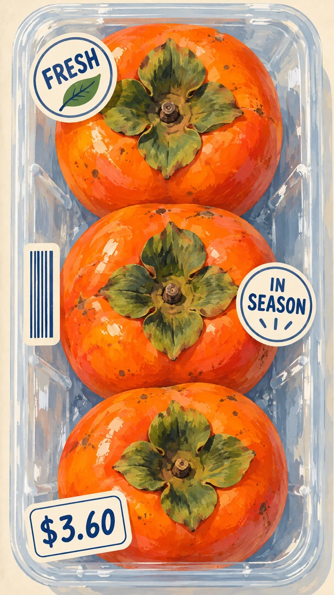

# Supermarket Tray with Stickers Gouache Illustration: Persimmons

**中文标题：** 超市托盘贴纸水粉插画·柿子  
**ID:** `gi25-x-1341` · **Mode:** `generate`  
**Categories:** `general`, `poster-typography`  
**Tags:** `x-twitter`, `community`, `gpt-image-2.5`, `x-direct`, `zh`



### Supermarket Tray with Stickers Gouache Illustration: Persimmons

```text
Create an image with the following visual system. Replace the subject as specified.

Visual system (light, color, composition, medium, mood):
一幅竖向 9:16 的平面不透明水粉插画。垂直俯视、中近景，无地平线；高饱和食材在浅蓝灰透明超市塑料托盘中纵向排列，彼此轻微遮挡，饱满色块占主体，边缘允许局部裁切。托盘圆角边框形成环绕主体的双层曲线，以半透明白色长擦痕、断续反光与浅灰叠色表现塑料；外围窄窄暖米色底。光从左上方柔和漫射，中性偏暖乳白；右下方仅留淡蓝灰接触阴影。食材表面保留不均匀水粉覆盖、干刷露底、细碎斑点及短划高光。沿四周错落安排圆形认证章、齿边产地票、竖向条码贴与倾斜价格签——文字与金额必须严格按 New subject 所写，使用简短装饰字形与图标，不用真实品牌。深蓝细线印刷感，温暖轻快的市集气息；不要商业摄影景深或镜面高光。

New subject:
三个橙红色的熟柿子，带深绿色的四瓣柿蒂，在透明塑料托盘里从上到下排成一列；托盘上贴着：左上角一枚圆形贴纸「FRESH」配一片小叶子图标，右侧中部一枚圆形贴纸「IN SEASON」，左下角一张奶油色小价签「$3.60」，左侧中部一条只有竖条纹没有数字的条形码贴纸。
```

- **Recommended model:** `gpt-image-2.5-sunburst`
- **Settings:** _(defaults)_
- **Source:** [community](https://x.com/static_stare/status/2117226129727639826) — @static_stare
- **License note:** Original public X post; quoted with attribution — remix with attribution
- **Notes:** Collected directly from X; original post https://x.com/static_stare/status/2117226129727639826; post text names GPT Image 2.5; discovered via X search, prompt re-verified against the original X post via api.fxtwitter.com; verified=True; prompt for image 1 of 4 (the author shares the other three on request); preview is image 1
- **Preview:** `previews/gi25-x-1341.webp`
