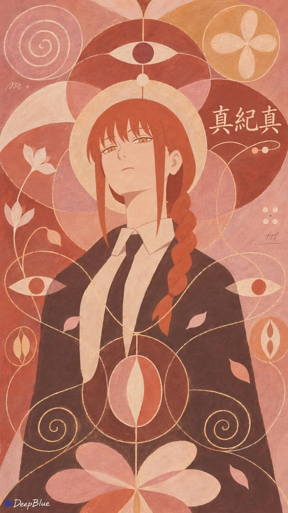

# Anime Characters × Hilma af Klint Spiritual Abstraction Tempera Series

**中文标题：** 动漫角色×希尔玛·阿夫·克林特灵性抽象蛋彩系列  
**ID:** `gi25-x-1343` · **Mode:** `generate`  
**Categories:** `general`, `poster-typography`  
**Tags:** `x-twitter`, `community`, `gpt-image-2.5`, `x-direct`, `zh`



### Anime Characters × Hilma af Klint Spiritual Abstraction Tempera Series

```text
动漫或游戏女性角色× 希尔玛·阿夫·克林特《十大》灵性抽象 × 人物与文字共同构图 × 蛋彩平面绘画

每张随机选择一位不同的成年动漫或游戏角色，结合角色的性格、故事或能力，设计一幅灵性抽象图画。

以希尔玛·阿夫·克林特《十大》系列的视觉语言为灵感，将角色转化为平面化的抽象形象。保留标志性发型、服饰外形、配饰与代表色，以简洁色块概括头发、面部与服饰，保留必要的识别细节，使角色清晰可辨。

自由组合螺旋、同心圆、卵形、花瓣、种子般的有机形状，以及细长曲线和小线圈。让部分形状与角色的发梢、衣摆或配饰自然呼应、衔接，共同形成有生长感的画面。

以角色代表色为基础，选择协调的主导底色和粉彩配色，局部以对比色细线勾边。大小图形交错分布，疏密有变化，留出安静的底色空间。

画面中加入角色的繁体中文名，仅出现一次，使用准确译名。根据角色姿态与图形布局，自由安排文字位置、大小和横竖方向，让名字参与整体构图。文字清晰可读，以与画面协调的手绘笔触呈现。

除角色名与签名外，局部可点缀少量手写字母或短小笔迹。

整体采用哑光、不透明的蛋彩平涂，保持平面绘画效果，呈现纸上蛋彩的粉质色层、细微笔触与自然手绘线条。角色、文字与抽象图形的色彩、笔触和简化程度协调统一。

每张独立变化角色、配色、人物位置、图形组合与文字布局。

n=9，9:16竖版，每张独立生成。

左下角签名：深蓝色实心圆点在前，白色手写体「DeepBlue」在后。
```

- **Recommended model:** `gpt-image-2.5-sunburst`
- **Settings:** _(defaults)_
- **Source:** [community](https://x.com/DeepBlueX0/status/2117236876478206345) — @DeepBlueX0
- **License note:** Original public X post; quoted with attribution — remix with attribution
- **Notes:** Collected directly from X; original post https://x.com/DeepBlueX0/status/2117236876478206345; post text names GPT Image 2.5; discovered via X search, prompt re-verified against the original X post via api.fxtwitter.com; verified=True; batch prompt (n=9/10 independent images, each a different character/subject); preview is image 1
- **Preview:** `previews/gi25-x-1343.webp`
