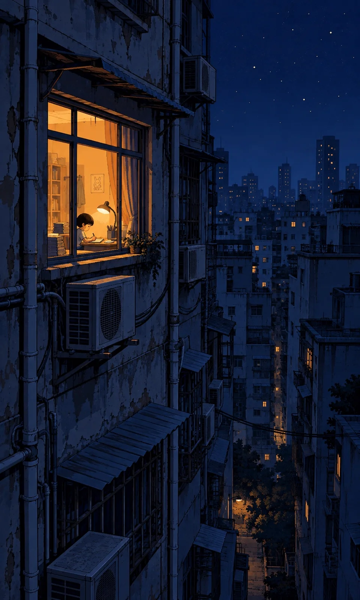

# Deep-Blue Night City with One Warm Window Flat Illustration

**中文标题：** 深蓝夜城一盏暖窗平涂插画  
**ID:** `gi25-x-1346` · **Mode:** `generate`  
**Categories:** `general`  
**Tags:** `x-twitter`, `community`, `gpt-image-2.5`, `x-direct`, `zh`



### Deep-Blue Night City with One Warm Window Flat Illustration

```text
Create an image with the following visual system. Replace the subject as specified.

Visual system (light, color, composition, medium, mood):
一幅竖幅约 3:5 的城市夜景平涂数字插画，有限色阶、硬边轮廓、少量阶梯状像素细节。密集老公寓围成狭长楼宇峡谷；机位在高层楼外，斜望对面并略向下俯视。近景墙体占据画面左半部，一扇窗落在左上至中部，是唯一强光源——饱和橙黄暖光从室内向外照亮窗框、窄窗台与窗内小小人影；空调外机、排水管和窗檐沿立面叠置。中远景楼群向右侧及下方逐层退远，上方右侧留出深蓝星空与细小星点。全画以近乎单色的墨蓝、海军蓝组织明暗，钴蓝仅用于少量受环境光照亮的墙面；远楼只保留零星微弱暖点。墙面哑光旧水泥，金属管道与空调格栅简化几何。不要大面积霓虹、多窗争辉、厚涂笔触或泛白天空。安静、孤独而有庇护感。

New subject:
老城区一排旧公寓楼，近处楼墙上唯一亮灯的窗里，一个小学生趴在书桌上写作业，桌上一盏小台灯和一摞书，窗外挂着空调外机和电线。
```

- **Recommended model:** `gpt-image-2.5-sunburst`
- **Settings:** _(defaults)_
- **Source:** [community](https://x.com/static_stare/status/2117257234082054311) — @static_stare
- **License note:** Original public X post; quoted with attribution — remix with attribution
- **Notes:** Collected directly from X; original post https://x.com/static_stare/status/2117257234082054311; post text names GPT Image 2.5; discovered via X search, prompt re-verified against the original X post via api.fxtwitter.com; verified=True; prompt for image 1 of 4 (the author shares the other three on request); preview is image 1
- **Preview:** `previews/gi25-x-1346.webp`
