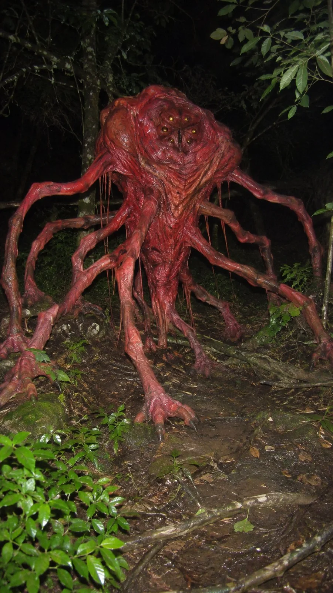

# Unknown Creature Caught by Point-and-Shoot Flash at Night

**中文标题：** 夜间卡片机闪光灯下的未知生物  
**ID:** `gi25-x-1348` · **Mode:** `generate`  
**Categories:** `general`  
**Tags:** `x-twitter`, `community`, `gpt-image-2.5`, `x-direct`, `en`



### Unknown Creature Caught by Point-and-Shoot Flash at Night

```text
Ultra-photorealistic nighttime compact digital camera photography of an unidentified living organism, captured spontaneously with an early-2000s consumer point-and-shoot camera and its built-in flash. Authentic small-sensor CCD image characteristics, harsh direct frontal flash illumination, abrupt light falloff into dark surroundings, strong physically accurate shadows, slightly overexposed reflective surfaces, imperfect automatic white balance, realistic chromatic noise in shadow regions, subtle JPEG compression artifacts, modest optical sharpness, natural lens distortion, believable digital sensor limitations and ordinary amateur photographic framing. Realistic biological surface textures, physically convincing anatomy, natural environmental interaction, authentic colors without cinematic grading, slightly awkward handheld composition and genuine snapshot aesthetics. The image must resemble an authentic unedited photograph of a real unknown animal captured unexpectedly at night. No CGI, no 3D rendering, no illustration, no digital painting, no artificial cinematic lighting, no fantasy effects, no excessive sharpening, no humans, no human silhouettes, no additional creatures, no text, no watermark.
```

- **Recommended model:** `gpt-image-2.5-sunburst`
- **Settings:** _(defaults)_
- **Source:** [community](https://x.com/92digitalartArt/status/2117275222285889919) — @92digitalartArt
- **License note:** Original public X post; quoted with attribution — remix with attribution
- **Notes:** Collected directly from X; original post https://x.com/92digitalartArt/status/2117275222285889919; post text names GPT Image 2.5; discovered via X search, prompt re-verified against the original X post via api.fxtwitter.com; verified=True
- **Preview:** `previews/gi25-x-1348.webp`
