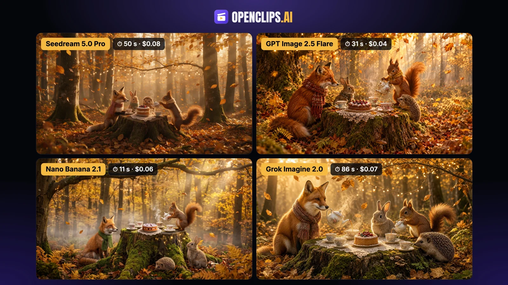

# Woodland Tea Party in a Golden November Beech Forest

**中文标题：** 十一月金色山毛榉林中的动物茶会  
**ID:** `gi25-x-1353` · **Mode:** `generate`  
**Categories:** `general`  
**Tags:** `x-twitter`, `community`, `gpt-image-2.5`, `x-direct`, `en`



### Woodland Tea Party in a Golden November Beech Forest

```text
A whimsical, cozy storybook scene photographed in a real golden beech forest in early November, golden hour. On a large mossy tree stump sits a tiny tea party: mismatched porcelain teacups, a small steaming teapot and a round cake with berries on a lace doily. A red fox in a knitted scarf, a small rabbit and a hedgehog sit around the stump, and a red squirrel standing on its hind legs pours tea from the teapot into a cup. Strings of tiny warm lights hang from the low branches above them. The ground and trees glow in gold, amber, mustard yellow and burnt orange, with soft mist and leaves drifting down through the sunbeams. Warm, magical and realistic, rich detail on fur, porcelain and leaves.
```

- **Recommended model:** `gpt-image-2.5-flare`
- **Settings:** _(defaults)_
- **Source:** [community](https://x.com/openclipsai/status/2117284348051542238) — @openclipsai
- **License note:** Original public X post; quoted with attribution — remix with attribution
- **Notes:** Collected directly from X; prompt posted as the author's own reply https://x.com/openclipsai/status/2117284348051542238 to https://x.com/openclipsai/status/2117284347170701574, which carries the images; GPT Image 2.5 is named in the parent post; discovered via X search, prompt re-verified against the original X post via api.fxtwitter.com; verified=True; comparison post (same prompt on four models incl. GPT Image 2.5 Flare); the preview is the four-model comparison image
- **Preview:** `previews/gi25-x-1353.webp`
