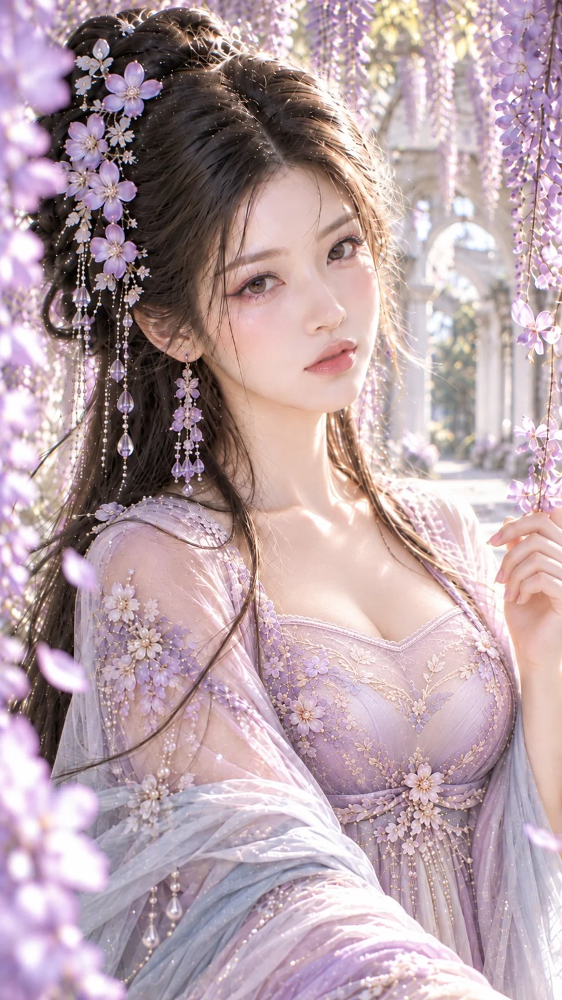

# Wisteria Dream Classical Chinese Beauty Portrait

**中文标题：** 紫藤云梦古风人像  
**ID:** `gi25-x-1355` · **Mode:** `generate`  
**Categories:** `general`  
**Tags:** `x-twitter`, `community`, `gpt-image-2.5`, `x-direct`, `zh`



### Wisteria Dream Classical Chinese Beauty Portrait

```text
9:16 竖版，古风梦幻花廊美妆特写，紫藤云梦珠光妆，高完成度东方古典贵女人像，真实摄影质感，高级古偶电影女主美学，梦幻、轻盈、矜贵、柔美、精致。

画面主体是一位视觉年龄约 24–27 岁、明确成年的年轻东方女性，身份为气质清贵的古典贵女。人物站在盛开的紫藤花廊下，胸像至半身近景构图，身体自然轻侧，肩颈放松，头部轻轻转向镜头，清亮的眼神平静地注视镜头。右手自然抬起，指尖轻轻接触一串垂落的紫藤花，另一只手自然放松于身体前侧。整体姿态轻盈自然，不刻意摆拍。

人物拥有极具辨识度的高级古偶女主脸，精致柔和的小鹅蛋脸，额头自然饱满，面中丰盈立体，颧骨柔和，下颌线纤细流畅但不过尖。眉形纤细舒展，双眼为横向拉长的清亮杏眼，眼裂自然偏长，外眼角轻微上扬，上眼睑弧度柔和，瞳孔大小真实，眼神清澈含蓄。鼻梁秀挺自然，鼻背转折柔和，鼻头小巧精致；唇形柔软丰润但不过厚，唇峰细致，唇珠轻微可见。面部五官精致协调，骨骼体积自然，具有成熟柔美的东方电影女主气质，不幼态、不欧美化、不网红脸。

妆容为“紫藤云梦珠光妆”。底妆白皙通透、细腻柔润，保留自然皮肤纹理；眼妆使用浅薰衣草紫、柔玫瑰粉与细腻浅银珠光渐层晕染，眼尾轻微延长，眼中与卧蚕带清晰但克制的透明细闪；眼下与面中加入轻柔莓粉腮红；鼻梁、鼻尖与唇峰带细腻珍珠柔光；唇妆为清透莓粉玻璃唇，唇形柔软丰润，唇珠自然清晰。妆面精致显妆、水润清透，但不油腻。

乌黑柔顺长发采用高低错落的层次半挽发型，顶部发量丰盈，盘发结构圆润自然，后方大量长发沿肩背顺滑垂落。发间佩戴紫藤花钗、银白花枝、珍珠小花、细银垂链和透明琉璃水滴饰件。耳饰为银白花饰搭配淡紫透明水滴琉璃长耳环，材质清透精致。

服装为雾紫色精致花卉刺绣轻纱襦裙，搭配珍珠白修身内层与浅灰蓝半透明披帛。外层轻纱带立体紫藤花刺绣、细银线、珍珠珠饰和细腻珠光纹理。内层采用珍珠白浅心形领口，领口高度适中，边缘有精细蕾丝状绣边与小珍珠装饰。人物胸部自然丰满圆润，衣料合理贴合身体，形成柔和清晰的胸部轮廓与自然胸线，胸口完整覆盖，不刻意挤压，不出现夸张深沟或过度暴露。服装整体精致华美、轻盈优雅，保留高级古风女主感。

浅灰蓝披帛轻柔环绕双臂，形成自然垂坠与丰富的纱料层次，刺绣与透明材质在阳光中带有细小反光。

背景为春日紫藤花廊，花架上大量浅紫、淡薰衣草紫与少量粉紫色藤花自然垂落，白色古典拱门向远处延伸，穿插自然绿叶与明亮庭院景色。前景少量紫藤花虚化，形成自然框景，花枝不遮挡人物面部。

明亮柔和的自然逆光从花廊侧后方照入，人物乌发边缘、透明琉璃与轻纱刺绣呈现细腻轮廓光，面部由柔和自然反射光照亮，肤色白皙通透，明暗过渡柔和，保留自然骨相结构。

整体色彩使用雾紫、珍珠白、浅灰蓝、自然绿与少量暖白日光。紫色集中于服装、发饰和藤花，白色建筑与浅灰蓝披帛平衡紫色，背景绿植保持自然色泽，不使用全局雾紫色滤镜，不让人物肤色泛紫、泛灰。

85mm 人像镜头，浅景深，人物面部与眼睛精准对焦，紫藤花前景自然虚化，白色拱门和远处庭院形成柔和散景。真实细腻的皮肤纹理，清晰的睫毛、发丝、珍珠、琉璃与精致刺绣质感，明亮通透的电影自然光，高级古风杂志封面美学，梦幻而不失真实，精致华丽而不过度装饰，9:16 竖版。
```

- **Recommended model:** `gpt-image-2.5-sunburst`
- **Settings:** _(defaults)_
- **Source:** [community](https://x.com/liyue_ai/status/2117291415604769245) — @liyue_ai
- **License note:** Original public X post; quoted with attribution — remix with attribution
- **Notes:** Collected directly from X; original post https://x.com/liyue_ai/status/2117291415604769245; post text names GPT Image 2.5; discovered via X search, prompt re-verified against the original X post via api.fxtwitter.com; verified=True
- **Preview:** `previews/gi25-x-1355.webp`
