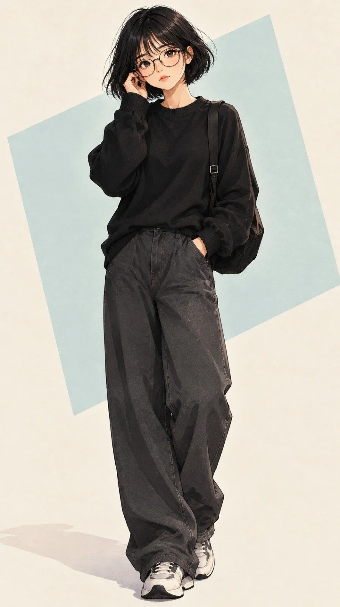

# Anime Four-Character Layered Collage (JSON Prompt)

**中文标题：** 动漫四人分层拼贴（JSON 提示词）  
**ID:** `gi25-x-1361` · **Mode:** `generate`  
**Categories:** `general`  
**Tags:** `x-twitter`, `community`, `gpt-image-2.5`, `x-direct`, `en`



### Anime Four-Character Layered Collage (JSON Prompt)

```text
"style": "Japanese anime manga illustration, clean detailed linework, soft cel shading",
  "aspect_ratio": "9:16",
  "composition": "Vertical layered character collage featuring four female characters. One large central close-up portrait with three smaller portraits arranged around her, partially overlapping naturally.",
  "characters": [
    "Girl 1: short black bob haircut, round glasses, black outfit, calm expression",
    "Girl 2: messy tied-up hair, blue turtleneck, side-facing pose",
    "Girl 3: long wavy brown hair, cream sweater, thoughtful expression",
    "Girl 4: long straight dark hair, red hoodie, gentle expression"
  ],
  "character_design": "Every character must have a distinctly different face, hairstyle, hair length, pose, expression and outfit. No duplicate faces.",
  "colors": "Full colored illustration, individual vibrant but balanced outfit colors, natural skin tones, dark detailed hair, subtle pastel background color blocks.",
  "background": "Minimal clean off-white background with soft colored geometric sections.",
  "quality": "High-quality anime illustration, detailed eyes, expressive faces, beautiful hair rendering.",
  "negative_prompt": "No text, no watermark, no logos, no grayscale, no monochrome, no repeated characters, no identical faces."
}
```

- **Recommended model:** `gpt-image-2.5-sunburst`
- **Settings:** _(defaults)_
- **Source:** [community](https://x.com/hey_am_cherry/status/2117465842309021716) — @hey_am_cherry
- **License note:** Original public X post; quoted with attribution — remix with attribution
- **Notes:** Collected directly from X; original post https://x.com/hey_am_cherry/status/2117465842309021716; post text names GPT Image 2.5; discovered via X search, prompt re-verified against the original X post via api.fxtwitter.com; verified=True
- **Preview:** `previews/gi25-x-1361.webp`
