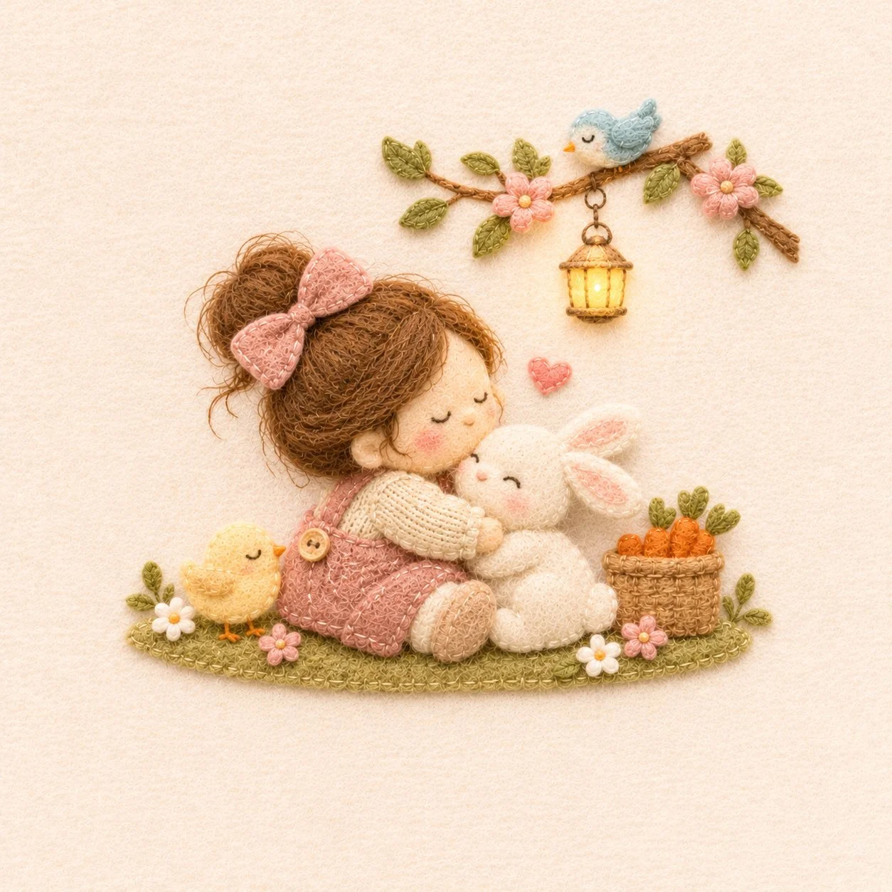

# Korean Handmade Felt Appliqué Cute Illustration

**中文标题：** 韩式手工毛毡贴布可爱插画  
**ID:** `gi25-x-1362` · **Mode:** `generate`  
**Categories:** `general`  
**Tags:** `x-twitter`, `community`, `gpt-image-2.5`, `x-direct`, `en`



### Korean Handmade Felt Appliqué Cute Illustration

```text
Create an exceptionally cute, heartwarming minimalist handmade felt applique illustration.

Imagine a tiny, adorable scene crafted as a premium piece of Korean handmade fabric artwork.

Use soft felt, wool, delicate embroidery, and cozy knitted textures.

Simplify all elements into soft, large rounded shapes.

Create adorable characters with:
Tiny proportions, cute hairstyles, cozy outfits, natural poses, sweet interactions, and a few charming details.

Keep facial features extremely minimal, with tiny embroidered eyes, subtle smiles, and soft rosy cheeks.

Use soft muted colors:
Cream, milk beige, oatmeal, dusty pink, sage green, soft brown, pale blue, buttery yellow, and warm ivory.

Create subtle fuzzy felt edges, delicate visible stitching, layered wool textures, and natural handmade imperfections.

Capture a genuinely sweet, emotional, playful, or cozy little moment.

Every new illustration should feature a fresh, unique, imaginative concept with different characters, poses, and storytelling. Avoid repeating previous scenes.

The artwork itself should be small within a large warm-white, softly textured fabric background.

Extremely generous negative space.

Soft.
Adorable.
Heartwarming.
Cozy.
Dreamy.
Tactile.
Minimal.
Beautifully handcrafted.

It should look like a tiny, precious Korean handmade lifestyle goods artwork, with premium artisan quality and irresistible cuteness.

Square 1:1 composition.

NO text.
NO realistic faces.
NO photorealism.
NO glossy 3D effect.
NO overcrowded scenes.
NO repetitive concepts.
NO dense details.
```

- **Recommended model:** `gpt-image-2.5-sunburst`
- **Settings:** _(defaults)_
- **Source:** [community](https://x.com/frametheory058/status/2117466753081217397) — @frametheory058
- **License note:** Original public X post; quoted with attribution — remix with attribution
- **Notes:** Collected directly from X; original post https://x.com/frametheory058/status/2117466753081217397; post text names GPT Image 2.5; discovered via X search, prompt re-verified against the original X post via api.fxtwitter.com; verified=True; post says it was made with GPT Image 2.5 on OpenArt
- **Preview:** `previews/gi25-x-1362.webp`
