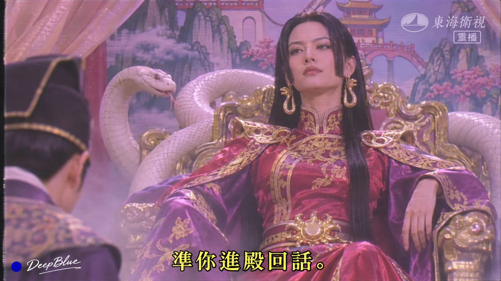

# Anime Characters in a Y2K Hong Kong/Taiwan Mythic TV Drama Still

**中文标题：** 动漫角色×千禧年港台古装神话剧截图  
**ID:** `gi25-x-1363` · **Mode:** `generate`  
**Categories:** `general`, `poster-typography`  
**Tags:** `x-twitter`, `community`, `gpt-image-2.5`, `x-direct`, `zh`



### Anime Characters in a Y2K Hong Kong/Taiwan Mythic TV Drama Still

```text
动漫或游戏女性角色× 千禧年港台古装神话剧 × 真人电视剧画面

每张随机选择一位不同的成年动漫或游戏女性角色，将其转译为2000年代港台古装神话电视剧中的真人角色。可从原神、崩坏：星穹铁道、海贼王、最终幻想等作品中开放选择。

保留角色标志性的发型、配色、服饰轮廓与关键配饰，使其清晰可辨。结合角色气质，将造型改编为当年的古装戏服：化纤绸缎、轻纱、亮片头饰与略显廉价的金属道具，呈现真实演员穿着戏服的效果。

根据角色的故事、性格或能力，设计一幕符合古装神话剧情的画面。人物正在经历具体事件，可以施法、交谈、对峙或做出其他符合情境的动作。表演认真投入，略带当年电视剧特有的戏剧感。

场景为摄影棚搭建的古装布景，结合剧情自由变化。适当出现干冰烟雾、手绘背景、塑料花草或简易道具，让场景具有当年电视剧的制作感。

画面呈现千禧年电视播出的怀旧质感：偏平的棚内布光、轻柔光晕、轻微色偏和边缘柔化，适量保留录像带噪点或扫描线。人物五官与角色特征清晰可辨。

画面底部显示一行黄色宋体繁体中文字幕，带黑色描边。内容为一句符合角色性格与当前剧情的简短台词。右上角有半透明电视台台标与「重播」字样。

每张独立变化角色、剧情、动作、场景与构图，保持同一年代的电视剧质感。

n=10，16:9横版，每张独立生成。

左下角签名：深蓝色实心圆点，后接白色手写体「DeepBlue」。
```

- **Recommended model:** `gpt-image-2.5-sunburst`
- **Settings:** _(defaults)_
- **Source:** [community](https://x.com/DeepBlueX0/status/2117468719685177759) — @DeepBlueX0
- **License note:** Original public X post; quoted with attribution — remix with attribution
- **Notes:** Collected directly from X; original post https://x.com/DeepBlueX0/status/2117468719685177759; post text names GPT Image 2.5; discovered via X search, prompt re-verified against the original X post via api.fxtwitter.com; verified=True; batch prompt (n=9/10 independent images, each a different character/subject); preview is image 1
- **Preview:** `previews/gi25-x-1363.webp`
