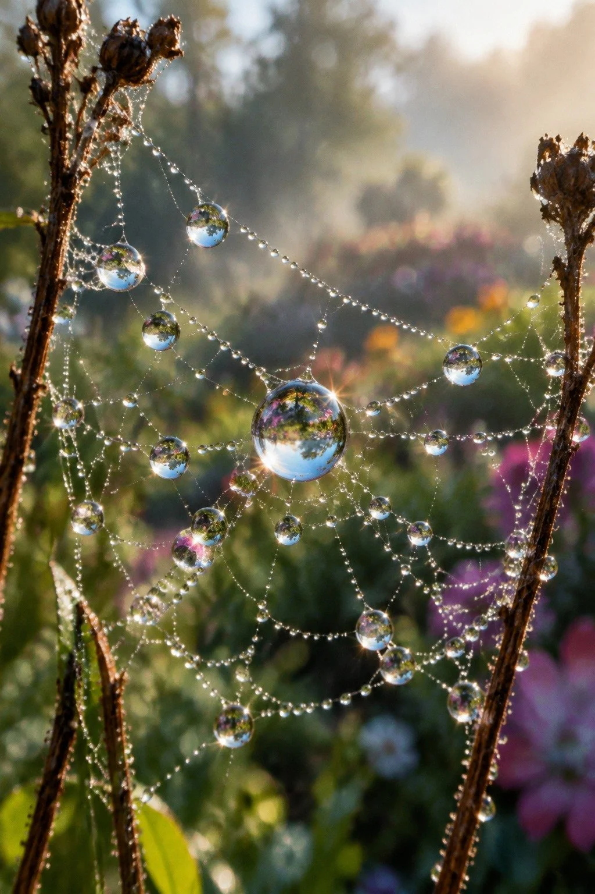

# Dewdrop Spiderweb Garden Macro

**中文标题：** 蛛网露珠花园微距  
**ID:** `gi25-x-1364` · **Mode:** `generate`  
**Categories:** `general`  
**Tags:** `x-twitter`, `community`, `gpt-image-2.5`, `x-direct`, `zh`



### Dewdrop Spiderweb Garden Macro

```text
清晨花园里的极致微距特写，一张精细蛛网挂在两枝枯草之间，蛛丝上凝结着十几颗晶莹的露珠，每颗露珠里都倒映着身后模糊的花丛与晨光；蛛丝纤细到几乎透明，根根分明，露珠表面张力饱满、边缘锐利；背景是柔和的绿色花园bokeh光斑，清晨薄雾漂浮；100mm微距镜头，f/2.8大光圈，焦点落在中央最大的一颗露珠上，浅景深虚化前后蛛丝；5500K自然晨光从侧面打过来，露珠内部折射出细腻的光谱；Eastmancolor胶片模拟，细腻film grain颗粒，真实照片质感；情绪安静、精密如珠宝；ultra-detailed, photorealistic, macro photography. No oil painting, No anime, No 3D render, No deformed droplets, No text, No watermark.
```

- **Recommended model:** `gpt-image-2.5-sunburst`
- **Settings:** _(defaults)_
- **Source:** [community](https://x.com/CandyTravelight/status/2117469316010635499) — @CandyTravelight
- **License note:** Original public X post; quoted with attribution — remix with attribution
- **Notes:** Collected directly from X; original post https://x.com/CandyTravelight/status/2117469316010635499; post text names GPT Image 2.5; discovered via X search, prompt re-verified against the original X post via api.fxtwitter.com; verified=True; comparison post (image 1 GPT Image 2.5, image 2 Grok Imagine 2); preview is image 1, the GPT Image 2.5 result
- **Preview:** `previews/gi25-x-1364.webp`
