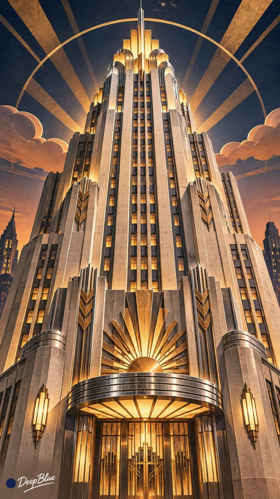

# Art Deco Reinterpretation Series Across Themes

**中文标题：** Art Deco 装饰艺术多主题重绘系列  
**ID:** `gi25-x-1367` · **Mode:** `generate`  
**Categories:** `general`  
**Tags:** `x-twitter`, `community`, `gpt-image-2.5`, `x-direct`, `zh`



### Art Deco Reinterpretation Series Across Themes

```text
Art Deco 装饰艺术 × 多领域主题 × 几何造型与装饰秩序 × 复古现代美学

每张从艺术、建筑、人物、神话、自然、科技、日常物品及流行文化中随机选择一个不同的主体，结合主体特点，自主选择适合的 Art Deco 视觉方向。

以1920至1930年代装饰艺术的设计语言重新诠释主体。提炼其标志性轮廓，将主要形体概括为清晰的几何结构与流畅曲面，保留必要识别特征。

运用放射、阶梯、折线、扇形或其他装饰艺术母题，建立富有节奏的视觉关系。装饰与主体造型自然融合，疏密有致。

根据题材选择协调的色彩与材质，可以呈现高级漆器与金属、建筑石材、光滑丝缎、复古平面印刷或流线型工业材料，保持整体视觉语言统一。

自由安排主体姿态、景别、视角、位置及画面留白，突出鲜明轮廓、几何秩序与视觉张力。

同批作品的主体、主要构图、装饰母题及色彩关系具有明显差异。

竖版9:16。左下角保留克制的深蓝色实心圆点与白色手写体“DeepBlue”签名。

n=10，每张独立生成，不制作拼图。
```

- **Recommended model:** `gpt-image-2.5-sunburst`
- **Settings:** _(defaults)_
- **Source:** [community](https://x.com/DeepBlueX0/status/2117491333145186495) — @DeepBlueX0
- **License note:** Original public X post; quoted with attribution — remix with attribution
- **Notes:** Collected directly from X; original post https://x.com/DeepBlueX0/status/2117491333145186495; post text names GPT Image 2.5; discovered via X search, prompt re-verified against the original X post via api.fxtwitter.com; verified=True; batch prompt (n=9/10 independent images, each a different character/subject); preview is image 1
- **Preview:** `previews/gi25-x-1367.webp`
