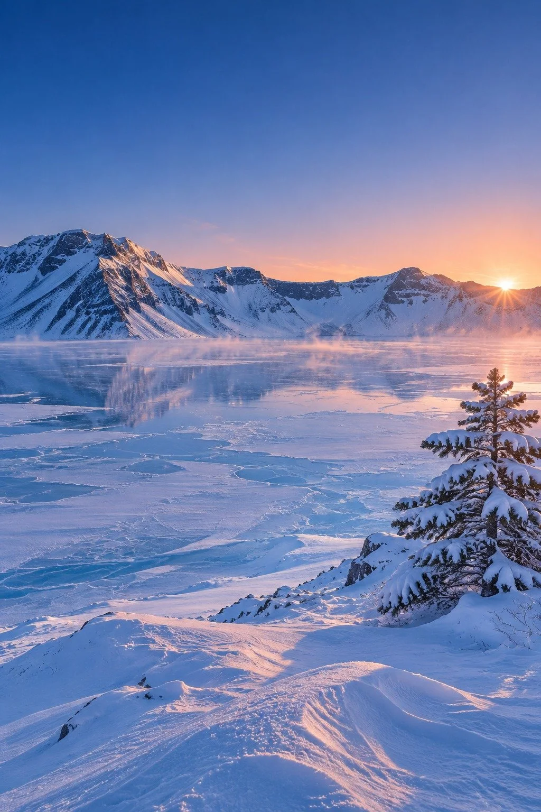

# Changbai Mountain Heaven Lake Winter Dawn Landscape

**中文标题：** 长白山天池冬日黎明雪景  
**ID:** `gi25-x-1370` · **Mode:** `generate`  
**Categories:** `general`  
**Tags:** `x-twitter`, `community`, `gpt-image-2.5`, `x-direct`, `en`



### Changbai Mountain Heaven Lake Winter Dawn Landscape

```text
Breathtaking winter landscape photograph of Heaven Lake on Changbai Mountain in deep winter, shot at blue-hour dawn after a fresh snowfall. Environment: a vast frozen volcanic crater lake at high altitude, its ice surface covered in wind-sculpted snow drifts and pale blue cracks, ringed by steep snow-capped crater ridges under a clear, cold sky shifting from deep indigo to soft rose-gold at the horizon. Subject details: the still, glassy frozen lake occupies the lower half, reflecting the ridgeline; a thin veil of ice fog drifts low over the snow, a lone snow-laden pine clump anchors the right foreground, and tiny wind-carved sastrugi patterns texture the snowfield. Atmosphere particles: fine blowing snow crystals catching the first light, thin mist rising where cold air meets the ice. Lighting: low, raking dawn sunlight from the east at 3500K, long blue shadows across the snow, crisp highlights on the ridge crests, soft fill from the pale sky. Background layers: foreground snow drifts, midground frozen lake, background crater wall, distant sky gradient, creating deep layered depth. Camera: eye-level tripod shot, 24mm wide-angle lens, f/8, deep depth of field, sharp from foreground to horizon, vertical 9:16 composition. Color grade: cool blue-white snow with warm rose-gold dawn accents, Eastmancolor film simulation, subtle film grain, natural contrast, no oversaturation. Composition: rule of thirds, lake horizon on the upper third line, generous negative space in the sky, leading snow ridge guiding the eye into the crater. High resolution, photorealistic, ultra-detailed snow texture. No people, no buildings, no text, no watermark, no oil painting, no anime, no 3D render, no oversaturated colors, no distorted perspective.
```

- **Recommended model:** `gpt-image-2.5-sunburst`
- **Settings:** _(defaults)_
- **Source:** [community](https://x.com/CandyTravelight/status/2117874495453114651) — @CandyTravelight
- **License note:** Original public X post; quoted with attribution — remix with attribution
- **Notes:** Collected directly from X; original post https://x.com/CandyTravelight/status/2117874495453114651; post text names GPT Image 2.5; discovered via X search, prompt re-verified against the original X post via api.fxtwitter.com; verified=True; comparison post (image 1 GPT Image 2.5, image 2 Grok Imagine 2); preview is image 1, the GPT Image 2.5 result
- **Preview:** `previews/gi25-x-1370.webp`
