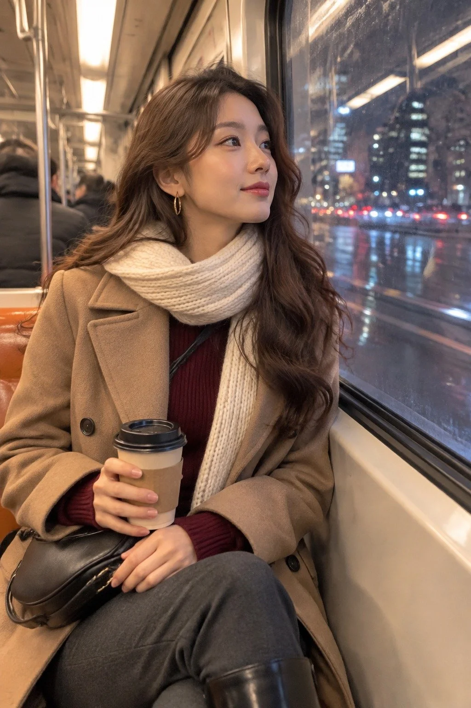

# Candid iPhone Winter Subway Commute Portrait

**中文标题：** 冬夜地铁通勤·iPhone抓拍人像  
**ID:** `gi25-x-1371` · **Mode:** `generate`  
**Categories:** `general`  
**Tags:** `x-twitter`, `community`, `gpt-image-2.5`, `x-direct`, `en`



### Candid iPhone Winter Subway Commute Portrait

```text
Candid iPhone-style photorealistic portrait of a 20-year-old East Asian woman riding a subway train on a cold winter evening, shot like a spontaneous handheld phone photo. Person: a young woman around 20, slender and naturally proportioned, fresh youthful face with soft features. Face and hair: light natural makeup, clear skin with visible pores and real texture, no plastic smoothing, long big-wave dark brown hair falling over one shoulder, a few loose strands catching the light. Expression: calm, slightly dreamy gaze out of the window, lips softly closed, a faint thoughtful smile. Outfit: a fitted camel double-breasted wool coat worn open over a burgundy fitted ribbed knit sweater, slim charcoal wool trousers, black knee-high leather boots, a cream chunky knit scarf loosely wrapped, thin gold hoop earrings, a small black leather shoulder bag on her lap. Pose and props: seated by the window, body angled toward the glass, one hand holding a warm paper coffee cup, the other resting lightly on her bag, knees together, shoulders relaxed. Environment: foreground blurred subway window frame and faint condensation, midground her seated figure and warm interior seats, background speeding city lights and dark winter streets streaking past the glass, reflections of carriage lights doubling on the window. Lighting: warm 3200K carriage ceiling light from above mixing with cool blue-white 5500K light spilling from the window, soft shadows on her face, gentle rim light on her hair. Camera: handheld iPhone main camera look, 24mm lens, f/1.8, chest-up framing, slight candid tilt, shallow depth of field, background lights melting into soft bokeh, subtle handheld motion and light digital noise. Color grade: warm amber interior against cold blue night outside, natural skin tones, Eastmancolor film simulation, fine film grain, realistic contrast. Mood: quiet, stylish, cinematic winter commute, a stolen moment between stops. Style: ultra-realistic phone photography, fashion-editorial attitude expressed through tailoring, color blocking and poise. High resolution, photorealistic, ultra-detailed fabric and skin texture. No text, no watermark, no oil painting, no anime, no 3D render, no deformed hands, no plastic skin, no over-smoothing, no oversaturation.
```

- **Recommended model:** `gpt-image-2.5-sunburst`
- **Settings:** _(defaults)_
- **Source:** [community](https://x.com/JimmyCarsttle/status/2117855567935152478) — @JimmyCarsttle
- **License note:** Original public X post; quoted with attribution — remix with attribution
- **Notes:** Collected directly from X; original post https://x.com/JimmyCarsttle/status/2117855567935152478; post text names GPT Image 2.5; discovered via X search, prompt re-verified against the original X post via api.fxtwitter.com; verified=True; comparison post (image 1 GPT Image 2.5, image 2 Grok Imagine 2); preview is image 1, the GPT Image 2.5 result
- **Preview:** `previews/gi25-x-1371.webp`
