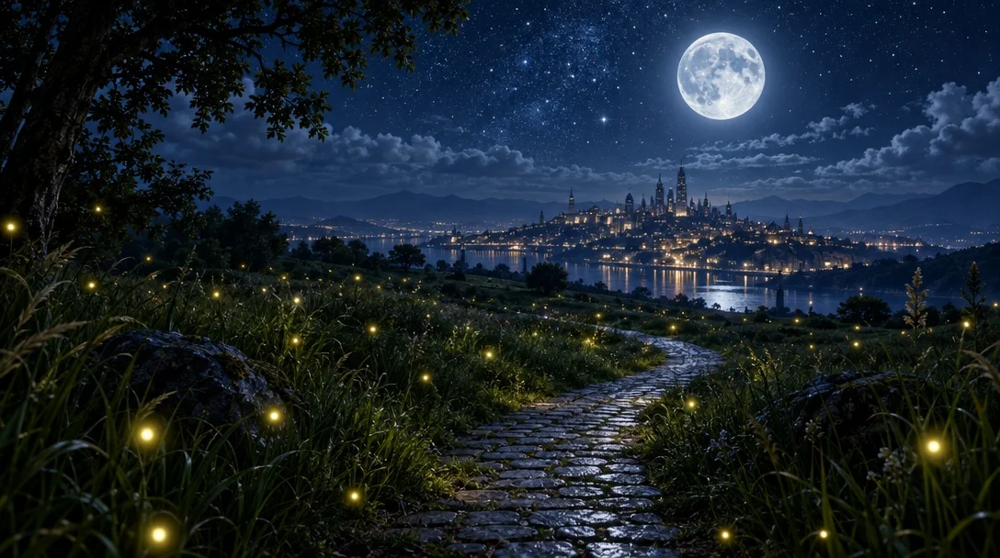

# Moonlit Cobblestone Path with Fireflies and City Skyline

**中文标题：** 月夜萤火鹅卵石小径与城市天际线  
**ID:** `gi25-x-1374` · **Mode:** `generate`  
**Categories:** `general`  
**Tags:** `x-twitter`, `community`, `gpt-image-2.5`, `x-direct`, `en`



### Moonlit Cobblestone Path with Fireflies and City Skyline

```text
A moonlit night scene with a cobblestone path winding through tall grass illuminated by glowing orbs, possibly fireflies, leading toward a distant city skyline under a star-filled sky. The composition is balanced with the moon as a focal point, and the style combines realism with a touch of fantasy, evoking a calm and enchanting mood.
```

- **Recommended model:** `gpt-image-2.5-sunburst`
- **Settings:** _(defaults)_
- **Source:** [community](https://x.com/churvikv/status/2117674598577701108) — @churvikv
- **License note:** Original public X post; quoted with attribution — remix with attribution
- **Notes:** Collected directly from X; original post https://x.com/churvikv/status/2117674598577701108; post text names GPT Image 2.5; discovered via X search, prompt re-verified against the original X post via api.fxtwitter.com; verified=True; created on Somake
- **Preview:** `previews/gi25-x-1374.webp`
