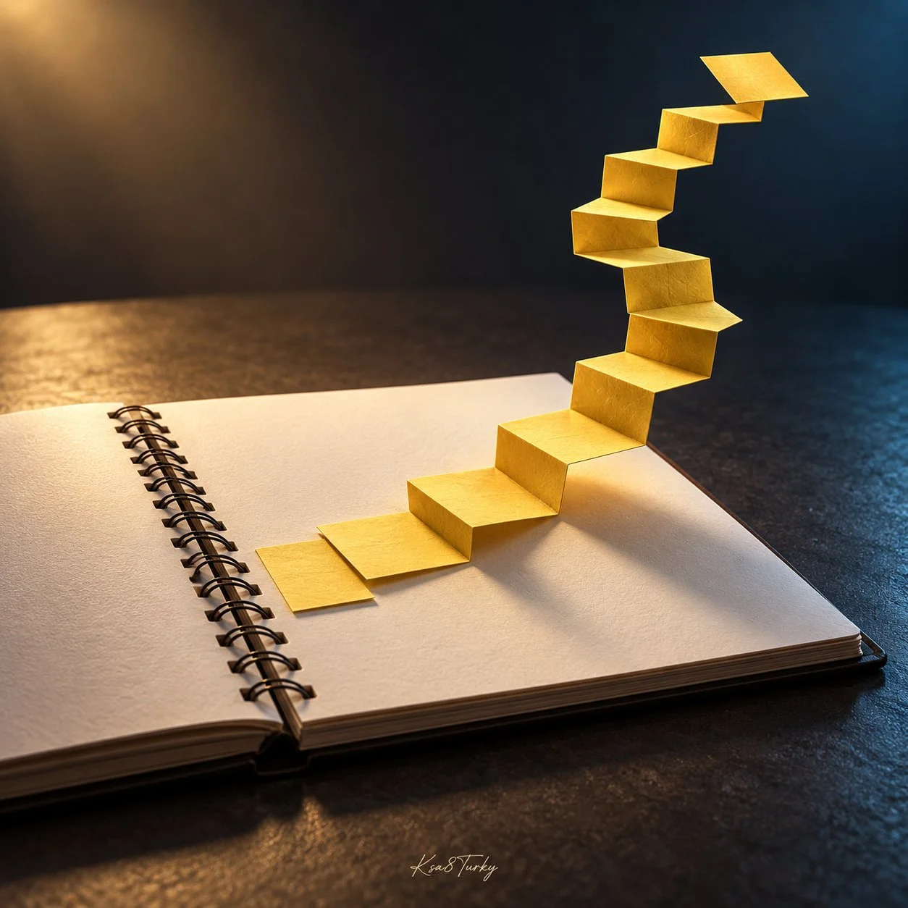

# Desk Material Transforming into Surreal Architecture

**中文标题：** 办公桌材料变身超现实建筑  
**ID:** `gi25-x-1376` · **Mode:** `generate`  
**Categories:** `general`  
**Tags:** `x-twitter`, `community`, `gpt-image-2.5`, `x-direct`, `en`



### Desk Material Transforming into Surreal Architecture

```text
Create a premium square surreal editorial photograph of [EVERYDAY DESK MATERIAL] transforming into [UNEXPECTED ARCHITECTURE] while retaining its texture. Example: golden-yellow sticky-note paper rises from an open ivory spiral notebook into one continuous folded-paper staircase. Lower steps remain flat notes; upper steps curve into empty space. Charcoal tabletop, warm grazing light, cool rim light, paper fibers and convincing shadows. No people, logos or captions. Small handwritten Ksa8Turky at bottom center, safe margin.
```

- **Recommended model:** `gpt-image-2.5-sunburst`
- **Settings:** _(defaults)_
- **Source:** [community](https://x.com/ksa8Turky/status/2117633146409898429) — @ksa8Turky
- **License note:** Original public X post; quoted with attribution — remix with attribution
- **Notes:** Collected directly from X; original post https://x.com/ksa8Turky/status/2117633146409898429; post text names GPT Image 2.5; discovered via X search, prompt re-verified against the original X post via api.fxtwitter.com; verified=True
- **Preview:** `previews/gi25-x-1376.webp`
