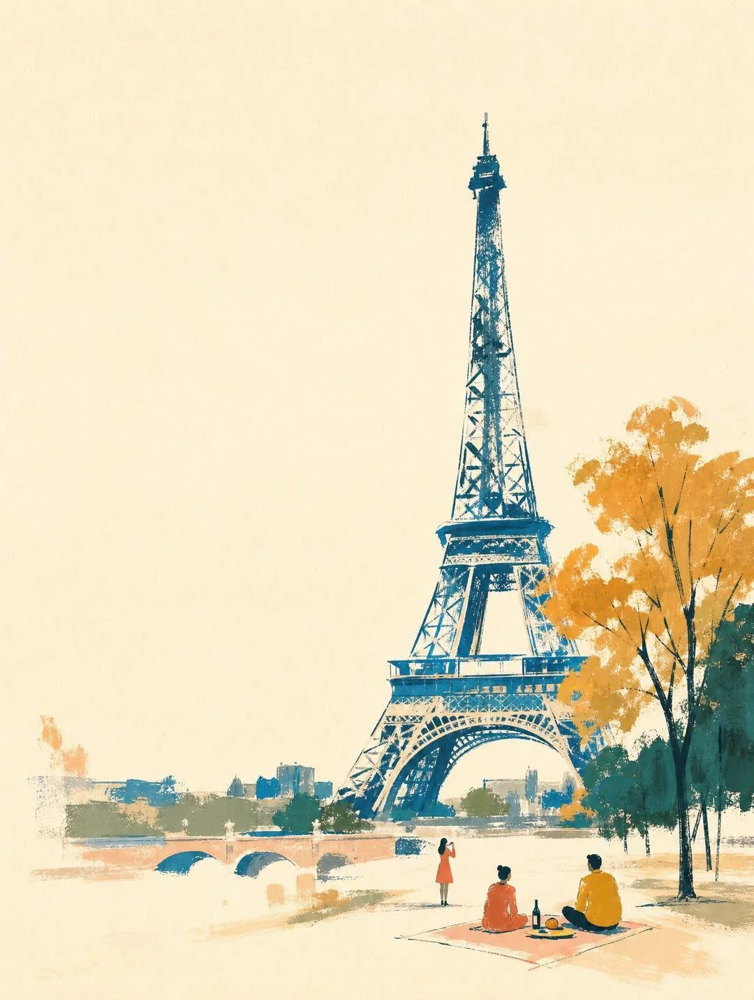

# Hand-Painted Landmark Landscape with Negative Space

**中文标题：** 留白手绘地标风景插画  
**ID:** `gi25-x-1382` · **Mode:** `generate`  
**Categories:** `general`  
**Tags:** `x-twitter`, `community`, `gpt-image-2.5`, `x-direct`, `en`



### Hand-Painted Landmark Landscape with Negative Space

```text
A wide horizontal landscape hand-painted illustration of [LANDMARK NAME] in [CITY/COUNTRY] with strong emphasis on negative space and quiet composition. 

The image features a warm off-white cream paper background that occupies 40-50% of the total canvas, creating generous blank margins and breathing room. 

The [LANDMARK NAME] is positioned slightly off-center as a calm visual anchor, depicted through simplified [KEY ARCHITECTURAL FEATURES - e.g., "towering structures", "iconic silhouette", "distinctive archways"] with loose, expressive brush strokes. The landmark is suggested through minimal rhythmic marks and abstract color blocks in deep teal, cobalt blue, and forest green, rather than drawing every architectural detail precisely.

The composition is sparse and uncluttered: only a few carefully placed elements including 2-3 tiny human figures [DOING TYPICAL ACTIVITY - e.g., "walking", "taking photos", "sitting"] rendered as simple silhouettes in coral red and mustard yellow, one small [CONTEXTUAL ELEMENT - e.g., "cafe table", "bench", "street vendor cart"] with minimal shapes, two or three [NATURAL ELEMENTS - e.g., "potted plants", "trees", "flowers"] in emerald green, and subtle [CULTURAL/ARCHITECTURAL HINTS - e.g., "traditional roof lines", "modern glass panels", "historic columns"].

Large areas of the warm paper background remain completely untouched, especially around the edges and between elements.

The style combines mid-century travel poster aesthetics with contemporary [REGIONAL] editorial illustration: elegant, minimal, warm, cultured, and slightly nostalgic.

The texture shows loose hand-painted gouache and pastel marks with dry brush strokes, pastel smudges, wax-crayon edges, uneven color patches, imperfect handmade edges, and visible gaps between colored areas.

Colors are layered, dry, and tactile with a restrained palette of deep teal, sky blue, coral red, salmon pink, mustard yellow, ochre, terracotta, and small near-black accents, but used sparingly so each color can breathe against the paper.

The overall mood is quiet, spacious, relaxed, refined, like a sophisticated [CITY] cultural postcard or handmade art print suitable for premium lifestyle merchandise.

The landmark remains recognizable through its essential identity—[DEFINING CHARACTERISTICS]—but the drawing stays airy, calm, poetic, and softly abstract.

Strong sense of pause, breath, and refined emptiness with confident use of blank space.

No crowded composition, no full-bleed busy background, no photorealism, no glossy digital rendering, no clean vector art, no 3D rendering, no text, no signage, no logos, no readable text.
```

- **Recommended model:** `gpt-image-2.5-sunburst`
- **Settings:** _(defaults)_
- **Source:** [community](https://x.com/Maercihh/status/2117592215602233781) — @Maercihh
- **License note:** Original public X post; quoted with attribution — remix with attribution
- **Notes:** Collected directly from X; original post https://x.com/Maercihh/status/2117592215602233781; post text names GPT Image 2.5; discovered via X search, prompt re-verified against the original X post via api.fxtwitter.com; verified=True; fill-in template for [LANDMARK NAME]
- **Preview:** `previews/gi25-x-1382.webp`
