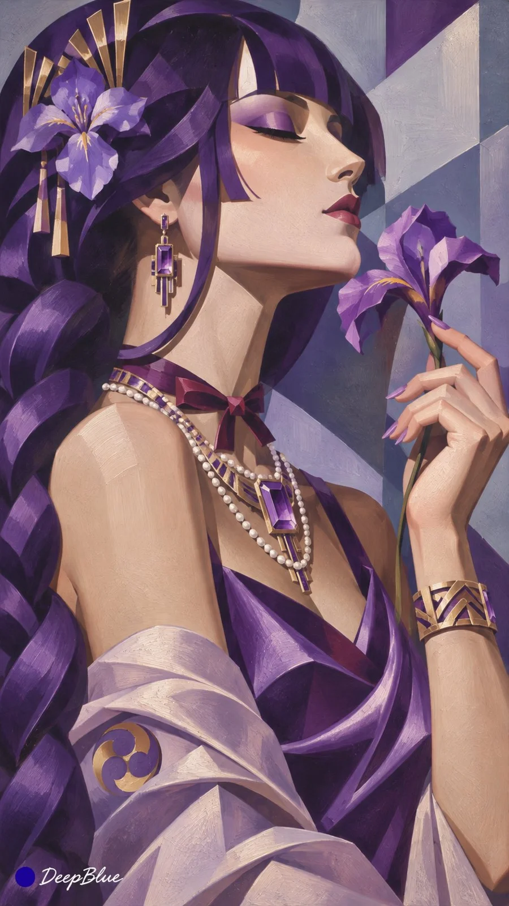

# Anime Characters as Art Deco Lempicka-Style Portraits

**中文标题：** 动漫角色×Art Deco莱姆皮卡风人物画  
**ID:** `gi25-x-1387` · **Mode:** `generate`  
**Categories:** `general`  
**Tags:** `x-twitter`, `community`, `gpt-image-2.5`, `x-direct`, `zh`



### Anime Characters as Art Deco Lempicka-Style Portraits

```text
动漫或游戏女性角色 × Art Deco 人物绘画 × 雕塑感造型 × 几何色面

每张随机选择一位不同的成年动漫或游戏女性角色，保留标志性发型、面部特征、服饰轮廓、配饰与代表色，使角色清晰可辨。

参考 Tamara de Lempicka 的装饰艺术人物绘画，将角色转译为1920至1930年代的摩登女性形象。人物具有优雅而鲜明的雕塑感，面部、身体与服装由概括的大块明暗和几何曲面塑造，体态自然，姿态富有个性。

结合角色气质重新设计具有 Art Deco 特征的服装、妆发与珠宝，让角色原有造型与摩登装饰艺术自然融合。丝缎、金属与光滑肌肤通过简洁明暗表现材质差异。

背景以建筑切面、阶梯结构、几何色块或抽象都市景观概括，与人物形成统一的造型节奏。根据角色选择协调而鲜明的配色。

自由变化人物姿态、视线、景别、机位与画面位置，允许大胆裁切和大面积留白。画面具有装饰艺术的精致、摩登与戏剧感，整体笔法统一，细节克制。

同批角色、动作、构图和主色调保持明显差异。

竖版9:16，左下角深蓝色实心圆点与白色手写体“DeepBlue”签名。

n=10，每张独立生成。
```

- **Recommended model:** `gpt-image-2.5-sunburst`
- **Settings:** _(defaults)_
- **Source:** [community](https://x.com/DeepBlueX0/status/2117818880966234562) — @DeepBlueX0
- **License note:** Original public X post; quoted with attribution — remix with attribution
- **Notes:** Collected directly from X; prompt posted as the author's own reply https://x.com/DeepBlueX0/status/2117818880966234562 to https://x.com/DeepBlueX0/status/2117818863173915096, which carries the images; GPT Image 2.5 is named in the reply; discovered via X search, prompt re-verified against the original X post via api.fxtwitter.com; verified=True; batch prompt (n=9/10 independent images, each a different character); preview is image 1
- **Preview:** `previews/gi25-x-1387.webp`
