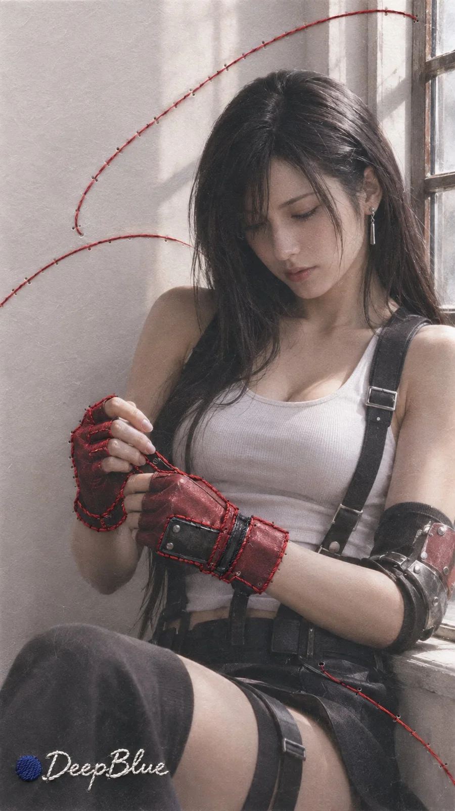

# Anime Characters as Photo Prints with Hand Embroidery

**中文标题：** 动漫角色实体照片×手工刺绣二次扫描  
**ID:** `gi25-x-1388` · **Mode:** `generate`  
**Categories:** `general`  
**Tags:** `x-twitter`, `community`, `gpt-image-2.5`, `x-direct`, `zh`



### Anime Characters as Photo Prints with Hand Embroidery

```text
动漫或游戏女性角色 × 实体摄影再加工 × 手工刺绣 × 二次扫描 × 极简编辑式构图

每张独立随机选择一位不同的成年动漫或游戏女性角色。

保留角色标志性的发型、服饰轮廓、配饰与代表色，将角色转译为具有真实摄影质感的人物形象。

首先制作一张具有自然光影和纸张纹理的实体照片。

根据角色性格、故事和视觉特征，在照片表面局部加入真实手工刺绣。刺绣与人物发型、服饰或环境自然呼应，部分针迹可跨越人物与背景的交界。

保留真实线材厚度、穿针痕迹、纸张纤维与细微阴影，让刺绣与照片的材质区别清晰可辨。

随后重新扫描整张照片，形成真实摄影与实体刺绣融合的完整图像。

人物保持清晰可辨，刺绣集中于局部，成为具有明确视觉重心的材料元素。

东方极简编辑式构图，留白自然，画面干净，材料质感真实。

每张独立变化角色、刺绣方式、构图与色彩。

n=9，9:16竖版，每张独立生成，不制作拼图。

左下签名：深蓝色实心圆点在前，白色手写体 DeepBlue 在后

圆点与文字均以手工刺绣呈现，保留清晰可读的字形、细密针脚和轻微线材立体感，与照片一同扫描。
```

- **Recommended model:** `gpt-image-2.5-sunburst`
- **Settings:** _(defaults)_
- **Source:** [community](https://x.com/DeepBlueX0/status/2117654047935348933) — @DeepBlueX0
- **License note:** Original public X post; quoted with attribution — remix with attribution
- **Notes:** Collected directly from X; prompt posted as the author's own reply https://x.com/DeepBlueX0/status/2117654047935348933 to https://x.com/DeepBlueX0/status/2117653994072096850, which carries the images; GPT Image 2.5 is named in the reply; discovered via X search, prompt re-verified against the original X post via api.fxtwitter.com; verified=True; batch prompt (n=9/10 independent images, each a different character); preview is image 1 (work-mode output)
- **Preview:** `previews/gi25-x-1388.webp`
