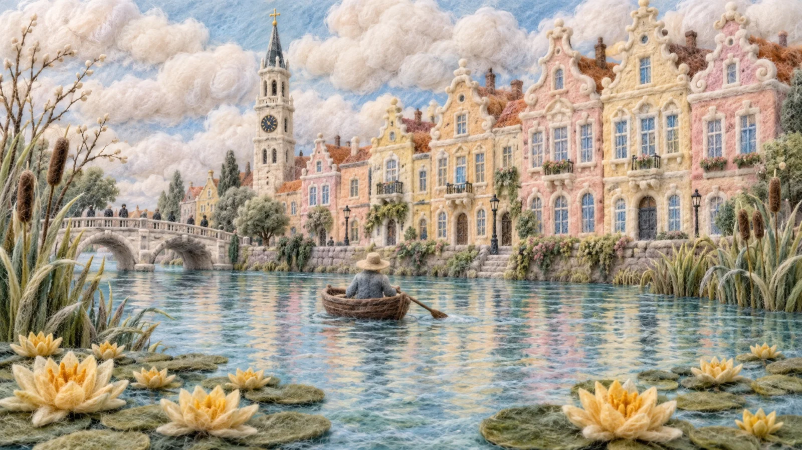

# Soft Cotton-Wool Relief Panoramic Landscape

**中文标题：** 棉絮羊毛浮雕全景风景  
**ID:** `gi25-x-1390` · **Mode:** `generate`  
**Categories:** `general`  
**Tags:** `x-twitter`, `community`, `gpt-image-2.5`, `x-direct`, `en`



### Soft Cotton-Wool Relief Panoramic Landscape

```text
Soft cotton-wool relief artwork photographed flat, wide 16:9 panoramic composition. Every form is sculpted from fluffy white cotton batting, felted wool and airy pulled fibre, so the scene looks puffy and three-dimensional, like clouds pressed into shapes. Surfaces are matte, fuzzy and softly fibrous, with loose wisps of fluff at every edge, no hard outlines, gentle shadows between the puffed shapes to show real volume.

SKY: billowing tufts of pulled cotton in ivory and cream, layered into rounded cloud masses across the upper third, pale blue backing showing through the gaps.

FACADES: a row of ornate old-European townhouses fills the right half and centre, pressed felted wool in pale blush pink, butter yellow and creamy ochre, with faded apricot patches worked into the surface. Stepped baroque gables crown the roofs, tiny rolled-wool finials along the ridges, rows of tall windows with pale blue wool glass and white sills raised on every facade. Carved pediments and balconies are puffed shapes.

TOWER: left of centre a tall slender tower rises highest, its spire a slim needle of rolled slate-blue and white fibre with a small cross, a round clock face and arched openings below.

BRIDGE: far left, a pale felt bridge with two low arches crosses the canal, tiny dark wool figures on its parapet.

CANAL: the lower half is calm pale turquoise and powder-blue felt water, combed into fine ripples, with long soft vertical reflections of the pastel buildings in pale violet, cream and mint.

BOAT: at the centre a brown felt rowboat floats, a single figure with back turned in a blue-grey coat and wide straw hat, one oar reaching to the water.

SHORES: dense reeds of pale sage-green fibre blades fringe both banks, with tall cattails and bare twigs at the left edge.

WATER LILIES: golden-yellow lotus blooms with layered pointed felt petals across the lower foreground, on green lily pads.

PALETTE: blush pink, cream, butter yellow, apricot, sage, powder blue, slate, gold. Matte fluff.
```

- **Recommended model:** `gpt-image-2.5-sunburst`
- **Settings:** _(defaults)_
- **Source:** [community](https://x.com/churvikv/status/2117886438691799105) — @churvikv
- **License note:** Original public X post; quoted with attribution — remix with attribution
- **Notes:** Collected directly from X; original post https://x.com/churvikv/status/2117886438691799105; post text names GPT Image 2.5; discovered via X search, prompt re-verified against the original X post via api.fxtwitter.com; verified=True; made with GPT Image 2.5 Sunburst on ImagineArt
- **Preview:** `previews/gi25-x-1390.webp`
