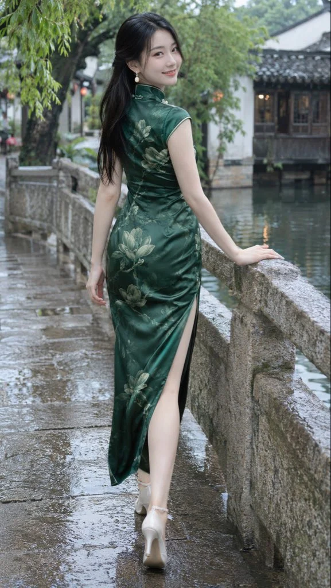

# Jiangnan Water Town Qipao Portrait After Rain

**中文标题：** 江南水乡雨后旗袍写真  
**ID:** `gi25-x-1391` · **Mode:** `generate`  
**Categories:** `general`  
**Tags:** `x-twitter`, `community`, `gpt-image-2.5`, `x-direct`, `zh`



### Jiangnan Water Town Qipao Portrait After Rain

```text
9:16竖版，全身写实人像，江南水乡雨后外景。一位24岁左右的成年东方女性，鹅蛋脸，清秀自然的五官，杏仁眼，小巧鼻梁，薄唇，轻轻露齿微笑，白皙细腻的皮肤保留自然纹理。黑色长发半扎，余下长发自然垂落至背部，脸颊两侧留少量碎发，佩戴精致的水滴形珍珠耳坠。

身穿墨绿色真丝缎面长旗袍，修身收腰剪裁，立领、精巧盘扣、包肩短袖，领口与袖口饰浅色细滚边，裙身带有疏密错落的浅金灰绿色玉兰花枝图案。面料柔软顺滑，呈现克制的丝绸光泽，腰背与臀部有自然的布料褶皱，侧面高开衩，裙长至脚踝，搭配米白色细跟一字扣高跟鞋。

人物背向镜头，身体呈后侧面，腰胯自然微转，上半身向右侧石栏轻靠，头部转向镜头回眸微笑。右手向侧后方伸展，手掌轻搭在湿润的石栏顶部，左臂自然垂落，手指放松。双腿前后错步，靠近镜头的一条腿从旗袍侧开衩处自然显露，小腿修长，膝盖、脚踝与鞋履结构准确，姿势舒展优雅，身体比例真实。

场景为江南古镇临水石桥，脚下是被雨水打湿的青灰色石板路，有浅浅积水与柔和倒影；画面右侧是带有岁月纹理的粗粝石栏及平静河道，远处为白墙黛瓦、深色木窗的临水古建筑。左上方垂落翠绿色柳枝，后方古树与建筑轻微虚化，少量暖色灯光点缀其间。石栏与石板路形成纵深引导线，人物全身完整入镜，头顶与鞋底均留出适当空间。

阴天雨后的柔和漫射自然光，肤色通透，墨绿色旗袍与灰白古建筑形成协调配色。专业摄影师户外人像摄影，约50mm镜头，适度浅景深，对焦人物面部，人物清晰，背景仍保留可辨认的环境细节，画面安静清新，带有自然回眸抓拍感，无文字、无水印。

画面保持干净自然的真实照片质感：不要数字噪点与彩色噪点，不要颗粒覆盖，不要过度锐化，不要 HDR 与油腻高光，不要蜡质表面，不要脏灰色调，不要假细节与压缩伪影。
```

- **Recommended model:** `gpt-image-2.5-sunburst`
- **Settings:** _(defaults)_
- **Source:** [community](https://x.com/krienknight/status/2117897138323784191) — @krienknight
- **License note:** Original public X post; quoted with attribution — remix with attribution
- **Notes:** Collected directly from X; original post https://x.com/krienknight/status/2117897138323784191; post text names GPT Image 2.5; discovered via X search, prompt re-verified against the original X post via api.fxtwitter.com; verified=True
- **Preview:** `previews/gi25-x-1391.webp`
