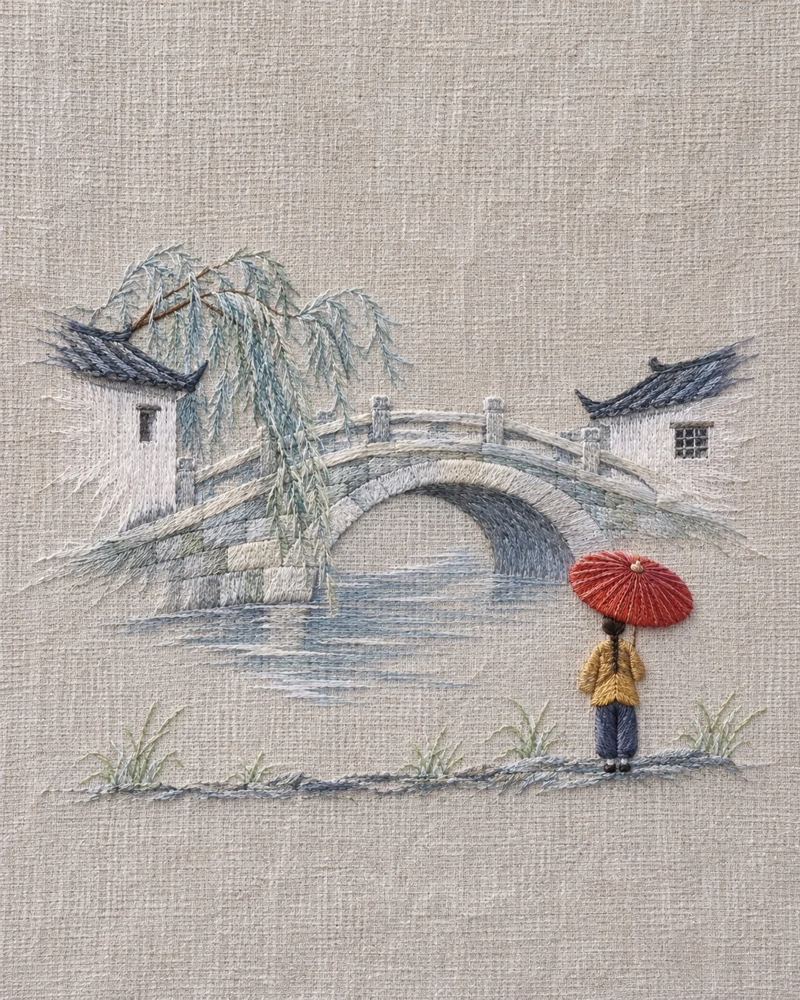

# Linen Embroidery Landscape with Negative Space

**中文标题：** 亚麻布刺绣留白风景  
**ID:** `gi25-x-1396` · **Mode:** `generate`  
**Categories:** `general`  
**Tags:** `x-twitter`, `community`, `gpt-image-2.5`, `x-direct`, `zh`



### Linen Embroidery Landscape with Negative Space

```text
Create an image with the following visual system. Replace the subject as specified.

Visual system (light, color, composition, medium, mood):
一幅竖幅约 4:5 的手工刺绣作品正面实拍，绣在一块米灰色细亚麻布上。机位正对布面平视，近景平拍，没有透视纵深；画面上方约三分之一和主景两侧大面积留给素布，只在中部偏上绣一处主景，主景用丝光绣线的长短针顺着形体方向排线，边缘的线尾故意拉成长短不齐的散针，像融进布里。右下方站着一个只占画面高度约五分之一的小人背影，用填充后的凸起缎面绣做出微浮雕体积，像贴在布面上；最底部是一条窄窄的地面线团，配几簇细直针的小植物。光线是左上方柔和的散射日光，色温中性略暖，线迹表面有细小丝光高光，凸绣小人在布面投下很浅的软阴影。配色：布面米灰为主场，主景以白、雾蓝、灰蓝、靛蓝等冷色或低饱和色铺排，朱红、芥末黄这类暖色只集中在小人身上。能看清麻布经纬纹理、线的捻度和偶尔起毛的纤维。完成态是写实的手作刺绣微距实拍，不要绣绷、花边、满幅刺绣、插画滤镜感或任何文字。安静、清冷，带一点独自远行的感觉。

New subject:
主景是一座江南水乡的单孔石拱桥，桥身用灰白和淡青灰的线顺着拱弧排针，桥下一弯河水用几道浅蓝长针带过，两岸各露出一小截白墙黛瓦的屋檐。右下方河岸上站着一个撑朱红色油纸伞的小人背影，穿芥末黄短外套和深蓝裤子，伞和人都是凸起的缎面绣。底部是一条灰蓝色的河岸线和几簇嫩绿的水草。画面中没有可辨认的文字、品牌或标志。
```

- **Recommended model:** `gpt-image-2.5-sunburst`
- **Settings:** _(defaults)_
- **Source:** [community](https://x.com/static_stare/status/2117952438338572496) — @static_stare
- **License note:** Original public X post; quoted with attribution — remix with attribution
- **Notes:** Collected directly from X; original post https://x.com/static_stare/status/2117952438338572496; post text names GPT Image 2.5; discovered via X search, prompt re-verified against the original X post via api.fxtwitter.com; verified=True; prompt for image 1 of 4 (the author shares the other three on request); preview is image 1
- **Preview:** `previews/gi25-x-1396.webp`
