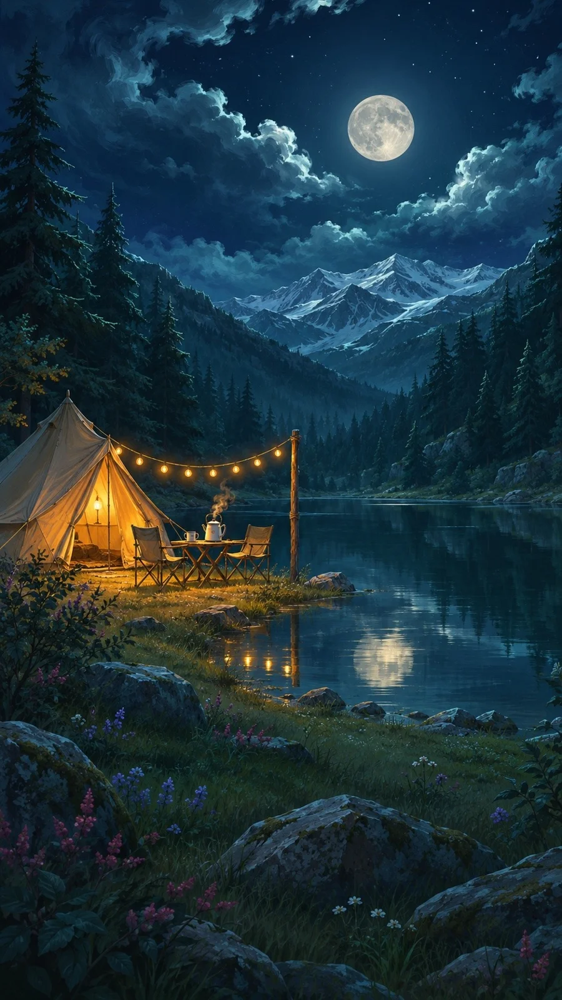

# Moonlit Valley with One Warm Light Night Painting

**中文标题：** 月光山谷一点暖灯夜景绘画  
**ID:** `gi25-x-1397` · **Mode:** `generate`  
**Categories:** `general`  
**Tags:** `x-twitter`, `community`, `gpt-image-2.5`, `x-direct`, `zh`



### Moonlit Valley with One Warm Light Night Painting

```text
Create an image with the following visual system. Replace the subject as specified.

Visual system (light, color, composition, medium, mood):
一幅竖幅约 9:16 的月夜山谷数字绘画，笔触细腻、边缘略带绘画感，介于电影概念图和绘本插画之间。机位在近处低处，平视略仰；近景是草地、石块、灌木或雪堆等深色前景，点缀少量洋红、紫蓝和白色的小色点；中景是画面里唯一的暖光处；远景是两侧高耸的深青绿松林夹出一道山谷，谷底尽头是层叠的雪线山峰，上方大片夜空。一轮满月悬在画面上部正中偏右，月光把周围翻卷的云团边缘照成亮青白色，天空从墨蓝过渡到深靛，散着零星星点。光线分两套：冷的月光从上方后侧打下来，只给松树尖、山脊和云边勾出蓝青色轮廓；暖的人造光集中在中景左下方一小块，橙黄灯光和一串串小灯泡把周围一小片地面和物件照成暖金色，衰减很快。蓝绿和墨蓝占大半画面，暖橙金只占约一成但最亮。不要城市楼群、亮窗成排、霓虹、白天感的天空或过曝的月亮。安静、远离人群、被山围着的温暖。

New subject:
中景是山谷里一片小湖的岸边，一顶尖顶帆布帐篷从里面透出暖黄的灯光，帐篷前拉着一串小灯泡挂到一根木杆上，旁边一张折叠小桌、两把露营椅和一只冒着热气的搪瓷水壶，平静的湖面倒映着月亮和那串灯。画面里没有人，也没有可辨认的文字、品牌或标志。
```

- **Recommended model:** `gpt-image-2.5-sunburst`
- **Settings:** _(defaults)_
- **Source:** [community](https://x.com/static_stare/status/2117983252384223354) — @static_stare
- **License note:** Original public X post; quoted with attribution — remix with attribution
- **Notes:** Collected directly from X; original post https://x.com/static_stare/status/2117983252384223354; post text names GPT Image 2.5; discovered via X search, prompt re-verified against the original X post via api.fxtwitter.com; verified=True; prompt for image 1 of 4 (the author shares the other three on request); preview is image 1
- **Preview:** `previews/gi25-x-1397.webp`
