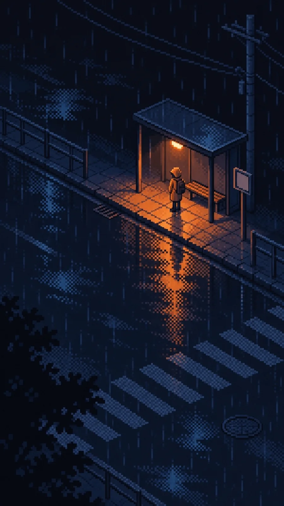

# Rainy Night Street Corner Lamp Pixel Art

**中文标题：** 雨夜街角一盏灯像素画  
**ID:** `gi25-x-1398` · **Mode:** `generate`  
**Categories:** `general`  
**Tags:** `x-twitter`, `community`, `gpt-image-2.5`, `x-direct`, `zh`



### Rainy Night Street Corner Lamp Pixel Art

```text
Create an image with the following visual system. Replace the subject as specified.

Visual system (light, color, composition, medium, mood):
一幅竖幅约 9:16 的雨夜街头像素画。像素颗粒清晰可见，有限调色板，硬边方块像素，渐变和水面反光一律用棋盘格抖动像素表现，不做平滑渐变或模糊。机位在三四层楼高处斜俯视，近似等距视角，斜向的街道边缘、斑马线或栏杆等长线条把画面切成对角线构图。画面里只有一处强光源：一盏暖橙色的灯从上往下照，在地面投出一块边缘清晰的橙色光斑，光里能看到几道短短的像素雨丝；光斑下方的湿地面把灯光和人影拉成一条竖长的倒影，用抖动像素碎成一块块。人物很小，只占画面高度约十分之一，没有面部细节。其余部分全部沉在墨蓝、藏青和蓝黑里，积水只反一点冷蓝天光，远处只留路缘、电线杆、井盖之类的模糊轮廓，画面一角用深色树影或屋檐压边。墨蓝近黑约占八成，暖橙只占一小块但最亮最饱和。不要霓虹招牌、多盏灯争亮、城市楼房亮窗、可读文字、厚涂笔触或平滑渐变。安静、潮湿、有点孤单，但被一盏灯照着。

New subject:
路口边一个小小的公交候车亭，顶棚下一盏暖橙色的灯是唯一亮处，亭子里一个穿雨衣、背着双肩包的上班族站着等车，脚边积水映着灯光，亭边立着一块没有字的空白小站牌，一辆公交车还没来，路面空空的。画面中没有可辨认的文字、品牌或标志。
```

- **Recommended model:** `gpt-image-2.5-sunburst`
- **Settings:** _(defaults)_
- **Source:** [community](https://x.com/static_stare/status/2118207755924152688) — @static_stare
- **License note:** Original public X post; quoted with attribution — remix with attribution
- **Notes:** Collected directly from X; original post https://x.com/static_stare/status/2118207755924152688; post text names GPT Image 2.5; discovered via X search, prompt re-verified against the original X post via api.fxtwitter.com; verified=True; prompt for image 1 of 4 (the author shares the other three on request); preview is image 1
- **Preview:** `previews/gi25-x-1398.webp`
