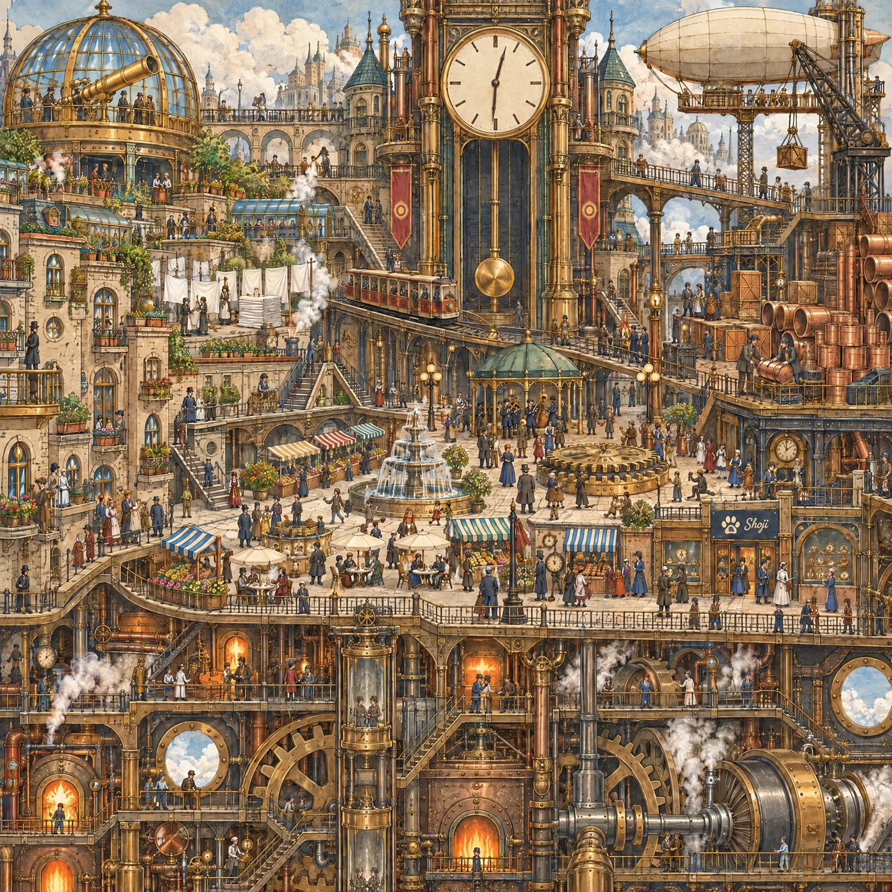

# Seek-and-Find Clockwork Steam City Cutaway

**中文标题：** 找猫图·蒸汽齿轮城市剖面  
**ID:** `gi25-x-1399` · **Mode:** `generate`  
**Categories:** `general`  
**Tags:** `x-twitter`, `community`, `gpt-image-2.5`, `x-direct`, `en`



### Seek-and-Find Clockwork Steam City Cutaway

```text
A gigantic clockwork steam city built into a huge brass-and-copper gear framework, shown as a vast cutaway cross-section, square 1:1, in the spirit of a classic seek-and-find book, seen from an extremely wide straight-on view so that the whole city fits in one picture, everything is tiny and there is an enormous amount to look at. Many decks stacked and interlocked, divided into clear districts by giant slowly turning gears, long iron stairways, steam-tram tracks, copper pipe bundles and glass-roofed arcades. Top left: a brass observation dome with a large brass telescope and an astronomer's gallery. Top right: an airship mooring tower with a plain cigar-shaped airship tied to it and a tall loading crane. Top centre: a gigantic clock tower with a huge clock face that has plain tick marks and no numerals, and a long swinging pendulum in a glass shaft. Centre: a big plaza deck with a round fountain fed by copper pipes, a carousel with plain bench seats, market stalls with striped awnings, cafe tables with umbrellas, a small round bandstand with a brass band, and a big cog-shaped brass dais at the foot of the clock tower. Centre-left: terraced rooftop gardens and a laundry deck with clotheslines of white sheets, a stack of folded white linen and puffs of white steam. Centre-right: a foundry and cargo yard with stacks of copper barrels, banks of copper pipes, cranes and loading carts. Between the districts: a steam tram on a curved elevated track and tightly packed tall narrow apartment blocks with round windows and brass balconies. The lower third of the picture is only the machinery decks: glowing furnaces and boilers, giant meshing gears, pistons, turbines, iron catwalks, round portholes onto a sea of clouds, and working people. About 180 minuscule people in Victorian work clothes, long coats, top hats and aprons with goggles pushed up on their foreheads, each doing something. A standing person is only about 3% of the picture height.

The look is the point: a Victorian steampunk picture-book illustration painted in opaque gouache with fine hand-inked linework and a faint copperplate-engraving texture, aged cream paper grain, a warm limited palette of brass, copper, sepia brown, deep teal, verdigris green, soft amber furnace glow and cream steam, with a muted blue-grey sky of clouds at the top, sharp and crisp everywhere (no blur). Not a photograph, not a 3D render, not a flat digital vector. The picture fills the whole frame to all four edges: no border, no frame, no caption.

Exactly one small logo: a small flat dark navy sign panel above the door of a watchmaker's shop on the plaza deck in the right half of the picture, about 4% of the picture width, with a cream-coloured cat paw print whose big pad holds a swirling ocean wave, and the word "Shoji" in cream cursive brush lettering to its right. Apart from that sign there are no letters, words, numbers or digits anywhere: no shop signs with writing, no clock numerals, no posters; gauges and clocks have plain tick marks only.

THE ONLY ANIMALS IN THE WHOLE PICTURE ARE FOUR CATS, and there are NEVER MORE THAN FOUR: not five, not a spare one, no look-alike twin of any cat. No other animal or creature at all: no mechanical or clockwork animals, no robot dogs or birds, no brass owls, dragons, fish or horses, no pigeons or other birds, no insects; no animal-shaped airships, signs, statues, weathervanes, flags, patches or mascots; nobody wears an animal head, animal ears, a tail or cat ears. The four cats are tiny cats like the people, all at the same distance from the viewer, each in a DIFFERENT kind of place at a DIFFERENT height: their feet are between about 15% and 60% of the picture height measured from the top, and NONE is in the lower third. Each cat is in the open, never hidden behind anything, and each appears only ONCE. The three real cats are each TINY: only about 1.1% of the picture height (about 23 pixels in a 2048-pixel-high picture), about a third of the height of a standing person, a bare cat with only a thin red collar with a tiny gold bell, no goggles and no hat. From left to right:
1. ONE black-and-white "hachiware" cat (black head and back, a white blaze splitting the face, white chest and paws) sitting upright on top of the brass balcony railing of an apartment block at the far left, feet at about 42% of the height. This is the only hachiware cat;
2. ONE calico cat (white with orange and black patches) sitting upright on top of a stack of folded white linen on the laundry deck left of the centre, among hanging white sheets and puffs of white steam, feet at about 33% of the height, its white fur close to the colour of the linen. This is the only calico;
3. Shoji Cat, an upright standing orange tabby cat about three heads tall in a black leather jacket, denim shorts, cream sneakers and black wayfarer sunglasses with blue and red lenses, dancing with one arm raised on the big cog-shaped brass dais at the foot of the clock tower right of the centre, among a few people, feet at about 51% of the height, about one and a half times as tall as each of the other three cats;
4. ONE orange tabby cat (orange fur with darker stripes, white muzzle and chest) sitting upright on top of a stack of copper barrels beside a bank of copper pipes in the foundry yard at the far right, feet at about 36% of the height, its fur close to the colour of the copper. This is the only tabby.
Besides the cats, a few small things to discover, none more eye-catching than anything else: the telescope in its dome, the airship at its mooring tower, and the huge clock with its swinging pendulum.
No black or dark round objects, no piles of dark pieces, and no dark animal-like shapes that could be mistaken for a cat. No watermark.
```

- **Recommended model:** `gpt-image-2.5-sunburst`
- **Settings:** _(defaults)_
- **Source:** [community](https://x.com/Shoji_ai/status/2117927339049017725) — @Shoji_ai
- **License note:** Original public X post; quoted with attribution — remix with attribution
- **Notes:** Collected directly from X; prompt posted as the author's own reply https://x.com/Shoji_ai/status/2117927339049017725 to https://x.com/Shoji_ai/status/2117927337530663414, which carries the images; GPT Image 2.5 is named in the parent post; discovered via X search, prompt re-verified against the original X post via api.fxtwitter.com; verified=True; seek-and-find picture (find the hidden cats)
- **Preview:** `previews/gi25-x-1399.webp`
