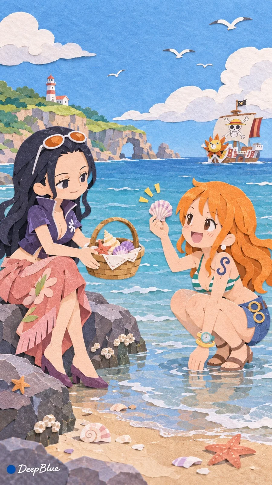

# Chibi Anime Characters as Paper-Collage Picture Book

**中文标题：** Q版动漫角色纸张拼贴绘本  
**ID:** `gi25-x-1401` · **Mode:** `generate`  
**Categories:** `general`  
**Tags:** `x-twitter`, `community`, `gpt-image-2.5`, `x-direct`, `zh`



### Chibi Anime Characters as Paper-Collage Picture Book

```text
動漫或遊戲女性角色 × Q版紙張拼貼繪本 × 治癒互動

每張選擇兩位或多位成年動漫或遊戲女性角色，可以來自同一作品，也可以跨作品同框。

保留每位角色標誌性的髮型、服飾輪廓、配飾與代表色，將其轉譯為圓潤簡潔的Q版形象，使角色清晰可辨。適當概括服飾細節，讓人物造型適合紙片裁切與拼貼。

結合角色的性格、能力或經歷，設計一個溫柔、有趣的共同事件。每位角色以符合自身特點的方式參與，通過動作、視線與彼此的回應，讓互動自然可見。

以手工紙張拼貼繪本的方式呈現人物與環境。用不同顏色的紙片剪裁、疊貼出角色、物件與場景，保留自然的紙張纖維、裁切邊緣、疊層厚度與細微陰影。人物與環境保持統一的紙張材質和拼貼方式。

根據事件安排人物數量、距離和位置，可以親密同框，也可以分布在畫面的不同空間。自由變化景別、視角與畫面結構，讓環境參與敘事，突出人物互動並保留自然的呼吸空間。

每張變化角色組合、互動事件、場景與畫面結構。

竪版 9:16，n=10。每次生成一張獨立單圖，不拼圖。

左下簽名：深藍色實心圓點在前，白色手寫體 DeepBlue 在後
```

- **Recommended model:** `gpt-image-2.5-sunburst`
- **Settings:** _(defaults)_
- **Source:** [community](https://x.com/DeepBlueX0/status/2117939630930858004) — @DeepBlueX0
- **License note:** Original public X post; quoted with attribution — remix with attribution
- **Notes:** Collected directly from X; prompt posted as the author's own reply https://x.com/DeepBlueX0/status/2117939630930858004 to https://x.com/DeepBlueX0/status/2117939614837264504, which carries the images; GPT Image 2.5 is named in the reply; discovered via X search, prompt re-verified against the original X post via api.fxtwitter.com; verified=True; batch prompt (n=10 independent images, each a different character pairing); preview is image 1
- **Preview:** `previews/gi25-x-1401.webp`
