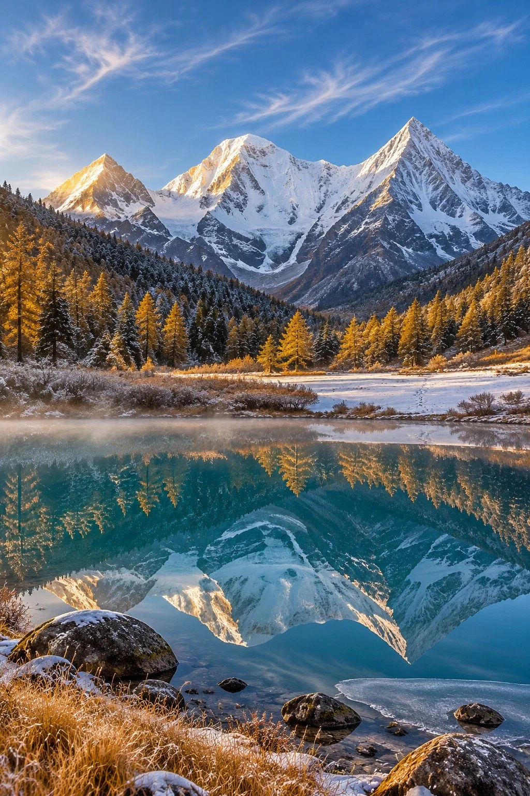

# Daocheng Yading Turquoise Alpine Lake First Snow

**中文标题：** 稻城亚丁雪山海子初雪  
**ID:** `gi25-x-1413` · **Mode:** `generate`  
**Categories:** `general`  
**Tags:** `x-twitter`, `community`, `gpt-image-2.5`, `x-direct`, `en`



### Daocheng Yading Turquoise Alpine Lake First Snow

```text
Breathtaking high-altitude landscape photograph of Daocheng Yading in early November, where late autumn meets the first snow on the eastern edge of the Tibetan Plateau in Sichuan. Environment: a still turquoise alpine lake at around 4,000 meters, ringed by golden autumn meadows and snow-dusted larch and pine, under a clear, thin high-altitude sky in the early morning. Subject details: the glassy lake fills the lower third and mirrors the snow-capped sacred peaks behind it with near-perfect symmetry; a scattering of dark wet boulders and a fringe of frost-touched golden grass anchor the near shore; a thin skin of ice edges the lake where shadow lingers, and a single trail of footprints crosses a small snow patch on the far bank. Atmosphere particles: faint mist drifting off the water, fine snow crystals glinting in the first sunlight, and thin high clouds streaking the blue sky. Light: low warm morning sun at 3800K striking the peaks from the left, casting long cool-blue shadows across the meadow, with warm gold and cold blue in direct contrast. Background layers: near shore and lake in the foreground, golden meadow and dark forest in the middle ground, three towering snow peaks and pale sky in the far distance. Camera: low viewpoint at the lakeshore, 24mm wide-angle lens, f/11, deep depth of field, vertical 9:16 composition on the rule of thirds, the reflection centered and undistorted. Color: Eastmancolor film look, restrained natural saturation, subtle film grain, crisp high-altitude clarity. Mood: silent, vast, and sacred. Photorealistic landscape photography, ultra-detailed, high resolution. No people, No buildings, No text, No watermark, No oil painting, No anime, No 3D render, No oversaturation, No deformed reflections.
```

- **Recommended model:** `gpt-image-2.5-sunburst`
- **Settings:** _(defaults)_
- **Source:** [community](https://x.com/CandyTravelight/status/2118161380645708240) — @CandyTravelight
- **License note:** Original public X post; quoted with attribution — remix with attribution
- **Notes:** Collected directly from X; original post https://x.com/CandyTravelight/status/2118161380645708240; post text names GPT Image 2.5; discovered via X search, prompt re-verified against the original X post via api.fxtwitter.com; verified=True; comparison post (image 1 GPT Image 2.5, image 2 Grok Imagine 2); preview is image 1, the GPT Image 2.5 result
- **Preview:** `previews/gi25-x-1413.webp`
